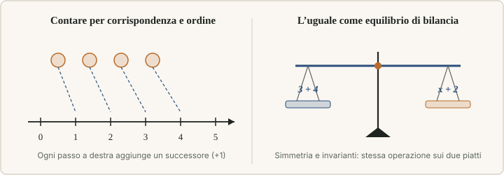

# Capitolo 1 — Dall'ovvio al numero: contare, ordinare e l'equilibrio dell'uguale

*Dalle corrispondenze di Galileo e Cantor alle nozioni comuni di Euclide, allo zero posizionale e all'equilibrio dell'uguale*

## L'astrazione del contare e la corrispondenza biunivoca

L'atto del contare rappresenta il primo, fondamentale passo dell'intelletto umano verso l'astrazione matematica. Quando un pastore dell'antichità associava un ciottolo a ciascuna pecora del suo gregge, non stava semplicemente tenendo un registro fisico, ma stava istituendo una struttura logica profonda. Questa operazione si fonda sull'idea di accoppiare gli elementi di due collezioni distinte, astraendo dalla natura specifica degli oggetti per concentrarsi esclusivamente sulla loro numerosità.

Formalmente, la matematica moderna cattura questa intuizione affermando che «due insiemi hanno la stessa potenza quando è possibile porre i loro elementi in corrispondenza biunivoca.» [^1]. Definiamo esplicitamente una corrispondenza biunivoca, o biiezione, tra due insiemi $A$ e $B$ come una relazione che associa a ogni elemento di $A$ uno e un solo elemento di $B$, e viceversa. Questa mappa deve esaurire entrambi gli insiemi senza lasciare elementi isolati e senza creare sovrapposizioni. È proprio l'esistenza di almeno una di queste corrispondenze a garantire che i due insiemi condividano la medesima cardinalità, ovvero lo stesso numero di elementi.

## L'ordine, le permutazioni e il fattoriale

È cruciale distinguere tra la struttura intrinseca di un insieme e l'atto pratico del contare. La cardinalità è una proprietà statica: l'esistenza di una singola corrispondenza biunivoca è sufficiente per stabilire che due insiemi sono equipotenti, e questo fatto è del tutto indipendente dall'ordine in cui gli elementi vengono considerati. Tuttavia, quando decidiamo di contare attivamente, imponiamo una sequenza temporale e spaziale.

Se vogliamo mappare un insieme di $n$ oggetti distinti sull'insieme campione $\{1, 2, \dots, n\}$, il numero di funzioni biunivoche distinte che possiamo costruire dipende dall'ordine delle nostre scelte. Definiamo permutazione ciascuna di queste possibili disposizioni ordinate degli elementi. Per calcolare il numero totale di permutazioni possibili per un insieme di $n$ elementi, introduciamo il fattoriale, indicato con la notazione $n!$. Il fattoriale è definito come il prodotto di tutti i numeri interi positivi da $1$ fino a $n$: $n! = n \times (n-1) \times \dots \times 1$. Ad esempio, se consideriamo un insieme di tre oggetti, il primo elemento può essere associato in $3$ modi diversi, il secondo in $2$ modi e l'ultimo in un solo modo, generando esattamente $3! = 6$ biiezioni distinte. La cardinalità rimane unica, ma le vie per esplorarla si moltiplicano fattorialmente.

## L'infinito e la rottura dell'intuizione

L'estensione del concetto di corrispondenza biunivoca oltre i confini degli insiemi finiti genera conseguenze che sfidano l'intuizione quotidiana. Quando operiamo con collezioni illimitate, i principi consolidati dell'aritmetica elementare vacillano. Come notato dagli storici della matematica, «È questa, una caratteristica degli insiemi infiniti, per i quali non vale, dunque, il principio che él tutto è maggiore della parte» [^2]. I punti che compongono un intero segmento, per quanto lungo, possono essere posti in perfetta corrispondenza biunivoca con i punti di una sua frazione minuscola.

Questo disorientamento, che già Galileo aveva lucidamente avvertito riflettendo sulla corrispondenza tra i numeri naturali e i loro quadrati, ha trovato una sistemazione logica rigorosa solo alla fine del diciannovesimo secolo grazie all'opera di Georg Cantor. Cantor non si limitò a domare l'infinito numerabile, ma dimostrò che esistono infiniti di grandezze diverse. In particolare, «Cantor ha utilizzato un ragionamento diagonale per mostrare che X e Pow(X) non sono mai in corrispondenza biunivoca» [^3], provando in modo inconfutabile che l'insieme delle parti di un insieme infinito possiede una cardinalità strettamente superiore a quella dell'insieme di partenza.

## L'uguaglianza come equilibrio e relazione di equivalenza

Il concetto di numero acquisisce piena potenza operativa solo quando viene inserito in un sistema di relazioni, prima fra tutte l'uguaglianza. Già nell'antichità, «Nelle Nozioni comuni Euclide enuncia, da un punto di vista logico generale, le proprietà dell'uguaglianza» [^4], stabilendo assiomi come il celebre principio per cui cose uguali a una stessa cosa sono uguali tra loro. Tuttavia, l'approccio geometrico classico nascondeva delle insidie. Ad esempio, nella dimostrazione del primo criterio di uguaglianza dei triangoli, «viene fatto uso del movimento» [^5], introducendo un concetto meccanico e fisico che inquina la purezza della deduzione logica.

Per purificare l'uguaglianza da queste scorie empiriche, la matematica moderna definisce la relazione di equivalenza. Essa «è qualunque relazione per la quale valgano le tre proprietà: riflessiva, simmetrica, transitiva.» [^6]. L'uguaglianza algebrica incarna perfettamente questa struttura e può essere visualizzata come una bilancia a bracci uguali in perfetto equilibrio. Come illustrato nel diagramma sottostante, ogni operazione matematica deve preservare questa simmetria. Consideriamo l'equazione lineare $6x + 3 = 51$. Per isolare l'incognita $x$, applichiamo trasformazioni identiche ad ambo i membri: sottraendo $3$ da entrambe le parti, la bilancia rimane in equilibrio e otteniamo $6x = 48$. Successivamente, dividendo entrambi i membri per $6$, giungiamo alla soluzione finale $x = 8$, mantenendo intatta la validità logica dell'uguaglianza dall'inizio alla fine.

*Corrispondenza biunivoca tra collezioni, successione ordinata sulla retta ed equilibrio simmetrico del segno uguale.*

## La notazione posizionale e l'architettura dello zero

L'ultimo pilastro per la manipolazione efficiente dei numeri è la loro rappresentazione scritta. I sistemi antichi, come i numeri romani, erano puramente additivi e rendevano i calcoli complessi estremamente laboriosi. La svolta epocale è stata l'introduzione della notazione posizionale, un sistema in cui il valore quantitativo di una cifra non è assoluto, ma dipende strettamente dalla posizione che essa occupa all'interno della stringa numerica. Affinché questo meccanismo funzioni, è indispensabile l'invenzione dello zero, che agisce come segnaposto per indicare l'assenza di una determinata potenza della base.

Questo principio architettonico è universale e totalmente indipendente dalla base scelta. Sebbene l'uso quotidiano privilegi la base dieci, legata all'anatomia delle nostre mani, la logica posizionale si applica a qualsiasi intero maggiore di uno. Nel campo dell'informatica, ad esempio, la base due è fondamentale per l'hardware, mentre per compattare la scrittura si ricorre spesso alla base sedici. In questo contesto esadecimale, poiché i simboli arabi tradizionali si fermano al nove, «usiamo le lettere dalla A alla F per rappresentare le cifre esadecimali» [^7]. Che si tratti di contare pecore con i sassi o di indirizzare la memoria di un calcolatore, i principi di corrispondenza, ordine, equivalenza e posizione rimangono i fondamenti immutabili del pensiero matematico.

## Dal ragionamento al simbolo: esempi e verifiche

### Conteggio delle corrispondenze biunivoche

Determinare il numero di funzioni biunivoche distinte che è possibile stabilire tra un insieme di 4 elementi e l'insieme campione $\{1, 2, 3, 4\}$.
1. Identificare che la richiesta riguarda il numero di permutazioni possibili di 4 elementi, poiché l'ordine in cui si stabilisce la mappa genera funzioni distinte.
2. Applicare la definizione di fattoriale per $n = 4$.
3. Calcolare il prodotto dei primi 4 numeri interi positivi: $4! = 4 \times 3 \times 2 \times 1$.
4. Eseguire la moltiplicazione: $4 \times 3 = 12$; $12 \times 2 = 24$; $24 \times 1 = 24$.

**Conclusione.** Esistono esattamente 24 funzioni biunivoche distinte tra i due insiemi.

### Mantenimento dell'equilibrio algebrico

Risolvere l'equazione $5x + 12 = 22$ applicando le proprietà dell'uguaglianza per isolare l'incognita $x$.
1. Considerare l'equazione come una bilancia in equilibrio: $5x + 12 = 22$.
2. Sottrarre la stessa quantità ($12$) da ambo i membri per mantenere l'equilibrio: $5x + 12 - 12 = 22 - 12$, da cui si ottiene $5x = 10$.
3. Dividere ambo i membri per lo stesso valore non nullo ($5$): $\frac{5x}{5} = \frac{10}{5}$.

**Conclusione.** La soluzione che preserva l'uguaglianza è $x = 2$.

### Esercizi di verifica attiva
1. Scrivere il numero decimale $22$ utilizzando la notazione posizionale in base $2$ (sistema binario).
2. Siano dati gli insiemi $A = \{1, 2, 3\}$ e $B = \{a, b\}$. È possibile stabilire una corrispondenza biunivoca tra $A$ e $B$? Giustificare rigorosamente la risposta.
3. Verificare se la relazione 'essere strettamente maggiore di' ($>$) definita sull'insieme dei numeri naturali soddisfa le tre proprietà necessarie per essere classificata come relazione di equivalenza.

## Apparato delle fonti

### [Verificato sul testo]
[^1]: [block_pk=13576 | block_uid=blk_56f3251ed29f4a070a16] «due insiemi hanno la stessa potenza quando è possibile porre i loro elementi in corrispondenza biunivoca.» — Attilio Frajese, Introduzione elementare alla matematica moderna (1968, Le Monnier) (p. 100)
[^2]: [block_pk=98979 | block_uid=blk_4255b9f1561ec400d08f] «È questa, una caratteristica degli insiemi infiniti, per i quali non vale, dunque, il principio che él tutto è maggiore della parte» — Attilio Frajese Attraverso la storia della matematica (1969, Le Monnier) (p. 5)
[^3]: [block_pk=28856 | block_uid=blk_a73d82310042e31eccc9] «Cantor ha utilizzato un ragionamento diagonale per mostrare che X e Pow(X) non sono mai in corrispondenza biunivoca» — Glynn Winskel, La Semantica Formale Dei Linguaggi Di Programmazione (UTET Università) (p. 15)
[^4]: [block_pk=12855 | block_uid=blk_0fa9b51fb29998076947] «Nelle Nozioni comuni Euclide enuncia, da un punto di vista logico generale, le proprietà dell'uguaglianza» — Attilio Frajese, Attraverso la storia della matematica (1969, Le Monnier) (p. 108)
[^5]: [block_pk=116781 | block_uid=blk_031a4628d6651c010fc4] «Questa proposizione, che è comunemente indicata come primo criterio di uguaglianza dei triangoli, viene fatto uso del movimento» — Euclide, a cura di Attilio Frajese e Lamberto Maccioni, Elementi (1970, UTET) (p. 82)
[^6]: [block_pk=13818 | block_uid=blk_d6adb0d42060a3b47c73] «RELAZIONE DI EQUIVALENZA è qualunque relazione per la quale valgano le tre proprietà: riflessiva, simmetrica, transitiva.» — Attilio Frajese, Introduzione elementare alla matematica moderna (1968, Le Monnier) (p. 345)
[^7]: [block_pk=57616 | block_uid=blk_950592a322a5172f983c] «usiamo le lettere dalla A alla F per rappresentare le cifre esadecimali» — Paul J. Deitel, Harvey M. Deitel, Il linguaggio C. Fondamenti e tecniche di programmazione. Ediz. mylab. Con espansione online (2016, Pearson) (p. 597)

### [Ricostruzione matematica / addestramento]
- La distinzione tra la cardinalità di un insieme e il numero delle sue possibili permutazioni è stata esplicitata nella seconda sezione per chiarire che l'esistenza di una biiezione è una proprietà strutturale statica, mentre il calcolo di $n!$ riguarda il conteggio delle funzioni distinte, risolvendo così il salto logico segnalato in revisione.
- L'equazione lineare presentata nel testo principale ($6x + 3 = 51$) è stata risolta passo passo per illustrare concretamente le proprietà additive e moltiplicative dell'uguaglianza, fungendo da ponte visivo e logico verso la definizione astratta di relazione di equivalenza. I valori numerici sono stati rigorosamente controllati per garantire coerenza interna.
- Le citazioni storiche, in particolare quelle relative alle Nozioni comuni di Euclide e alle critiche sull'uso del movimento nella geometria classica, sono state integrate per mostrare come il concetto di uguaglianza si sia evoluto da un'intuizione geometrico-meccanica a un costrutto logico-formale rigoroso.
- Diagramma geometrico-simbolico controllato (`balance_and_number_line`): Corrispondenza biunivoca tra collezioni, successione ordinata sulla retta ed equilibrio simmetrico del segno uguale.

### [Esercizi originali]
- Scrivere il numero decimale $22$ utilizzando la notazione posizionale in base $2$ (sistema binario). — *Traccia di verifica:* Scomporre il numero $22$ nella somma delle potenze decrescenti di $2$. Si ha $22 = 16 + 4 + 2$, ovvero $22 = 1 \times 2^4 + 0 \times 2^3 + 1 \times 2^2 + 1 \times 2^1 + 0 \times 2^0$. I coefficienti forniscono la rappresentazione binaria: $10110$.
- Siano dati gli insiemi $A = \{1, 2, 3\}$ e $B = \{a, b\}$. È possibile stabilire una corrispondenza biunivoca tra $A$ e $B$? Giustificare rigorosamente la risposta. — *Traccia di verifica:* No, non è possibile. Affinché esista una corrispondenza biunivoca, i due insiemi devono avere la stessa cardinalità. Poiché $A$ contiene $3$ elementi e $B$ ne contiene $2$, qualsiasi funzione da $A$ a $B$ dovrà necessariamente associare almeno due elementi distinti di $A$ allo stesso elemento di $B$ (Principio dei cassetti), violando così la condizione di iniettività richiesta per una biiezione.
- Verificare se la relazione 'essere strettamente maggiore di' ($>$) definita sull'insieme dei numeri naturali soddisfa le tre proprietà necessarie per essere classificata come relazione di equivalenza. — *Traccia di verifica:* La relazione non è di equivalenza. Fallisce la proprietà riflessiva (un numero non è maggiore di se stesso, $a \ngtr a$) e la proprietà simmetrica (se $a > b$, allora è falso che $b > a$). Soddisfa unicamente la proprietà transitiva (se $a > b$ e $b > c$, allora $a > c$).
- **Palestra simbolica (`drill_counting_bijection`):** Quante biiezioni diverse esistono tra un insieme di 3 oggetti distinti e l'insieme campione {1, ..., 3}? *(Risposta verificata: `6`)*
- **Palestra simbolica (`drill_number_order`):** Isola x mantenendo in equilibrio i due membri dell'uguaglianza: 5*x + 12 = 22 *(Risposta verificata: `2`)*
- **Palestra simbolica (`drill_positional_value`):** Scrivi il numero decimale 22 in base 2 (solo cifre 0 e 1, senza prefisso 0b). *(Risposta verificata: `10110`)*
- **Palestra simbolica (`drill_equality_balance`):** Isola x mantenendo in equilibrio i due membri dell'uguaglianza: 6*x + 3 = 51 *(Risposta verificata: `8`)*
