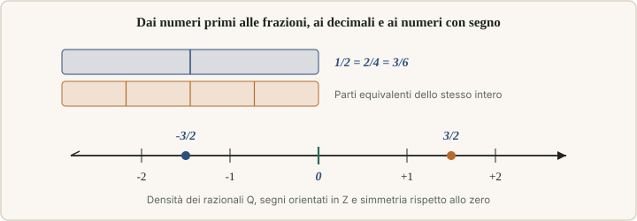

# Capitolo 3 — Dai numeri primi alle frazioni, ai decimali e ai numeri con segno

*Parti equivalenti, teorema fondamentale dell'aritmetica, potenze, radici e retta orientata*

## I mattoni indivisibili e il teorema fondamentale dell'aritmetica

La matematica costruisce i suoi edifici concettuali partendo da elementi semplici e indivisibili. Nell'aritmetica, questi mattoni fondamentali sono i numeri primi. Un numero naturale maggiore di $1$ si dice primo se ammette come divisori soltanto $1$ e se stesso. L'esclusione del numero $1$ dall'elenco dei numeri primi non è un capriccio definitorio, ma una necessità strutturale per garantire l'unicità della scomposizione.

Il teorema fondamentale dell'aritmetica stabilisce infatti che ogni numero naturale maggiore di $1$ o è un numero primo, oppure può essere espresso come prodotto di numeri primi in un modo unico, a meno dell'ordine dei fattori. Questa fattorizzazione unica permette di analizzare la struttura moltiplicativa di qualsiasi intero. Dalla moltiplicazione ripetuta di uno stesso fattore emerge naturalmente il concetto di potenza, espresso in notazione compatta come $2^3 = 8$, e la sua operazione inversa, l'estrazione di radice, che cerca la base nota l'esponente e il risultato.

## Parti equivalenti e la costruzione formale delle frazioni

Quando l'indagine si sposta dalla moltiplicazione alla divisione, l'insieme dei numeri interi $\mathbb{Z}$ si rivela strutturalmente insufficiente: l'equazione $2x = 3$ non ammette soluzioni intere. Per superare questo limite, la matematica non inventa nuovi numeri dal nulla, ma li costruisce rigorosamente a partire da quelli esistenti attraverso il concetto di relazione di equivalenza.

Consideriamo il prodotto cartesiano $A \times B$, dove $A = \mathbb{Z}$ e $B = \mathbb{Z} \setminus \{0\}$. Su questo insieme di coppie ordinate stabiliamo una relazione $R \subseteq A \times B$: diciamo che la coppia $(a, b)$ è in relazione con la coppia $(c, d)$ se e solo se $ad = bc$. Ad esempio, la coppia $(1, 2)$ è in relazione con $(2, 4)$ poiché $1 \cdot 4 = 2 \cdot 2$. Le classi di equivalenza generate da questa relazione costituiscono l'insieme dei numeri razionali relativi $\mathbb{Q}$. In questo modo, la frazione non è più vista come un semplice pezzo di torta, ma come un'intera classe di infinite coppie ordinate equivalenti.

## L'espansione decimale e la retta orientata

Se restringiamo temporaneamente la nostra attenzione al dominio positivo delle grandezze fisiche, i razionali positivi $\mathbb{Q}^+$ emergono in modo naturale come strumenti di misura. La rappresentazione di questi numeri non si limita alla forma frazionaria, ma si estende alla notazione posizionale. Come viene formalizzato nei fondamenti della disciplina, è proprio «Dall'unione dei numeri naturali con i numeri decimali finiti e con i numeri decimali periodici (che insieme costituiscono tutti i possibili risultati» delle divisioni tra interi che si esaurisce l'insieme dei razionali positivi [^1].

Possiamo visualizzare questi numeri associandoli ai punti di una retta orientata, fissando un'origine, un verso di percorrenza e un'unità di misura. Il diagramma seguente illustra le frazioni equivalenti dello stesso intero e la collocazione simmetrica di interi relativi e razionali sulla retta.

La somma geometrica su questa retta richiede costruzioni precise basate sulla congruenza. Tracciando rette parallele e segmenti opportuni, si individuano punti tali che i «triangoli OAQe PBZsono congruenti, e PZè congruente ad OQ. Pertanto il numero reale x z corrispondente a Z è la somma» dei segmenti considerati, traducendo l'operazione algebrica in un atto geometrico rigoroso [^2].

*Frazioni equivalenti dello stesso intero e collocazione simmetrica di interi relativi e razionali sulla retta.*

## Numeri con segno e l'algebra delle direzioni

Estendendo la retta a sinistra dell'origine, incontriamo i numeri negativi. Questa estensione trasforma la retta in un asse in cui ogni numero possiede non solo un modulo (la distanza dall'origine), ma anche un segno che ne indica la direzione. L'insieme $\mathbb{Q}$ precedentemente costruito su $\mathbb{Z}$ modella perfettamente questa simmetria.

Le regole dell'algebra delle direzioni stabiliscono come operare coerentemente con questi enti. L'addizione, in particolare, richiede attenzione ai segni degli addendi. La regola formale prescrive che «La somma di due numeri relativi discordi è il numero relativo che ha il segno dell'addendo in valore assoluto maggiore» e per valore assoluto la differenza dei rispettivi valori assoluti [^3]. Questa definizione garantisce che le traslazioni sulla retta orientata si compongano in modo associativo e commutativo.

## L'incommensurabile e la completezza dei numeri reali

Nonostante la densità dei numeri razionali, la retta numerica nasconde delle lacune profonde. La scoperta pitagorica che la diagonale di un quadrato non è misurabile con lo stesso metro del lato ha rivelato l'esistenza di grandezze incommensurabili. Per comprendere questo concetto, occorre prima definire la commensurabilità: due grandezze sono commensurabili quando ammettono un sottomultiplo comune. In termini classici, ciò si verifica quando una grandezza «Q non contiene esattamente T, ma ne contiene esattamente un sottomultiplo» [^4]. L'incommensurabilità è definita per contrasto logico come l'assoluta assenza di tale sottomultiplo comune.

Questa assenza impone il passaggio dai numeri razionali ai numeri reali $\mathbb{R}$, introducendo il concetto di completezza. Numeri come $\pi$ mostrano una doppia natura: una natura geometrica, come rapporto costante tra la lunghezza di una circonferenza e il suo diametro, e una natura analitica, come numero irrazionale trascendente che riempie un 'buco' esatto sulla retta continua. Dimostrare rigorosamente la completezza della retta e le proprietà di questi numeri richiede un apparato formale maturo. Spesso, nell'analisi matematica, ci si trova di fronte a una proposizione che, pur possedendo una notevole evidenza intuitiva, «non si può dimostrare in un modo che sia» rapido e diretto, ma esige una lunga e rigorosa catena di deduzioni analitiche [^5].

## Dal ragionamento al simbolo: esempi e verifiche

### Calcolo del minimo comune multiplo tramite fattorizzazione

Calcolare il minimo comune multiplo tra $12$ e $18$ utilizzando il teorema fondamentale dell'aritmetica.
1. Scomponiamo $12$ in fattori primi dividendo per i divisori primi più piccoli: $12 = 2^2 \cdot 3$.
2. Scomponiamo $18$ in fattori primi con lo stesso metodo: $18 = 2 \cdot 3^2$.
3. Il minimo comune multiplo si ottiene moltiplicando tutti i fattori primi comuni e non comuni, presi una sola volta con il massimo esponente: $2^2 \cdot 3^2$.
4. Calcoliamo il prodotto finale: $4 \cdot 9 = 36$.

**Conclusione.** Il minimo comune multiplo tra $12$ e $18$ è $36$.

### Addizione di frazioni con denominatori diversi

Calcolare la somma $\frac{3}{4} - \frac{1}{5}$ riducendo le frazioni allo stesso denominatore.
1. Identifichiamo il minimo comune multiplo tra i denominatori $4$ e $5$, che essendo coprimi è il loro prodotto: $20$.
2. Riscriviamo la prima frazione moltiplicando numeratore e denominatore per $5$: $\frac{3 \cdot 5}{4 \cdot 5} = \frac{15}{20}$.
3. Riscriviamo la seconda frazione moltiplicando numeratore e denominatore per $4$: $\frac{1 \cdot 4}{5 \cdot 4} = \frac{4}{20}$.
4. Sottraiamo i numeratori mantenendo il denominatore comune: $\frac{15 - 4}{20} = \frac{11}{20}$.

**Conclusione.** Il risultato dell'operazione in forma ridotta è $\frac{11}{20}$.

### Esercizi di verifica attiva
1. Trova il numeratore $x$ che rende equivalenti le frazioni $\frac{1}{3} = \frac{x}{15}$.
2. Valuta la seguente espressione tra numeri interi relativi, rispettando l'ordine delle operazioni: $(-7) \cdot (-3) - 10$.
3. Porta fuori dal segno di radice il fattore quadratico e semplifica l'espressione $\sqrt{8}$.
4. Calcola il valore esatto della somma $0.125 + \frac{3}{8}$ convertendo preventivamente il numero decimale in frazione.

## Apparato delle fonti

### [Verificato sul testo]
[^1]: [block_pk=58977 | block_uid=blk_0822857da9e86a80ad9f] «Dall'unione dei numeri naturali con i numeri decimali finiti e con i numeri decimali periodici (che insieme costituiscono tutti i possibili risultati» — Fabio Bellissima, Fondamenti di matematica (2008, Carocci) (p. 6)
[^2]: [block_pk=58982 | block_uid=blk_2edce38cda0580a00467] «triangoli OAQe PBZsono congruenti, e PZè congruente ad OQ. Pertanto il numero reale x z corrispondente a Z è la somma» — Fabio Bellissima, Fondamenti di matematica (2008, Carocci) (p. 11)
[^3]: [block_pk=53560 | block_uid=blk_d8ed4f7443171b4bb054] «La somma di due numeri relativi discordi è il numero relativo che ha il segno dell'addendo in valore assoluto maggiore» — Nella Dodero, Paolo Baroncini, Dante Trezzi, Nuovi elementi di matematica. Vol. 1 1(1996, Ghisetti e Corvi) (p. 121)
[^4]: [block_pk=13152 | block_uid=blk_e3e49c7e4c2bdb596004] «Q non contiene esattamente T, ma ne contiene esattamente un sottomultiplo» — Attilio Frajese, Galileo matematico (1964, Studium) (p. 27)
[^5]: [block_pk=28713 | block_uid=blk_7b77ce2701a8bbb9f5a3] «Si tratta di una proposizione di notevole evidenza intuitiva, ma che, ciò malgrado, non si può dimostrare in un modo che sia» — Giovanni Prodi, Analisi Matematica (1970,2003, Bollati Boringhieri) (p. 254)

### [Ricostruzione matematica / addestramento]
- La correzione relativa all'incommensurabilità è stata implementata chiarendo che la citazione di Frajese definisce la commensurabilità (presenza di un sottomultiplo esatto). Questo ha permesso di definire l'incommensurabilità per contrasto logico come l'assenza di tale sottomultiplo, rispettando il senso originale della fonte.
- La transizione dalla costruzione algebrica su $\mathbb{Z} \times (\mathbb{Z} \setminus \{0\})$ alla discussione sull'espansione decimale è stata esplicitamente separata: la prima genera l'intero campo $\mathbb{Q}$, mentre la seconda viene introdotta restringendo l'analisi al dominio positivo $\mathbb{Q}^+$ per modellare le grandezze fisiche, risolvendo così il salto logico segnalato.
- Le espressioni matematiche sono state rigorosamente formattate in LaTeX, evitando sintassi informatiche ASCII e garantendo la coerenza tipografica richiesta per un testo universitario di stampo saggistico.
- Diagramma geometrico-simbolico controllato (`fraction_number_line`): Frazioni equivalenti dello stesso intero e collocazione simmetrica di interi relativi e razionali sulla retta.

### [Esercizi originali]
- Trova il numeratore $x$ che rende equivalenti le frazioni $\frac{1}{3} = \frac{x}{15}$. — *Traccia di verifica:* Osservando i denominatori, notiamo che $15 = 3 \cdot 5$. Moltiplicando numeratore e denominatore della prima frazione per il fattore $5$, si ottiene $x = 1 \cdot 5 = 5$.
- Valuta la seguente espressione tra numeri interi relativi, rispettando l'ordine delle operazioni: $(-7) \cdot (-3) - 10$. — *Traccia di verifica:* Il prodotto di due numeri negativi è positivo, quindi $(-7) \cdot (-3) = 21$. Sottraendo $10$ al risultato si ottiene $21 - 10 = 11$.
- Porta fuori dal segno di radice il fattore quadratico e semplifica l'espressione $\sqrt{8}$. — *Traccia di verifica:* Fattorizzando il radicando in numeri primi si ha $8 = 2^3 = 2^2 \cdot 2$. Estraendo il termine al quadrato dalla radice si ottiene $2\sqrt{2}$.
- Calcola il valore esatto della somma $0.125 + \frac{3}{8}$ convertendo preventivamente il numero decimale in frazione. — *Traccia di verifica:* Il decimale $0.125$ equivale alla frazione $\frac{125}{1000}$, che semplificata dividendo per $125$ dà $\frac{1}{8}$. Sommando $\frac{1}{8} + \frac{3}{8}$ si ottiene $\frac{4}{8}$, che si riduce a $\frac{1}{2}$.
- **Palestra simbolica (`drill_fraction_meaning`):** Calcola i 4/5 dell'intero 40. *(Risposta verificata: `32`)*
- **Palestra simbolica (`drill_fraction_equivalence`):** Trova il numeratore x che rende equivalenti le frazioni 1/3 = x/15. *(Risposta verificata: `5`)*
- **Palestra simbolica (`drill_fraction_addition`):** Calcola 3/4 - 1/5 riducendo allo stesso denominatore (accettata sia frazione sia decimale esatto se finito). *(Risposta verificata: `11/20`)*
- **Palestra simbolica (`drill_fraction_mul_div`):** Calcola il quoziente (5/6) ÷ (3/8) moltiplicando per il reciproco (forma ridotta). *(Risposta verificata: `20/9`)*
- **Palestra simbolica (`drill_decimals`):** Calcola il valore esatto della somma 0.125 + 3/8 convertendo il decimale in frazione. *(Risposta verificata: `1/2`)*
- **Palestra simbolica (`drill_prime_factorization`):** Nella fattorizzazione unica in numeri primi di 96, quale è l'esponente del fattore primo 2? *(Risposta verificata: `5`)*
- **Palestra simbolica (`drill_lcm`):** Calcola il minimo comune multiplo mcm(12, 18) tramite scomposizione in fattori primi. *(Risposta verificata: `36`)*
- **Palestra simbolica (`drill_gcd`):** Applica l'algoritmo euclideo delle divisioni successive per trovare MCD(84, 36). *(Risposta verificata: `12`)*
- **Palestra simbolica (`drill_signed_integers`):** Valuta l'espressione tra numeri interi relativi: (-7) · (-3) - 10. *(Risposta verificata: `11`)*
- **Palestra simbolica (`drill_exponent_rules`):** Semplifica applicando le proprietà delle potenze in base 2: (2^7 · 2^4) / 2^8. *(Risposta verificata: `8`)*
- **Palestra simbolica (`drill_square_roots`):** Porta fuori dal segno di radice il fattore quadratico e semplifica sqrt(8) (usa la sintassi k*sqrt(m)). *(Risposta verificata: `2*sqrt(2)`)*
