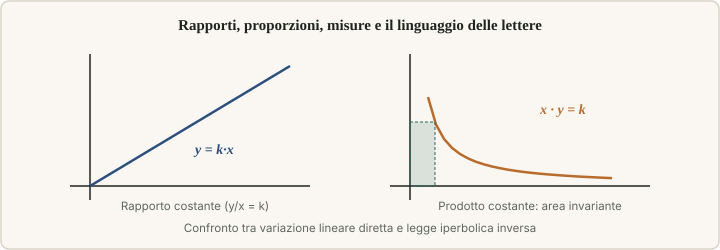

# Capitolo 4 — Rapporti, proporzioni, misure e il linguaggio delle lettere

*Dal confronto tra grandezze omogenee alle leggi di proporzionalità e alle prime equazioni*

> *«Rapporto (o ragione, in greco, $\lambda\acute{o}\gamma\omicron\varsigma$, ratio) fra due grandezze omogenee è un certo modo di comportarsi rispetto»* — Euclide, a cura di Attilio Frajese e Lamberto Maccioni, Elementi (1970, UTET) (p. 302) [^1]

## Il confronto tra grandezze e la nascita del rapporto

L'atto del misurare nasce da un'esigenza concreta: confrontare una grandezza ignota con una nota, assunta come unità di misura. Affinché questo confronto abbia senso, le grandezze in questione devono essere omogenee, ovvero della stessa natura: si possono confrontare due lunghezze o due pesi, ma non una lunghezza e un peso. La matematica greca aveva compreso profondamente questa necessità. Negli Elementi, si stabilisce che il «Rapporto (o ragione, in greco, $\lambda\acute{o}\gamma\omicron\varsigma$, ratio) fra due grandezze omogenee è un certo modo di comportarsi rispetto» [^1] alla quantità. Questo comportamento reciproco è il fondamento della nozione di numero razionale, inteso come quoziente tra due interi.

Tuttavia, il confronto geometrico rivela presto la sua complessità. Si consideri il rapporto tra la lunghezza di una circonferenza e il suo diametro. Dal punto di vista puramente geometrico, si tratta di un confronto legittimo tra due lunghezze omogenee, che produce una costante universale indicata con $\pi$. Dal punto di vista analitico, però, $\pi$ non è esprimibile come rapporto tra due numeri interi: la sua natura trascendente dimostra che la geometria del continuo nasconde una ricchezza inesauribile, non catturabile dalla sola aritmetica delle frazioni.

## Dalla proporzione alla relazione formale

Quando due rapporti si equivalgono, si genera una proporzione. Storicamente, la manipolazione delle proporzioni ha sollevato dibattiti sottili sul significato delle operazioni consentite. Ad esempio, discutendo la composizione delle proporzioni, Guidobaldo del Monte osservava criticamente che «non è tuttavia ciò che prescrive la definizione, che propriamente non domanda» [^2] una semplice moltiplicazione aritmetica delle quantità, come invece avrebbe suggerito l'algebra successiva. Per superare le ambiguità del linguaggio naturale e le controversie storiche, la matematica moderna ha rifondato il concetto di associazione tra elementi.

Dati due insiemi non vuoti $A$ e $B$, si definisce relazione un qualunque sottoinsieme del prodotto cartesiano $A \times B$. In questa accezione rigorosa, una relazione $R$ non richiede l'esistenza di una 'legge' esplicita o di una regola di calcolo: dire che un elemento $a \in A$ è in relazione con un elemento $b \in B$ significa unicamente affermare che la coppia ordinata $(a, b)$ appartiene all'insieme $R$. Questa definizione puramente insiemistica previene ogni confusione concettuale tra la nozione di relazione e quella di funzione calcolabile o algoritmo.

## Misure, continuità e la completezza dei reali

Le grandezze fisiche, come la massa, la lunghezza o il tempo, assumono tipicamente valori in un dominio strettamente positivo, modellizzato matematicamente dall'insieme dei numeri reali positivi $\mathbb{R}^{+}$. Ma quale struttura possiede la retta reale per poter rappresentare fedelmente il continuo fisico? Se ci limitassimo ai numeri razionali, la retta numerica risulterebbe densa ma crivellata di 'buchi' microscopici, incapace di misurare grandezze incommensurabili come la diagonale di un quadrato di lato unitario.

L'insieme dei numeri reali $\mathbb{R}$ viene costruito proprio per garantire la proprietà di completezza, ovvero l'assoluta assenza di buchi. In termini intuitivi, la completezza assicura che ogni successione di numeri che si infittisce sempre di più (una successione convergente) troverà sempre un punto esatto sulla retta su cui atterrare, senza cadere nel vuoto. Questo fondamento continuo è essenziale per la fisica classica. Lo stesso Newton, riflettendo sulla natura del tempo come grandezza continua e inesorabile, postulava che «il flusso del tempo assoluto non può essere mutato. Identica è la durata o la persistenza delle cose, sia che i moti» [^3] avvengano con maggiore o minore rapidità.

## Leggi di proporzionalità: diretta e inversa

Il legame tra grandezze variabili si esprime spesso attraverso leggi di proporzionalità. Due grandezze $x$ e $y$ si dicono direttamente proporzionali se il loro rapporto si mantiene costante, ovvero $y = kx$ con $k > 0$. In questo caso, al raddoppiare di $x$, anche $y$ raddoppia. Al contrario, due grandezze sono inversamente proporzionali se è il loro prodotto a rimanere invariato, ossia $x \cdot y = k$. Se $x$ raddoppia, $y$ si dimezza, mantenendo intatto l'equilibrio del sistema.

Il confronto geometrico tra proporzionalità diretta $y = kx$ e legge iperbolica inversa $x \cdot y = k$ rende visibile questa distinzione: la prima è rappresentata nel piano cartesiano da una retta passante per l'origine, la seconda da un'iperbole equilatera i cui asintoti coincidono con gli assi coordinati. Tali modelli matematici governano innumerevoli fenomeni naturali. Newton stesso, analizzando la meccanica dei fluidi, deduceva che «Se la densità di un fluido, costituito da particelle che si sfuggono fra loro, sta come la compressione, le forze centrifughe» [^4] tra le particelle devono seguire una precisa legge di proporzionalità inversa rispetto alle distanze.

*Confronto geometrico tra proporzionalità diretta y = kx e legge iperbolica inversa x·y = k.*

## Il linguaggio delle lettere e le prime equazioni

Per manipolare queste relazioni in modo universale, la matematica ha sviluppato il linguaggio dell'algebra, in cui le lettere dell'alfabeto sostituiscono i numeri specifici. Una lettera come $x$ funge da segnaposto per una quantità incognita o variabile. Un'equazione è un'uguaglianza tra due espressioni algebriche, vera solo per particolari valori attribuiti alle incognite. Risolvere un'equazione lineare come $5x + 4 = 14$ significa applicare i principi di equivalenza per isolare la $x$, mantenendo in perfetto equilibrio i due membri dell'uguaglianza.

Quando l'equazione coinvolge due variabili, le sue soluzioni non sono più singoli numeri, ma infinite coppie ordinate che descrivono un luogo geometrico. Come sintetizzato nei testi di didattica moderna, «Possiamo perciò concludere che in ogni caso l'insieme delle soluzioni di un'equazione lineare in due incognite è rappresentato, nel piano cartesiano, da» [^5] una retta. Questa traduzione dal simbolo algebrico alla forma geometrica rappresenta uno dei traguardi più alti del pensiero matematico, permettendo di visualizzare l'astrazione e di calcolare la forma.

## Dal ragionamento al simbolo: esempi e verifiche

### Risoluzione di un'equazione lineare di primo grado

Determinare il valore dell'incognita $x$ che soddisfa l'equazione $5x + 4 = 14$.
1. Si applica il primo principio di equivalenza, sottraendo $4$ ad ambo i membri per isolare il termine con l'incognita: $5x + 4 - 4 = 14 - 4$.
2. Semplificando, si ottiene $5x = 10$.
3. Si applica il secondo principio di equivalenza, dividendo ambo i membri per il coefficiente dell'incognita, ovvero $5$: $\frac{5x}{5} = \frac{10}{5}$.

**Conclusione.** Il valore che soddisfa l'equazione è $x = 2$.

### Calcolo di grandezze inversamente proporzionali

Due grandezze positive $x$ e $y$ sono inversamente proporzionali, per cui vale la relazione $x \cdot y = k$. Sapendo che per $x = 6$ si ha $y = 12$, determinare il valore di $y$ quando $x = 2$.
1. Si calcola innanzitutto la costante di proporzionalità inversa $k$ moltiplicando i valori noti: $k = 6 \cdot 12 = 72$.
2. Si imposta la nuova equazione con il valore aggiornato di $x$: $2 \cdot y = 72$.
3. Si divide per $2$ per isolare la $y$: $y = \frac{72}{2}$.

**Conclusione.** Quando $x = 2$, la grandezza corrispondente è $y = 36$.

### Esercizi di verifica attiva
1. Un articolo che costa inizialmente $100$ euro subisce un rincaro del $20\%$. Successivamente, sul nuovo prezzo viene applicato uno sconto del $20\%$. Qual è il prezzo finale dell'articolo? Coincide con il prezzo di partenza?
2. Calcola il rapporto adimensionale tra due lunghezze, $3$ km e $250$ m, esprimendole preventivamente nella stessa unità di misura.
3. Semplifica la seguente espressione letterale raccogliendo i termini simili: $5(x + 5) - 2x + 3$.

## Apparato delle fonti

### [Verificato sul testo]
[^1]: [block_pk=117282 | block_uid=blk_3111f86e0fcd177084be] «Rapporto (o ragione, in greco, $\lambda\acute{o}\gamma\omicron\varsigma$, ratio) fra due grandezze omogenee è un certo modo di comportarsi rispetto» — Euclide, a cura di Attilio Frajese e Lamberto Maccioni, Elementi (1970, UTET) (p. 302)
[^2]: [block_pk=60097 | block_uid=blk_aff31babe0af65250112] «non è tuttavia ciò che prescrive la definizione, che propriamente non domanda» — Giusti Enrico, Euclides reformatus. La teoria delle proporzioni nella scuola galileiana (1993, Bollati Boringhieri) (p. 34)
[^3]: [block_pk=107105 | block_uid=blk_0558267b532a198812cf] «il flusso del tempo assoluto non può essere mutato. Identica è la durata o la persistenza delle cose, sia che i moti» — Isaac Newton, a cura di Alberto Pala, Principi matematici della Filosofia naturale (1965, UTET) (p. 105)
[^4]: [block_pk=114620 | block_uid=blk_ac8f2d4c499db213d911] «Se la densità di un fluido, costituito da particelle che si sfuggono fra loro, sta come la compressione, le forze centrifughe» — Isaac Newton, a cura di Alberto Pala, Principi matematici della Filosofia naturale (1965, UTET) (p. 477)
[^5]: [block_pk=53841 | block_uid=blk_0085479175202a423c84] «Possiamo perciò concludere che in ogni caso l'insieme delle soluzioni di un'equazione lineare in due incognite è rappresentato, nel piano cartesiano, da» — Nella Dodero, Paolo Baroncini, Dante Trezzi, Nuovi elementi di matematica. Vol. 1 1(1996, Ghisetti e Corvi) (p. 402)

### [Ricostruzione matematica / addestramento]
- La definizione di relazione è stata rigorosamente ancorata al concetto di sottoinsieme del prodotto cartesiano, eliminando l'uso improprio del termine 'legge' per evitare sovrapposizioni epistemologiche con il concetto di funzione algoritmica o calcolabile.
- Il riferimento alla completezza dei numeri reali è stato semplificato concettualmente: si è evitato di introdurre formalmente le successioni di Cauchy senza un adeguato apparato definitorio, preferendo illustrare la completezza come assenza di buchi e garanzia di convergenza per successioni che si infittiscono.
- Diagramma geometrico-simbolico controllato (`proportional_scaling_hyperbola`): Confronto geometrico tra proporzionalità diretta y = kx e legge iperbolica inversa x·y = k.

### [Esercizi originali]
- Un articolo che costa inizialmente $100$ euro subisce un rincaro del $20\%$. Successivamente, sul nuovo prezzo viene applicato uno sconto del $20\%$. Qual è il prezzo finale dell'articolo? Coincide con il prezzo di partenza? — *Traccia di verifica:* Il prezzo dopo il rincaro è $100 \cdot (1 + \frac{20}{100}) = 120$ euro. Lo sconto del $20\%$ si applica su $120$, quindi il prezzo finale è $120 \cdot (1 - \frac{20}{100}) = 120 \cdot 0.8 = 96$ euro. Non coincide con il prezzo di partenza.
- Calcola il rapporto adimensionale tra due lunghezze, $3$ km e $250$ m, esprimendole preventivamente nella stessa unità di misura. — *Traccia di verifica:* Convertendo i chilometri in metri si ha $3$ km $= 3000$ m. Il rapporto tra grandezze omogenee è quindi $\frac{3000}{250} = 12$.
- Semplifica la seguente espressione letterale raccogliendo i termini simili: $5(x + 5) - 2x + 3$. — *Traccia di verifica:* Distribuendo il $5$ si ottiene $5x + 25 - 2x + 3$. Sommando i coefficienti dei termini in $x$ ($5 - 2 = 3$) e i termini noti ($25 + 3 = 28$), l'espressione semplificata è $3x + 28$.
- **Palestra simbolica (`drill_proportions_percent`):** [Che cosa si rompe] Un prezzo di 100 euro subisce prima un aumento del 20% e poi uno sconto del 20%: quale è il prezzo finale? *(Risposta verificata: `96`)*
- **Palestra simbolica (`drill_unit_measurement`):** Calcola il rapporto adimensionale tra due lunghezze esprimendole nella stessa unità: (3 km) / (250 m). *(Risposta verificata: `12`)*
- **Palestra simbolica (`drill_metric_conversions`):** Converti una superficie di 2 m^2 in cm^2 ricordando che 1 m = 100 cm. *(Risposta verificata: `20000`)*
- **Palestra simbolica (`drill_sequence_pattern`):** Data la successione definita ricorsivamente da a_0 = 3 e a_{n+1} = 2*a_n + 1, calcola il termine a_3. *(Risposta verificata: `31`)*
- **Palestra simbolica (`drill_literal_expressions`):** Semplifica l'espressione letterale raccogliendo i termini simili: 5*(x + 5) - 2*x + 3. *(Risposta verificata: `3*x + 28`)*
- **Palestra simbolica (`drill_direct_inverse_prop`):** Due grandezze positive x e y sono inversamente proporzionali (x·y = k). Se x = 6 dà y = 12, quanto vale y quando x = 2? *(Risposta verificata: `36`)*
- **Palestra simbolica (`drill_linear_equation`):** Isola x mantenendo in equilibrio i due membri dell'uguaglianza: 5*x + 4 = 14 *(Risposta verificata: `2`)*
