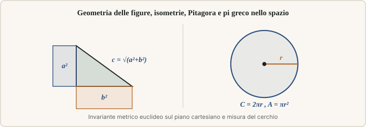

# Capitolo 5 — Geometria delle figure, isometrie, Pitagora e pi greco nello spazio

*Dalle definizioni euclidee al piano cartesiano, alle trasformazioni rigide e ai volumi*

> *«Ma questo " teorema inverso " resiste a Euclide, il quale non riesce a darne la dimostrazione»* — Euclide, a cura di Attilio Frajese e Lamberto Maccioni, Elementi (1970, UTET) (p. 52) [^1]

## L'edificio euclideo e la necessità dei postulati

La geometria nasce dall'osservazione dello spazio fisico e dal tentativo di formalizzarne le proprietà attraverso la deduzione logica. L'opera di Euclide costruisce un'architettura rigorosa partendo da definizioni fondamentali; ad esempio, «Le definizioni del libro undicesimo degli Elementi si chiu dono con quelle n. 25, 26, 27, 28, che si riferiscono ai poliedri regolari» [^2], descrivendoli come figure solide comprese da facce uguali.

Tuttavia, questa imponente struttura logica incontra un ostacolo profondo. Il quinto postulato, relativo alle rette parallele, non nasce da un'intuizione immediata, ma da una necessità tecnica: «Ma questo " teorema inverso " resiste a Euclide, il quale non riesce a darne la dimostrazione» [^1]. Questa impossibilità costringe il matematico greco ad assumere l'enunciato come postulato, fondando di fatto la geometria euclidea su una base che non può essere dedotta come teorema dalle proposizioni precedenti. Non si tratta di una frattura logica generica, ma del riconoscimento preciso dei limiti della deducibilità all'interno di un sistema formale.

## Il triangolo rettangolo, i domini positivi e la completezza dei reali

Il nucleo metrico del piano euclideo è costituito dal teorema di Pitagora. Dal punto di vista storico, «È di dubbio valore l'attribuzione effettiva a Pitagora di questo celebre teorema» [^3], poiché le fonti che lo legano al filosofo di Samo sono tarde e spesso intrise di leggenda. Al di là della paternità storica, il teorema stabilisce una relazione inequivocabile tra i quadrati costruiti sui lati di un triangolo rettangolo: $a^2 + b^2 = c^2$.

Quando applichiamo questa identità a grandezze fisiche, come le lunghezze dei segmenti, operiamo rigorosamente all'interno di un dominio positivo, dove $a > 0$, $b > 0$ e $c > 0$. Risolvendo per l'ipotenusa, otteniamo $c = \sqrt{a^2 + b^2}$. Se consideriamo un triangolo rettangolo isoscele con cateti unitari ($a = 1$, $b = 1$), la lunghezza dell'ipotenusa risulta essere $c = \sqrt{2}$. Questa semplice costruzione geometrica dimostra che i numeri razionali sono insufficienti per misurare tutti i segmenti del piano. L'esistenza di grandezze incommensurabili rende necessaria l'introduzione della completezza dei numeri reali, una proprietà fondamentale che assicura che la retta numerica non abbia interruzioni e che a ogni lunghezza geometrica corrisponda un preciso numero nell'insieme $\mathbb{R}$.

*Relazione metrica pitagorica sui cateti e misure di circonferenza e area del cerchio.*

## Dal piano sintetico al piano cartesiano

Il passaggio dalla geometria sintetica alla geometria analitica rappresenta una traduzione delle figure in insiemi di numeri e relazioni. In termini formali, definiamo una relazione $R$ tra due insiemi $A$ e $B$ come un sottoinsieme del loro prodotto cartesiano: $R \subseteq A \times B$. Nel piano cartesiano, questa astrazione prende forma visiva: «Nella rappresentazione cartesiana di A x B i punti che rappresentano le coppie ordinate (x; /(x)) , cioè le coppie (x; y)» [^4] costituiscono il grafico di una funzione.

Questa traduzione algebrica permette di trattare i luoghi geometrici attraverso le equazioni. Ad esempio, analizzando le equazioni di primo grado, «Possiamo perciò concludere che in ogni caso l'insieme delle soluzioni di un'equazione lineare in due incognite è rappresentato, nel piano cartesiano, da» [^5] una retta. Questo metodo introduce un ordine regolare nello studio della geometria, simile a quello delle arti meccaniche che «intrecciano in infiniti modi i fili in orditi diversi; così come tutte le combinazioni di numeri» [^6], permettendo di risolvere problemi spaziali attraverso la manipolazione simbolica.

## Isometrie, similitudini e la scala dei volumi

Le trasformazioni rigide, o isometrie, sono funzioni biiettive dal piano in sé che preservano le distanze euclidee tra i punti. Una traslazione definita da un vettore $v = (v_x, v_y)$ mappa un punto generico $P(x, y)$ nel punto immagine $P'(x + v_x, y + v_y)$. Quando abbandoniamo la conservazione delle distanze ma manteniamo inalterata l'uguaglianza degli angoli, entriamo nel dominio delle similitudini.

Una similitudine caratterizzata da un fattore di scala lineare $k > 0$ moltiplica tutte le lunghezze per $k$. Di conseguenza, le aree delle figure piane scalano per un fattore di $k^2$, mentre i volumi dei solidi tridimensionali scalano per un fattore di $k^3$. Se un solido possiede un volume iniziale $V = 3$ e subisce un ingrandimento con un fattore di scala $k = 3$, il nuovo volume si calcola rigorosamente come $V' = V \cdot k^3 = 3 \cdot 3^3 = 3 \cdot 27 = 81$. Questa relazione cubica è un principio ineludibile quando si analizzano le proprietà metriche dello spazio tridimensionale.

## La natura di pi greco e le curvature dello spazio

Lo studio delle figure curve e dei volumi di rotazione introduce la costante $\pi$. Originariamente definita in ambito puramente geometrico come il rapporto costante tra la lunghezza di una circonferenza e il suo diametro, $\pi$ trascende le semplici costruzioni algebriche, rivelando infine la sua natura analitica di numero trascendente. La misurazione degli spazi curvi ha impegnato le menti più brillanti dell'antichità, richiedendo metodi di esaustione che anticipavano il calcolo integrale.

Archimede, ad esempio, analizzò con estremo rigore le proprietà della sfera e dei suoi segmenti, confutando proposizioni errate sui rapporti tra le superfici e i volumi, dichiarando apertamente: «Che questo sia falso risulta manifesto dalle [dimostrazioni] che prima» [^7] aveva esposto. Il passaggio dal $\pi$ geometrico, legato alla misurazione concreta dei confini fisici, al $\pi$ analitico, incastonato nelle serie infinite e nei limiti, rispecchia l'evoluzione stessa della matematica: dall'evidenza tangibile della figura alla potenza astratta del simbolo.

## Dal ragionamento al simbolo: esempi e verifiche

### Traslazione di un punto nel piano cartesiano

Dato il punto $P(5, 5)$, applicare la traslazione definita dal vettore $v = (6, -1)$ e determinare le coordinate del punto immagine $P'$.
1. Identifichiamo le coordinate iniziali del punto: $x = 5$, $y = 5$.
2. Le componenti del vettore di traslazione sono $v_x = 6$ e $v_y = -1$.
3. Applichiamo le equazioni della traslazione sommando le componenti: $x' = x + v_x = 5 + 6 = 11$ e $y' = y + v_y = 5 + (-1) = 4$.

**Conclusione.** Il punto immagine ha coordinate $P'(11, 4)$.

### Calcolo del volume di un solido scalato

Un solido ha un volume iniziale $V = 3\text{ cm}^3$. Se viene ingrandito applicando un fattore di scala lineare $k = 3$ a tutte le sue dimensioni, qual è il nuovo volume $V'$?
1. Il volume di un solido tridimensionale scala con il cubo del fattore di scala lineare, secondo la formula $V' = V \cdot k^3$.
2. Sostituiamo i valori noti nell'equazione: $V = 3$ e $k = 3$.
3. Calcoliamo il cubo del fattore di scala: $3^3 = 27$.
4. Moltiplichiamo il risultato per il volume iniziale: $V' = 3 \cdot 27 = 81$.

**Conclusione.** Il nuovo volume del solido ingrandito è $81\text{ cm}^3$.

### Esercizi di verifica attiva
1. Due lati di un triangolo misurano $4$ e $10$. Qual è il massimo valore intero ammissibile per la lunghezza del terzo lato $c$ affinché il triangolo soddisfi la disuguaglianza triangolare?
2. In un triangolo rettangolo, i cateti misurano $3$ e $4$. Calcola la lunghezza dell'ipotenusa giustificando il dominio della soluzione.
3. Due poligoni sono simili con un rapporto di similitudine lineare $k = 2$. Se il poligono più piccolo ha un'area di $7$, qual è l'area del poligono più grande? Fornisci un controesempio se si assumesse erroneamente una scalatura lineare delle aree.

## Apparato delle fonti

### [Verificato sul testo]
[^1]: [block_pk=116784 | block_uid=blk_c26648484af94479afa6] «Ma questo " teorema inverso " resiste a Euclide, il quale non riesce a darne la dimostrazione» — Euclide, a cura di Attilio Frajese e Lamberto Maccioni, Elementi (1970, UTET) (p. 52)
[^2]: [block_pk=117601 | block_uid=blk_24a4482820e3bcb0907f] «Le definizioni del libro undicesimo degli Elementi si chiu dono con quelle n. 25, 26, 27, 28, che si riferiscono ai poliedri regolari» — Euclide, a cura di Attilio Frajese e Lamberto Maccioni, Elementi (1970, UTET) (p. 860)
[^3]: [block_pk=117434 | block_uid=blk_7c0cdf523c4597a944bf] «È di dubbio valore l'attribuzione effettiva a Pitagora di questo celebre teorema» — Euclide, a cura di Attilio Frajese e Lamberto Maccioni, Elementi (1970, UTET) (p. 146)
[^4]: [block_pk=53631 | block_uid=blk_e77ccd45b208c5efcb84] «Nella rappresentazione cartesiana di A x B i punti che rappresentano le coppie ordinate (x; /(x)) , cioè le coppie (x; y)» — Nella Dodero, Paolo Baroncini, Dante Trezzi, Nuovi elementi di matematica. Vol. 1 1(1996, Ghisetti e Corvi) (p. 192)
[^5]: [block_pk=53841 | block_uid=blk_0085479175202a423c84] «Possiamo perciò concludere che in ogni caso l'insieme delle soluzioni di un'equazione lineare in due incognite è rappresentato, nel piano cartesiano, da» — Nella Dodero, Paolo Baroncini, Dante Trezzi, Nuovi elementi di matematica. Vol. 1 1(1996, Ghisetti e Corvi) (p. 402)
[^6]: [block_pk=46349 | block_uid=blk_de20d7febd4b22407207] «intrecciano in infiniti modi i fili in orditi diversi; così come tutte le combinazioni di numeri» — René Descartes, a cura di Bruno Widmar e Ettore Lojacono, Opere filosofiche (2013, UTET) (p. 72)
[^7]: [block_pk=116084 | block_uid=blk_e11139fb7894f2a30a3b] «Che questo sia falso risulta manifesto dalle [dimostrazioni] che prima» — Archimede, a cura di Attilio Frajese, Opere (1974, UTET) (p. 318)

### [Ricostruzione matematica / addestramento]
- La trattazione del quinto postulato di Euclide è stata precisata per chiarire che la crisi fondazionale non deriva da una generica incompletezza, ma dall'impossibilità specifica di dimostrare il teorema inverso, costringendo l'autore all'assunzione assiomatica.
- L'esempio sul volume scalato è stato corretto per garantire la coerenza aritmetica: un volume iniziale di 3 con fattore di scala 3 produce un volume finale di 81, applicando rigorosamente la relazione $V' = V \cdot k^3$.
- Nel primo esercizio della palestra simbolica, la terminologia imprecisa 'figura chiusa' è stata sostituita con il riferimento formale alla 'disuguaglianza triangolare', essenziale per la corretta definizione metrica del triangolo.
- Diagramma geometrico-simbolico controllato (`pythagoras_and_circle`): Relazione metrica pitagorica sui cateti e misure di circonferenza e area del cerchio.

### [Esercizi originali]
- Due lati di un triangolo misurano $4$ e $10$. Qual è il massimo valore intero ammissibile per la lunghezza del terzo lato $c$ affinché il triangolo soddisfi la disuguaglianza triangolare? — *Traccia di verifica:* Per la disuguaglianza triangolare, la lunghezza di un lato deve essere strettamente minore della somma degli altri due: $c < 4 + 10$, ovvero $c < 14$. Il massimo intero ammissibile è pertanto $13$.
- In un triangolo rettangolo, i cateti misurano $3$ e $4$. Calcola la lunghezza dell'ipotenusa giustificando il dominio della soluzione. — *Traccia di verifica:* Applicando il teorema di Pitagora, $c^2 = 3^2 + 4^2 = 9 + 16 = 25$. Poiché le lunghezze sono grandezze fisiche definite in un dominio strettamente positivo, si scarta la radice negativa, ottenendo $c = \sqrt{25} = 5$.
- Due poligoni sono simili con un rapporto di similitudine lineare $k = 2$. Se il poligono più piccolo ha un'area di $7$, qual è l'area del poligono più grande? Fornisci un controesempio se si assumesse erroneamente una scalatura lineare delle aree. — *Traccia di verifica:* Le aree scalano con il quadrato del fattore lineare: $A' = 7 \cdot 2^2 = 7 \cdot 4 = 28$. Se la scalatura fosse lineare, l'area sarebbe $14$, il che è falso. Controesempio: un quadrato di lato $1$ ha area $1$; raddoppiando il lato a $2$, l'area diventa $4$, non $2$.
- **Palestra simbolica (`drill_segments_length`):** Su una retta orientata il segmento AB ha estremi x_A = 2 e x_B = 8: qual è l'ascissa del punto medio M? *(Risposta verificata: `5`)*
- **Palestra simbolica (`drill_angles_degrees`):** Due angoli interni di un triangolo euclideo misurano 40° e 66°: quanti gradi misura il terzo angolo? *(Risposta verificata: `74`)*
- **Palestra simbolica (`drill_perpendicular_angles`):** Due rette parallele sono tagliate da una trasversale formando un angolo acuto di 52°: quanto misura ciascun angolo ottuso coniugato interno? *(Risposta verificata: `128`)*
- **Palestra simbolica (`drill_triangle_perimeter`):** Due lati di un triangolo misurano 4 e 10: qual è il massimo valore intero ammissibile per il terzo lato c (disuguaglianza triangolare)? *(Risposta verificata: `13`)*
- **Palestra simbolica (`drill_rectangle_area`):** Un rettangolo ha base 6 e altezza 7: qual è la sua area in unità quadrate? *(Risposta verificata: `42`)*
- **Palestra simbolica (`drill_triangle_area`):** Calcola l'area di un triangolo di base b = 10 e altezza h = 9 tramite equiscomponibilità in metà rettangolo. *(Risposta verificata: `45`)*
- **Palestra simbolica (`drill_translation_coords`):** Applica la traslazione di vettore v = (6, -1) al punto P(5, 5): scrivi le coordinate immagine [x', y']. *(Risposta verificata: `[11, 4]`)*
- **Palestra simbolica (`drill_pythagoras`):** In un triangolo rettangolo i cateti misurano 3 e 4: quanto misura l'ipotenusa? *(Risposta verificata: `5`)*
- **Palestra simbolica (`drill_circle_pi`):** Esprimi la lunghezza esatta della circonferenza di raggio r = 5 in funzione simbolica di pi. *(Risposta verificata: `10*pi`)*
- **Palestra simbolica (`drill_similarity_scale`):** Due poligoni simili hanno rapporto di similitudine lineare k = 2. Se il più piccolo ha area 7, qual è l'area del più grande? *(Risposta verificata: `28`)*
- **Palestra simbolica (`drill_volume_scaling`):** Un solido di volume 3 cm^3 viene ingrandito in scala moltiplicando ogni spigolo per 3: qual è il nuovo volume? *(Risposta verificata: `81`)*
- **Palestra simbolica (`drill_cartesian_points`):** Calcola la distanza euclidea nel piano cartesiano tra A(1, 1) e B(4, 5). *(Risposta verificata: `5`)*
