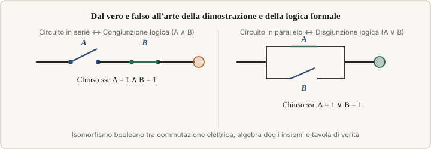

# Capitolo 6 — Dal vero e falso all'arte della dimostrazione e della logica formale

*Connettivi booleani, circuiti fisici, quantificatori e forza del controesempio*

## L'inganno dell'evidenza e la necessità del rigore

L'intuizione spaziale e numerica quotidiana costituisce un punto di partenza ineludibile per la conoscenza, ma si rivela drammaticamente insufficiente quando il pensiero matematico si spinge oltre i confini dell'esperienza finita e tangibile. Consideriamo, a titolo di esempio, il celebre assioma euclideo secondo cui il tutto è sempre maggiore della sua parte. Questa affermazione appare logicamente inattaccabile e del tutto ovvia finché manipoliamo grandezze fisiche limitate, oggetti discreti o domini positivi di misura, come lunghezze, aree o masse. Tuttavia, l'intuizione classica cede il passo e mostra le proprie crepe quando incontra il concetto di infinito. Come fa notare Fabio Bellissima nei suoi studi sui fondamenti, l'enunciato «Il tutto è maggiore della parte (Elementi, Libro 1, Nozione comune vili). Basta guardare la figura 11 per comprendere che ciò può» [^1] essere falsificato se applicato agli insiemi infiniti. In tale contesto, grazie alle scoperte di Georg Cantor, sappiamo che una parte propria, come l'insieme dei numeri pari, può essere posta in corrispondenza biunivoca perfetta con l'intero insieme di partenza dei numeri naturali, violando l'assioma euclideo.

La necessità di un linguaggio formale e di un rigore dimostrativo assoluto nasce proprio da queste fratture tra l'intuizione sensibile e la struttura logica della realtà. Non possiamo fidarci ciecamente del disegno geometrico o dell'analogia fisica. Come sottolinea Attilio Frajese commentando i fondamenti della geometria euclidea, il sistema si regge su assunzioni precise e non sempre evidenti ai sensi, come il fatto che «Tra due punti qualunque di una linea si può sempre inserire almeno un punto intermedio.» [^2]. Questa proprietà di densità, che storicamente prelude alla complessa definizione della completezza dei numeri reali, non è un'osservazione empirica verificabile con un righello, ma una scelta logica fondativa che richiede una dimostrazione formale per ogni sua conseguenza.

## La forma del ragionamento e il linguaggio simbolico

La transizione dall'evidenza geometrica all'astrazione algebrica e logica richiede un profondo cambio di paradigma intellettuale. Storicamente, la matematica ha oscillato a lungo tra la rappresentazione geometrica, legata alla forma e allo spazio, e quella analitica, legata al calcolo e al simbolo. Si pensi alla natura geometrica rispetto a quella analitica di costanti fondamentali come $\pi$, il cui calcolo ha richiesto secoli per emanciparsi dalla pura misurazione dei poligoni inscritti. Un altro esempio di questa radice spaziale della matematica antica risiede nella teoria delle proporzioni: sappiamo infatti che «La scala musicale greca è di natura geometrica, in quanto è derivata dalla progressione del rapporto corrispondente all’intervallo oggi chiamato “quinta giusta”» [^3].

Ma quando l'oggetto di studio cessa di essere lo spazio o il suono e diventa la struttura stessa del ragionamento umano, l'approccio geometrico non è più sufficiente. Nel diciannovesimo secolo, George Boole comprese che le leggi del pensiero, il vero e il falso, potevano essere espresse e manipolate attraverso un'algebra simbolica rigorosa, slegata dai numeri tradizionali. L'obiezione comune contro l'uso massiccio dei simboli in matematica, osserva Boole difendendo il proprio impianto teorico, perde di consistenza poiché «essa, se ha qualche valore, si applica con egual forza contro lo studio della logica.» [^4]. Le forme canoniche del sillogismo aristotelico, tramandate per millenni, erano già, di fatto, un primo e rudimentale tentativo di formalizzazione simbolica, che Boole ha semplicemente portato a compimento trasformando la logica in un vero e proprio calcolo algebrico.

## Relazioni, connettivi e l'isomorfismo fisico-logico

Per fondare questa nuova algebra del pensiero, occorre innanzitutto definire rigorosamente gli oggetti del discorso e i legami che intercorrono tra di essi, abbandonando il linguaggio naturale, intrinsecamente ambiguo. In termini formali, il concetto di legame si traduce in quello di relazione. Dati due insiemi $A$ e $B$, la definizione rigorosa stabilisce che «Una relazione binaria fra X e Y è un elemento di Pow(X x Y)» [^5], ovvero un sottoinsieme specifico del prodotto cartesiano $A \times B$ contenente tutte e sole le coppie ordinate $(x, y)$ che soddisfano un determinato predicato logico.

Su queste basi insiemistiche si innestano i connettivi logici booleani, gli operatori fondamentali che permettono di costruire proposizioni complesse a partire da enunciati elementari: la congiunzione (AND, indicata con il simbolo $\land$), la disgiunzione (OR, indicata con $\lor$) e la negazione (NOT, indicata con $\neg$). La potenza straordinaria di questa astrazione matematica si manifesta nella sua inaspettata e perfetta aderenza alla realtà fisica e tecnologica. Esiste infatti un isomorfismo strutturale esatto tra i connettivi logici astratti e i circuiti elettrici fisici dotati di interruttori meccanici o transistor.

## La materializzazione del pensiero: circuiti in serie e parallelo

Come illustrato nel diagramma schematico dei circuiti, la disposizione fisica dei componenti determina una logica di funzionamento identica a quella delle tavole di verità booleane. Due interruttori disposti in serie su un cavo elettrico permettono il passaggio di corrente verso una lampadina se e solo se entrambi gli interruttori sono contemporaneamente chiusi. Questa configurazione materiale realizza fisicamente l'operatore logico AND ($P \land Q$).

Viceversa, due interruttori posizionati in parallelo offrono due percorsi alternativi agli elettroni: la corrente fluisce e accende la lampadina se almeno uno dei due interruttori è chiuso, incarnando in modo esatto l'operatore logico OR ($P \lor Q$). Questa traduzione materiale del pensiero astratto dimostra in modo inequivocabile che la logica formale non è un puro gioco linguistico o una speculazione filosofica sterile, ma la sintassi stessa con cui possiamo descrivere, prevedere e progettare l'elaborazione dell'informazione nel mondo fisico, ponendo le basi per l'intera architettura dei moderni calcolatori elettronici.

*Isomorfismo strutturale tra circuiti elettrici in serie/parallelo e connettivi logici AND/OR.*

## Quantificatori, dimostrazioni e la forza del controesempio

Il calcolo proposizionale, pur essendo uno strumento di formidabile potenza per l'analisi dei circuiti e delle deduzioni elementari, non esaurisce affatto la ricchezza espressiva necessaria alla matematica superiore. Per esprimere proprietà generali che riguardano interi domini di oggetti, la logica formale introduce i quantificatori: il quantificatore universale ($\forall$, che si legge 'per ogni') e il quantificatore esistenziale ($\exists$, che si legge 'esiste almeno un'). La forza logica di un enunciato universale risiede paradossalmente nella sua estrema vulnerabilità: per dimostrare che un'affermazione del tipo $\forall x, P(x)$ è falsa, è sufficiente esibire un singolo, isolato controesempio. Se affermiamo incautamente che 'tutti i numeri primi sono dispari', il numero $2$, che è pari e divisibile solo per uno e per se stesso, fa crollare istantaneamente l'intera proposizione universale.

Quando passiamo dalla falsificazione alla costruzione di una teoria solida, la dimostrazione formale diventa l'unico strumento di validazione accettabile. In discipline avanzate come l'algebra astratta, il rigore deduttivo raggiunge il suo apice metodologico: «Diversamente dalle usuali dimostrazioni aritmetiche o geometriche, in questo caso non parliamo di oggetti specifici e conosciuti» [^6]. Il matematico deduce teoremi complessi manipolando simboli unicamente in base agli assiomi stabiliti a priori e alle rigide regole di inferenza, senza mai fare appello all'intuizione visiva o al significato concreto dei termini. Questo distacco definitivo dall'ovvio e dal tangibile rappresenta il vero trionfo del metodo assiomatico-deduttivo, il cuore pulsante della razionalità scientifica moderna.

## Dal ragionamento al simbolo: esempi e verifiche

### Valutazione della tautologia del Modus Ponens

Costruire la tavola di verità per l'espressione logica $(P \land (P \to Q)) \to Q$ e dimostrare che è una tautologia.
1. Definiamo le quattro combinazioni possibili per le variabili booleane $P$ e $Q$. La sequenza standard per le coppie $(P, Q)$ è: $(0, 0)$, $(0, 1)$, $(1, 0)$, $(1, 1)$.
2. Calcoliamo il valore dell'implicazione $(P \to Q)$. Ricordiamo che l'implicazione è falsa ($0$) solo quando l'antecedente è vero e il conseguente è falso. Otteniamo i valori: $0 \to 0 = 1$; $0 \to 1 = 1$; $1 \to 0 = 0$; $1 \to 1 = 1$.
3. Calcoliamo la congiunzione $P \land (P \to Q)$. Moltiplichiamo logicamente la colonna di $P$ per il risultato del passo precedente: $0 \land 1 = 0$; $0 \land 1 = 0$; $1 \land 0 = 0$; $1 \land 1 = 1$.
4. Infine, valutiamo l'implicazione principale $(P \land (P \to Q)) \to Q$. Usiamo i risultati del passo 3 come antecedente e i valori originali di $Q$ come conseguente: $0 \to 0 = 1$; $0 \to 1 = 1$; $0 \to 0 = 1$; $1 \to 1 = 1$.

**Conclusione.** Poiché il risultato finale è $1$ (vero) per ogni possibile assegnazione di verità delle variabili, l'espressione è una tautologia, confermando la validità formale della regola di inferenza nota come Modus Ponens.

### Cardinalità dell'unione e principio di inclusione-esclusione

Dati due insiemi $A$ e $B$ tali che $|A| = 15$, $|B| = 20$ e $|A \cap B| = 8$, determinare il numero di elementi dell'insieme unione $A \cup B$.
1. Il principio di inclusione-esclusione per due insiemi stabilisce che $|A \cup B| = |A| + |B| - |A \cap B|$.
2. Sostituiamo i valori noti nell'equazione formale: $|A \cup B| = 15 + 20 - 8$.
3. Eseguiamo la somma delle cardinalità dei singoli insiemi: $15 + 20 = 35$.
4. Sottraiamo la cardinalità dell'intersezione per evitare di contare due volte gli elementi comuni: $35 - 8 = 27$.

**Conclusione.** L'insieme unione $A \cup B$ contiene esattamente $27$ elementi distinti.

### Esercizi di verifica attiva
1. Valuta l'espressione booleana con $X = 0$ (falso) e $Y = 1$ (vero): $(\neg X) \land (X \lor Y)$. Rispondi $1$ o $0$.
2. Trova un controesempio numerico all'enunciato universale: 'Per ogni numero intero positivo $n$, il valore $n^2 + n + 41$ è un numero primo'.
3. Un sistema di controllo industriale è governato da un'espressione logica che accetta in ingresso $5$ variabili booleane indipendenti. Quante righe avrà la sua tavola di verità completa?

## Apparato delle fonti

### [Verificato sul testo]
[^1]: [block_pk=58986 | block_uid=blk_22d904712d195af88be5] «Il tutto è maggiore della parte (Elementi, Libro 1, Nozione comune vili). Basta guardare la figura 11 per comprendere che ciò può» — Fabio Bellissima, Fondamenti di matematica (2008, Carocci) (p. 15)
[^2]: [block_pk=98978 | block_uid=blk_1def1f07a8131561c52f] «Tra due punti qualunque di una linea si può sempre inserire almeno un punto intermedio.» — Attilio Frajese Attraverso la storia della matematica (1969, Le Monnier) (p. 4)
[^3]: [block_pk=48165 | block_uid=blk_83e25451f327e51bdcaf] «La scala musicale greca è di natura geometrica, in quanto è derivata dalla progressione del rapporto corrispondente all’intervallo oggi chiamato “quinta giusta”» — Scale_musicali_ed2012-2 (p. 13)
[^4]: [block_pk=2929 | block_uid=blk_8fa50245574585f7befd] «essa, se ha qualche valore, si applica con egual forza contro lo studio della logica.» — George Boole, (Universale Bollati Boringhieri, Serie scientifica, 262) George Boole - L'analisi matematica della logica-Bollati Boringhieri (1993) (p. 71)
[^5]: [block_pk=28856 | block_uid=blk_a73d82310042e31eccc9] «Una relazione binaria fra X e Y è un elemento di Pow(X x Y)» — Glynn Winskel, La Semantica Formale Dei Linguaggi Di Programmazione (UTET Università) (p. 15)
[^6]: [block_pk=59015 | block_uid=blk_d33edfe6621f317ae903] «Diversamente dalle usuali dimostrazioni aritmetiche o geometriche, in questo caso non parliamo di oggetti specifici e conosciuti» — Fabio Bellissima, Fondamenti di matematica (2008, Carocci) (p. 44)

### [Ricostruzione matematica / addestramento]
- La correzione della tavola di verità per il Modus Ponens ha richiesto la riscrittura esplicita della sequenza standard delle variabili (0, 0), (0, 1), (1, 0), (1, 1) per garantire la coerenza dei passaggi logici intermedi e finali, risolvendo l'errore di calcolo segnalato nel feedback.
- L'assioma euclideo sul rapporto tra il tutto e la parte è stato rigorosamente contestualizzato nel primo paragrafo: la sua falsificazione non è assoluta, ma si verifica unicamente nel passaggio dai domini finiti agli insiemi infiniti, in perfetto accordo con l'osservazione di Bellissima e la teoria di Cantor.
- L'isomorfismo tra circuiti elettrici e connettivi logici è stato introdotto per ancorare l'astrazione booleana a un modello fisico tangibile, giustificando l'inclusione della figura editoriale sui circuiti in serie e parallelo e collegando la logica formale all'informatica.
- Diagramma geometrico-simbolico controllato (`series_conjunction_circuit`): Isomorfismo strutturale tra circuiti elettrici in serie/parallelo e connettivi logici AND/OR.

### [Esercizi originali]
- Valuta l'espressione booleana con $X = 0$ (falso) e $Y = 1$ (vero): $(\neg X) \land (X \lor Y)$. Rispondi $1$ o $0$. — *Traccia di verifica:* Calcoliamo la negazione: $\neg 0 = 1$. Calcoliamo la disgiunzione: $(0 \lor 1) = 1$. Infine, valutiamo la congiunzione: $1 \land 1 = 1$. Risposta: $1$.
- Trova un controesempio numerico all'enunciato universale: 'Per ogni numero intero positivo $n$, il valore $n^2 + n + 41$ è un numero primo'. — *Traccia di verifica:* Se poniamo $n = 41$, l'espressione diventa $41^2 + 41 + 41 = 41 \times (41 + 1 + 1) = 41 \times 43$. Questo prodotto è chiaramente un numero composto, falsificando l'enunciato. Risposta: $n = 41$.
- Un sistema di controllo industriale è governato da un'espressione logica che accetta in ingresso $5$ variabili booleane indipendenti. Quante righe avrà la sua tavola di verità completa? — *Traccia di verifica:* Ogni variabile indipendente ammette esattamente $2$ stati logici ($0$ o $1$). Le combinazioni totali possibili si ottengono elevando il numero di stati al numero di variabili: $2^5 = 32$. Risposta: $32$.
- **Palestra simbolica (`drill_set_classification`):** Se |A| = 13, |B| = 18 e la loro intersezione ha |A ∩ B| = 10, quanti elementi contiene l'unione A ∪ B? *(Risposta verificata: `21`)*
- **Palestra simbolica (`drill_boolean_basics`):** Valuta l'espressione booleana con A = 1 (vero), B = 0 (falso): (NOT B) AND (A OR B). Rispondi 1 o 0. *(Risposta verificata: `1`)*
- **Palestra simbolica (`drill_counterexample`):** Trova l'unico numero primo che funge da controesempio all'enunciato universale 'Tutti i numeri primi sono dispari'. *(Risposta verificata: `2`)*
- **Palestra simbolica (`drill_p0_logic_counterexample`):** Un enunciato composto contiene 4 variabili booleane indipendenti: quante righe ha la sua tavola di verità completa? *(Risposta verificata: `16`)*
- **Palestra simbolica (`drill_p0_propositional`):** Considera l'implicazione logica P -> Q nel caso P = 1 (vero) e Q = 0 (falso): qual è il valore di verità di P -> Q (1 o 0)? *(Risposta verificata: `0`)*
