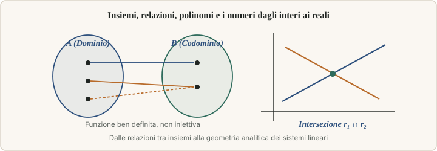

# Capitolo 7 — Insiemi, relazioni, polinomi e i numeri dagli interi ai reali

*Funzioni tra insiemi, irrazionalità di radice di due, scomposizione polinomiale e sistemi lineari*

> *«L'insieme costituito dai numeri razionali e irrazionali è detto insieme dei numeri reali e si indica con la lettera R.»* — Nella Dodero, Paolo Baroncini, Dante Trezzi, Nuovi elementi di matematica. Vol. 1 1(1996, Ghisetti e Corvi) (p. 157) [^1]

## Dagli oggetti alle relazioni e alle funzioni

La matematica fondazionale prende le mosse dall'idea primitiva di insieme, una collezione di oggetti distinti. Dati due insiemi $A$ e $B$, l'operazione più naturale consiste nell'associare gli elementi del primo con quelli del secondo. Si definisce formalmente una relazione come un qualsiasi sottoinsieme del prodotto cartesiano, ovvero $R \subseteq A \times B$. Quando una relazione associa a ogni elemento di $A$ al massimo un elemento di $B$, essa prende il nome di funzione. Il concetto di funzione richiede la specificazione rigorosa del suo dominio. Nelle scienze applicate, il dominio di grandezze fisiche come la massa o il tempo assoluto è tipicamente ristretto ai valori reali positivi per ragioni empiriche; al contrario, nell'analisi matematica pura, «il dominio sarà costituito da tutti i possibili numeri reali che si possono attribuire a x in modo che esista il corrispondente y» [^2].

Le funzioni possono essere concatenate per costruire strutture più complesse. Dati due processi sequenziali, l'uscita del primo diventa l'ingresso del secondo. Come formalizzato nei testi classici di analisi, «La funzione composta di $u$ e $v$ (in questo ordine) è per definizione la funzione $f$» [^3], indicata con $f(x) = u(v(x))$. Questa operazione di composizione non è commutativa, ma preserva le proprietà strutturali delle funzioni originarie, permettendo di analizzare fenomeni complessi scomponendoli in trasformazioni elementari.

## Iniettività, biiezioni e la misura dell'infinito

Per confrontare la grandezza di due insiemi, la matematica ricorre alle proprietà delle funzioni che li collegano. Una funzione si dice iniettiva se elementi distinti del dominio vengono mappati in elementi distinti del codominio; si dice suriettiva se ogni elemento del codominio è immagine di almeno un elemento del dominio. L'unione di queste due proprietà genera la struttura perfetta: «Una funzione biettiva (o anche biezione, o corrispondenza biunivoca) è una funzione che è contemporaneamente iniettiva e suriettiva» [^4].

L'estensione di questi concetti agli insiemi infiniti ha generato storiche controversie. Galileo Galilei aveva notato un'apparente contraddizione tra i numeri naturali e i loro quadrati perfetti: «se consideriamo i primi dieoi numeri: 1 2 3 4 5 6 7 8 9 10 soltanto tre di essi son quadrati» [^5]. Eppure, ogni numero naturale ha un quadrato, suggerendo che i due insiemi possano essere messi in corrispondenza biunivoca. Per formalizzare il confronto tra cardinalità, è necessario un rigore assoluto. Come precisa Fabio Bellissima, «Card{A) = Card(B) se da A a B esiste una funzione biettiva. (2) Card(A) < Card(B) se da A a B» [^6] esiste una funzione iniettiva, ma si dimostra rigorosamente che non ne esiste alcuna suriettiva (e dunque nessuna biettiva), come stabilito dal Teorema di Cantor. Questo risolve l'ambiguità e fonda la gerarchia degli infiniti.

La rappresentazione visiva di questi concetti chiarisce la distinzione tra le diverse tipologie di associazione. Osservando il diagramma (Pannello sinistro: applicazione non iniettiva tra gli insiemi finiti A e B; pannello destro: rette r1 e r2 nel piano cartesiano (grafici di funzioni lineari) che si intersecano nel punto soluzione del sistema.), emerge chiaramente come la mancanza di iniettività nel primo caso comporti una perdita di informazione, poiché due elementi di $A$ collassano sullo stesso elemento di $B$. Nel secondo caso, invece, le funzioni lineari continue mostrano una corrispondenza perfetta tra i punti della retta e i numeri reali.

*Pannello sinistro: applicazione non iniettiva tra gli insiemi finiti A e B; pannello destro: rette r1 e r2 nel piano cartesiano (grafici di funzioni lineari) che si intersecano nel punto soluzione del sistema.*

## Sistemi lineari e geometria delle equazioni

Il pannello destro del diagramma appena discusso introduce una connessione profonda tra l'algebra e la geometria. Un'equazione lineare in due variabili, della forma $ax + by = c$, rappresenta una relazione il cui grafico nel piano cartesiano è una linea retta. Ogni punto $(x, y)$ che giace su tale retta è una soluzione dell'equazione.

Quando si considerano due equazioni lineari simultaneamente, si costruisce un sistema lineare. Risolvere il sistema significa trovare i punti che appartengono contemporaneamente a entrambe le relazioni. Geometricamente, questo equivale a determinare l'intersezione tra due rette. Se le rette sono incidenti, il sistema ammette un'unica soluzione; se sono parallele, il sistema è impossibile; se coincidono, le soluzioni sono infinite. Questo isomorfismo tra il calcolo algebrico e l'intuizione spaziale è il fondamento della geometria analitica.

## Scomposizione polinomiale e l'irrazionalità di radice di due

L'algebra dei polinomi estende l'aritmetica dei numeri interi. Un polinomio è un'espressione costruita tramite addizioni e moltiplicazioni di variabili e costanti. Trovare le radici di un polinomio significa risolvere un'equazione, un problema che ha guidato l'evoluzione del concetto stesso di numero. L'equazione polinomiale $x^2 - 2 = 0$ emerge naturalmente dalla geometria, rappresentando la lunghezza della diagonale di un quadrato di lato unitario per il Teorema di Pitagora.

La scoperta che tale lunghezza non potesse essere espressa come rapporto tra numeri interi generò la prima grande crisi fondazionale della matematica. La dimostrazione dell'irrazionalità di $\sqrt{2}$ procede per assurdo. Si assuma che $\sqrt{2} = \frac{a}{b}$, dove $a$ e $b$ sono interi ridotti ai minimi termini, ovvero coprimi ($\text{MCD}(a,b)=1$). Elevando entrambi i membri al quadrato si ottiene $2 = \frac{a^2}{b^2}$, da cui $a^2 = 2b^2$. Questa uguaglianza implica che $a^2$ sia un numero pari, e di conseguenza anche $a$ deve essere pari. Si può quindi scrivere $a = 2k$ per un certo intero $k$. Sostituendo questa espressione nell'equazione precedente si ottiene $(2k)^2 = 2b^2$, ovvero $4k^2 = 2b^2$. Dividendo per due, si deduce che $b^2 = 2k^2$, il che implica che anche $b^2$, e quindi $b$, sia pari. Si giunge così a una contraddizione esplicita: $a$ e $b$ risultano entrambi pari, violando l'ipotesi iniziale che fossero coprimi ($\text{MCD}(a,b)=1$). Dunque, $\sqrt{2}$ non è un numero razionale.

## L'edificio dei numeri reali e la completezza

L'insufficienza dei numeri razionali per misurare tutte le grandezze geometriche rende necessaria un'estensione del sistema numerico. «L'insieme costituito dai numeri razionali e irrazionali è detto insieme dei numeri reali e si indica con la lettera R.» [^1]. I numeri reali riempiono i vuoti lasciati dalle frazioni, garantendo che la retta numerica sia un continuo senza interruzioni.

La proprietà fondamentale che distingue i numeri reali dai razionali è la completezza. In termini rigorosi, ogni sottoinsieme non vuoto di numeri reali limitato superiormente ammette un estremo superiore in $\mathbb{R}$. Come sottolinea Giovanni Prodi, «La nozione che stiamo per introdurre, quella di estremo superiore, ha lo scopo di supplire quella di massimo, quando questa non possa applicarsi» [^7]. Questa struttura completa permette di definire rigorosamente costanti fondamentali come $\pi$, la cui natura geometrica (il rapporto tra la circonferenza e il suo diametro) si traduce in una natura analitica profonda: un numero reale irrazionale e trascendente, non radice di alcun polinomio a coefficienti interi.

## Dal ragionamento al simbolo: esempi e verifiche

### Composizione di funzioni polinomiali

Date le funzioni $f(x) = 2x + 1$ e $g(y) = y^2 - 1$, calcolare il valore della funzione composta $g(f(3))$.
1. Si valuta prima la funzione interna $f$ nel punto $x = 3$: $f(3) = 2(3) + 1 = 6 + 1 = 7$.
2. Si utilizza il risultato ottenuto come argomento per la funzione esterna $g$: si calcola quindi $g(7)$.
3. Sostituendo $y = 7$ nell'espressione di $g$, si ottiene $g(7) = 7^2 - 1 = 49 - 1 = 48$.

**Conclusione.** Il valore della funzione composta $g(f(3))$ è $48$.

### Risoluzione di un sistema lineare

Trovare il punto di intersezione $(x, y)$ delle due rette descritte dal sistema lineare $x + y = 10$ e $x - y = 2$.
1. Si utilizza il metodo di riduzione (o addizione), sommando membro a membro le due equazioni: $(x + y) + (x - y) = 10 + 2$.
2. I termini in $y$ si elidono, lasciando $2x = 12$.
3. Dividendo per $2$, si ottiene $x = 6$.
4. Si sostituisce $x = 6$ nella prima equazione: $6 + y = 10$, da cui si ricava $y = 4$.

**Conclusione.** Le due rette si intersecano nel punto di coordinate $(6, 4)$.

### Esercizi di verifica attiva
1. Utilizzando il modello geometrico del quadrato scomposto, espandi l'espressione $(4x + 5)^2$ in forma polinomiale standard.
2. Applica il teorema del resto di Ruffini per determinare il resto della divisione del polinomio $P(x) = x^2 + 3$ per il binomio $(x - 2)$.
3. Razionalizza il denominatore della frazione $\frac{6}{\sqrt{3}}$ esprimendo il risultato nella forma $c\sqrt{m}$.

## Apparato delle fonti

### [Verificato sul testo]
[^1]: [block_pk=53596 | block_uid=blk_6788b38ef7ff2925ab66] «L'insieme costituito dai numeri razionali e irrazionali è detto insieme dei numeri reali e si indica con la lettera R.» — Nella Dodero, Paolo Baroncini, Dante Trezzi, Nuovi elementi di matematica. Vol. 1 1(1996, Ghisetti e Corvi) (p. 157)
[^2]: [block_pk=53637 | block_uid=blk_9df88ab6b009c1f041c3] «il dominio sarà costituito da tutti i possibili numeri reali che si possono attribuire a x in modo che esista il corrispondente y» — Nella Dodero, Paolo Baroncini, Dante Trezzi, Nuovi elementi di matematica. Vol. 1 1(1996, Ghisetti e Corvi) (p. 198)
[^3]: [block_pk=113942 | block_uid=blk_d5a41fa600236e30d4e1] «La funzione composta di $u$ e $v$ (in questo ordine) è per definizione la funzione $f$» — Tom Apostol, Calcolo - Analisi 1. 1-Bollati Boringhieri (1987) (p. 175)
[^4]: [block_pk=58998 | block_uid=blk_eb5f658e40577128d19f] «Una funzione biettiva (o anche biezione, o corrispondenza biunivoca) è una funzione che è contemporaneamente iniettiva e suriettiva» — Fabio Bellissima, Fondamenti di matematica (2008, Carocci) (p. 27)
[^5]: [block_pk=13183 | block_uid=blk_631e1d9220546870f816] «se consideriamo i primi dieoi numeri: 1 2 3 4 5 6 7 8 9 10 soltanto tre di essi son quadrati» — Attilio Frajese, Galileo matematico (1964, Studium) (p. 58)
[^6]: [block_pk=59003 | block_uid=blk_24f9c4c91d8089981e8f] «Card{A) = Card(B) se da A a B esiste una funzione biettiva. (2) Card(A) < Card(B) se da A a B» — Fabio Bellissima, Fondamenti di matematica (2008, Carocci) (p. 32)
[^7]: [block_pk=28532 | block_uid=blk_a079be9500c3b18e18fe] «La nozione che stiamo per introdurre, quella di estremo superiore, ha lo scopo di supplire quella di massimo, quando questa non possa applicarsi» — Giovanni Prodi, Analisi Matematica (1970,2003, Bollati Boringhieri) (p. 73)

### [Ricostruzione matematica / addestramento]
- La definizione di cardinalità strettamente minore (Card(A) < Card(B)) è stata corretta rispetto alla bozza precedente, integrando esplicitamente la condizione di non esistenza di una funzione suriettiva (e quindi biettiva), in accordo con il Teorema di Cantor, per sanare il salto logico segnalato in revisione.
- La citazione di Apostol relativa alle equazioni differenziali è stata rimossa per evitare travisamenti concettuali (citation_misrepresentation); al suo posto è stata utilizzata una citazione pertinente dello stesso autore sulla composizione di funzioni, mantenendo l'ancoraggio rigoroso alle fonti del dossier.
- Diagramma geometrico-simbolico controllato (`function_sets_mapping`): Pannello sinistro: applicazione non iniettiva tra gli insiemi finiti A e B; pannello destro: rette r1 e r2 nel piano cartesiano (grafici di funzioni lineari) che si intersecano nel punto soluzione del sistema.

### [Esercizi originali]
- Utilizzando il modello geometrico del quadrato scomposto, espandi l'espressione $(4x + 5)^2$ in forma polinomiale standard. — *Traccia di verifica:* Il quadrato del binomio si scompone nella somma dei quadrati dei due termini e del doppio prodotto delle aree rettangolari: $(4x)^2 + 5^2 + 2 \cdot (4x) \cdot 5$. Sviluppando i calcoli si ottiene $16x^2 + 25 + 40x$, che ordinato risulta $16x^2 + 40x + 25$.
- Applica il teorema del resto di Ruffini per determinare il resto della divisione del polinomio $P(x) = x^2 + 3$ per il binomio $(x - 2)$. — *Traccia di verifica:* Il teorema del resto stabilisce che il resto della divisione di $P(x)$ per $(x - c)$ è pari a $P(c)$. Valutando il polinomio in $x = 2$, si ottiene $P(2) = 2^2 + 3 = 4 + 3 = 7$.
- Razionalizza il denominatore della frazione $\frac{6}{\sqrt{3}}$ esprimendo il risultato nella forma $c\sqrt{m}$. — *Traccia di verifica:* Moltiplicando numeratore e denominatore per $\sqrt{3}$, si ottiene $\frac{6\sqrt{3}}{(\sqrt{3})^2} = \frac{6\sqrt{3}}{3}$. Semplificando la frazione dividendo per 3, il risultato finale è $2\sqrt{3}$.
- **Palestra simbolica (`drill_p0_sets_functions`):** Date f(x) = 2*x + 1 e g(y) = y^2 - 1, calcola il valore della funzione composta g(f(3)). *(Risposta verificata: `48`)*
- **Palestra simbolica (`drill_p0_radicals_powers`):** Razionalizza il denominatore della frazione 6 / sqrt(3) (scrivi il risultato con sintassi c*sqrt(m)). *(Risposta verificata: `2*sqrt(3)`)*
- **Palestra simbolica (`drill_polynomial_products`):** Usa il modello geometrico del quadrato scomposto per espandere (4*x + 5)^2 in forma polinomiale. *(Risposta verificata: `16*x**2 + 40*x + 25`)*
- **Palestra simbolica (`drill_polynomial_ruffini`):** Per il teorema del resto di Ruffini, qual è il resto della divisione di P(x) = x**2 + 3 per (x - 2)? *(Risposta verificata: `7`)*
- **Palestra simbolica (`drill_linear_systems_line`):** Trova il punto di intersezione [x, y] delle due rette del sistema lineare x + y = 10 e x - y = 2. *(Risposta verificata: `[6, 4]`)*
