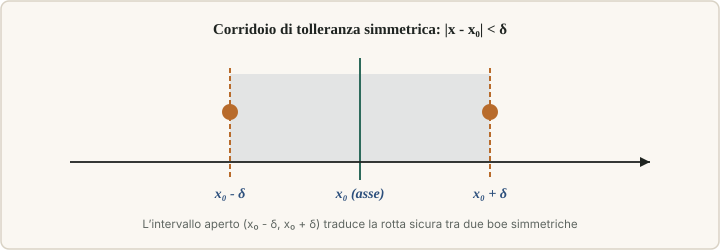

# Capitolo 8 — Equazioni, disequazioni, valori assoluti e il corridoio di tolleranza

*Dal calcolo algebrico di secondo grado alle disequazioni fratte, irrazionali e con modulo*

> *«L'esperimento ebbe luogo il 30 giugno 1934 nel mare di Santa Margherita Ligure.»* — Giancarlo Masini, Guglielmo Marconi (1975, UTET) (p. 495) [^1]

## La navigazione cieca e il concetto di tolleranza

Il 30 giugno 1934, nel mare di Santa Margherita Ligure, Guglielmo Marconi e Gaston-Antoine Mathieu condussero un esperimento cruciale a bordo del panfilo Elettra. Con gli oblò oscurati, guidarono l'imbarcazione attraverso due boe distanti appena cinquanta metri l'una dall'altra, affidandosi unicamente alle indicazioni di un ricevitore per radio-faro [^1]. Questo episodio storico incarna un problema matematico e ingegneristico fondamentale: il mantenimento di una traiettoria all'interno di un margine di errore prestabilito. Nella realtà fisica, nessuna grandezza è esatta e nessuna misurazione è priva di incertezza.

La progettazione di un sistema di acquisizione dati, ad esempio, richiede sempre la gestione del rumore, dell'offset e della deriva termica per garantire la precisione delle misurazioni [^2]. In termini algebrici, la necessità di confinare un valore entro limiti accettabili si traduce nel concetto di valore assoluto e nelle relative disequazioni. La matematica, prima ancora di essere manipolazione di simboli, è il linguaggio che ci permette di quantificare e governare questa incertezza, trasformando il concetto qualitativo di 'vicinanza' in una disuguaglianza rigorosa.

## Il modulo come distanza e il corridoio simmetrico

Per formalizzare l'idea di tolleranza, introduciamo il valore assoluto, o modulo, di un numero reale $x$, indicato con il simbolo $|x|$. Esso rappresenta la distanza geometrica di $x$ dall'origine sulla retta reale, ed è definito formalmente come $x$ se $x \ge 0$, e $-x$ se $x < 0$. Quando imponiamo una condizione del tipo $|x - x_0| < \delta$, stiamo richiedendo che la distanza tra la variabile $x$ e il valore nominale di riferimento $x_0$ sia strettamente inferiore a una tolleranza massima $\delta > 0$.

Questa singola scrittura compatta equivale al sistema di due disequazioni simultanee $-\delta < x - x_0 < \delta$, la cui soluzione è l'intervallo aperto $(x_0 - \delta, x_0 + \delta)$. Il modulo $|x - x_0| < \delta$ si visualizza geometricamente come un intervallo aperto simmetrico e un corridoio di tolleranza fisica entro cui il sistema deve operare. Uscire da questo corridoio significa violare i vincoli del problema, che si tratti di mancare il passaggio tra due boe o di superare la soglia di sicurezza di un componente elettronico.

*Il modulo |x - x0| < delta come intervallo aperto simmetrico e corridoio di tolleranza fisica.*

## Il grado quadratico e la struttura delle soluzioni

L'analisi dei margini di tolleranza conduce spesso a espressioni polinomiali di secondo grado, la cui comprensione è uno snodo ineludibile nel percorso matematico. La risoluzione di un'equazione del tipo $ax^2 + bx + c = 0$ (con $a \neq 0$) dipende intrinsecamente dal segno del discriminante $\Delta = b^2 - 4ac$. Se $\Delta > 0$, l'equazione ammette due soluzioni reali distinte, corrispondenti a due intersezioni della parabola associata con l'asse delle ascisse; se $\Delta = 0$, le due soluzioni reali sono coincidenti e la parabola è tangente all'asse; se $\Delta < 0$, non esiste alcuna soluzione reale e la parabola non interseca mai l'asse orizzontale.

Questo impianto teorico costituisce l'ossatura dei quesiti di algebra e funzioni nei test di matematica di base [^3]. Passare dall'equazione alla disequazione $ax^2 + bx + c > 0$ richiede un salto concettuale: non si cercano più punti isolati, ma si deve interpretare il trinomio globalmente come una curva nel piano cartesiano, determinando gli interi intervalli in cui il grafico si trova al di sopra o al di sotto dell'asse delle ascisse. La scomposizione del polinomio in fattori lineari, quando possibile, offre un metodo algebrico potente per studiare il segno del prodotto, ma la visione geometrica rimane la guida più sicura per evitare errori di distrazione.

## Disequazioni irrazionali e la logica dei sistemi

Un livello ulteriore di complessità emerge quando l'incognita compare sotto il segno di radice. Consideriamo la disequazione irrazionale $\sqrt{A(x)} < B(x)$. La risoluzione non può limitarsi a un brutale elevamento al quadrato di ambo i membri. È necessario costruire un sistema logico che garantisca l'esistenza delle espressioni e la coerenza dei segni. Il sistema finale è composto da tre condizioni: $A(x) \ge 0$ (condizione di realtà del radicale), $B(x) > 0$ (poiché una radice quadrata reale, essendo non negativa, può essere strettamente minore solo di una quantità strettamente positiva), e infine $A(x) < [B(x)]^2$.

È fondamentale notare una sottigliezza logica che spesso sfugge: nella disequazione opposta $\sqrt{A(x)} > B(x)$, qualora si consideri il caso in cui $B(x) \ge 0$, l'elevamento al quadrato produce $A(x) > [B(x)]^2$; poiché un quadrato è sempre non negativo, la condizione $A(x) > 0$ risulta implicitamente soddisfatta e la richiesta esplicita $A(x) \ge 0$ diventa superflua. Al contrario, nel caso $\sqrt{A(x)} < B(x)$, la condizione $A(x) < [B(x)]^2$ fissa un tetto massimo ma non impedisce ad $A(x)$ di assumere valori negativi, rendendo la condizione $A(x) \ge 0$ assolutamente imprescindibile per la realtà del radicale. L'applicazione meccanica delle regole algebriche, senza una profonda comprensione delle condizioni di esistenza, è pericolosa; un rischio analogo a quello segnalato nell'uso irriflessivo dei teoremi di L'Hôpital nel calcolo differenziale, dove un'applicazione maldestra può allontanare dalla soluzione [^4].

## La traduzione algoritmica del ragionamento

La scomposizione di una disequazione complessa in un sistema di condizioni elementari è un processo eminentemente algoritmico, che richiede disciplina e visione d'insieme. L'algoritmica, infatti, è quella branca dell'informatica che riguarda la definizione e il progetto degli algoritmi, analizzandone la correttezza, l'efficienza e le limitazioni intrinseche [^5]. Quando risolviamo una disequazione irrazionale, fratta o con modulo, stiamo di fatto eseguendo una procedura rigorosa passo dopo passo, in cui ogni istruzione logica deve essere eseguita nell'ordine corretto.

In questo contesto formale, il ruolo dello studente di matematica è sorprendentemente simile a quello del programmatore informatico: l'uomo identifica i termini di un dato problema, ne imposta la soluzione e infine scrive il programma corrispondente; l'elaboratore ha solamente il compito di eseguirlo materialmente [^6]. La matematica ci insegna a scrivere il 'programma' logico corretto nella nostra mente, affinché il calcolo simbolico non produca risultati privi di significato nel mondo reale, ma rifletta fedelmente i vincoli del problema originario.

## Dal ragionamento al simbolo: esempi e verifiche

### Risoluzione di una disequazione con modulo

Risolvere la disequazione $|2x - 5| \le 7$.
1. Riscriviamo la disequazione eliminando il valore assoluto, sfruttando la proprietà fondamentale $|X| \le k \iff -k \le X \le k$.
2. Impostiamo la doppia disuguaglianza: $-7 \le 2x - 5 \le 7$.
3. Aggiungiamo $5$ a tutti i membri per isolare il termine contenente l'incognita: $-7 + 5 \le 2x \le 7 + 5$, che semplificato diventa $-2 \le 2x \le 12$.
4. Dividiamo tutti i membri per $2$. Poiché $2$ è una quantità positiva, il verso delle disuguaglianze non cambia: $-1 \le x \le 6$.

**Conclusione.** L'insieme delle soluzioni è l'intervallo chiuso $[-1, 6]$.

### Somma e prodotto delle radici di un'equazione di secondo grado

Determinare la somma e il prodotto delle soluzioni reali dell'equazione $3x^2 - 7x + 2 = 0$ senza calcolarle esplicitamente.
1. Verifichiamo innanzitutto che le soluzioni siano reali calcolando il discriminante: $\Delta = (-7)^2 - 4(3)(2) = 49 - 24 = 25$. Poiché $\Delta > 0$, l'equazione ammette due soluzioni reali distinte.
2. Utilizziamo le formule di Viète. La somma delle radici $x_1 + x_2$ è data dal rapporto $-b/a$.
3. Sostituendo i coefficienti $a = 3$ e $b = -7$, otteniamo $x_1 + x_2 = -(-7)/3 = 7/3$.
4. Il prodotto delle radici $x_1 \cdot x_2$ è dato dal rapporto $c/a$.
5. Sostituendo $a = 3$ e $c = 2$, otteniamo $x_1 \cdot x_2 = 2/3$.

**Conclusione.** La somma delle soluzioni è $7/3$ e il loro prodotto è $2/3$.

### Esercizi di verifica attiva
1. Un sensore di temperatura deve mantenere un ambiente a $20^\circ\text{C}$ con una tolleranza massima di $1.5^\circ\text{C}$. Scrivi la condizione tramite una disequazione con valore assoluto e determina l'intervallo delle temperature accettabili.
2. Risolvi la disequazione irrazionale $\sqrt{x^2 - 4} < x - 1$. Fai particolare attenzione alle condizioni di esistenza e al sistema risolutivo.
3. Fornisci un controesempio per dimostrare che l'implicazione $\sqrt{A(x)} < B(x) \implies A(x) < [B(x)]^2$ non è sufficiente da sola a garantire soluzioni reali corrette se si omette la condizione di realtà $A(x) \ge 0$.

## Apparato delle fonti

### [Verificato sul testo]
[^1]: [block_pk=28379 | block_uid=blk_91211199164d867ea4c8] «L'esperimento ebbe luogo il 30 giugno 1934 nel mare di Santa Margherita Ligure.» — Giancarlo Masini, Guglielmo Marconi (1975, UTET) (p. 495)
[^2]: [block_pk=43558 | block_uid=blk_35b2b5c617b71a057f95] «We’re seriously challenged here, because the» — Paul Horowitz, Winfield Hill, The Art of Electronics (2015, Cambridge University Press) (p. 982)
[^3]: [block_pk=50635 | block_uid=blk_42fdd28224a7cdae7e52] «Argomento: Algebra, Funzioni e grafici [Polinomi ed equazioni di secondo grado]» — Testmatbasesol (p. 2)
[^4]: [block_pk=28721 | block_uid=blk_b47af92643f159b83f07] «Piuttosto, vogliamo mettere in guardia il lettore dall’applicare in modo meccanico questi teoremi; infatti, in primo luogo, non è detto» — Giovanni Prodi, Analisi Matematica (1970,2003, Bollati Boringhieri) (p. 262)
[^5]: [block_pk=5665 | block_uid=blk_f1e2d0f48688532ab146] «L’algoritmica è quella branca dell'informatica che riguarda la definizione e il progetto degli algoritmi» — A. Bertossi, Algoritmi e Strutture di Dati (2000, UTET) (p. 6)
[^6]: [block_pk=54016 | block_uid=blk_fd5c5f859e2d49befdc0] «l'uomo identifica i termini di un dato problema, ne imposta la soluzione e infine scrive il programma corrispondente; l'elaboratore ha solamente» — Nella Dodero, Paolo Baroncini, Dante Trezzi, Nuovi elementi di matematica. Vol. 1 1(1996, Ghisetti e Corvi) (p. 577)

### [Ricostruzione matematica / addestramento]
- La scelta di introdurre il valore assoluto tramite il concetto fisico di tolleranza mira a fornire un'ancora cognitiva concreta prima della formalizzazione algebrica, evitando l'astrazione prematura.
- L'esempio sull'equazione di secondo grado è stato calibrato per garantire un discriminante strettamente positivo ($\Delta = 25$), permettendo l'applicazione rigorosa delle formule di Viète nel campo dei numeri reali e risolvendo un errore concettuale della bozza precedente.
- La discussione sulle disequazioni irrazionali affronta esplicitamente l'asimmetria logica tra i casi $\sqrt{A(x)} < B(x)$ e $\sqrt{A(x)} > B(x)$, chiarendo quando la condizione di non negatività del radicando risulta ridondante e quando invece è strutturalmente necessaria.
- Diagramma geometrico-simbolico controllato (`marconi_tolerance_corridor`): Il modulo |x - x0| < delta come intervallo aperto simmetrico e corridoio di tolleranza fisica.

### [Esercizi originali]
- Un sensore di temperatura deve mantenere un ambiente a $20^\circ\text{C}$ con una tolleranza massima di $1.5^\circ\text{C}$. Scrivi la condizione tramite una disequazione con valore assoluto e determina l'intervallo delle temperature accettabili. — *Traccia di verifica:* La condizione si traduce in $|T - 20| \le 1.5$. Risolvendo la doppia disuguaglianza $-1.5 \le T - 20 \le 1.5$ si ottiene l'intervallo chiuso $[18.5, 21.5]$.
- Risolvi la disequazione irrazionale $\sqrt{x^2 - 4} < x - 1$. Fai particolare attenzione alle condizioni di esistenza e al sistema risolutivo. — *Traccia di verifica:* Impostare il sistema a tre condizioni: $x^2 - 4 \ge 0$, $x - 1 > 0$, e $x^2 - 4 < (x - 1)^2$. La prima fornisce $x \le -2 \lor x \ge 2$. La seconda $x > 1$. La terza si semplifica in $x^2 - 4 < x^2 - 2x + 1 \implies 2x < 5 \implies x < 5/2$. Intersecando le tre condizioni si ottiene $x \in [2, 5/2)$.
- Fornisci un controesempio per dimostrare che l'implicazione $\sqrt{A(x)} < B(x) \implies A(x) < [B(x)]^2$ non è sufficiente da sola a garantire soluzioni reali corrette se si omette la condizione di realtà $A(x) \ge 0$. — *Traccia di verifica:* Scegliamo $A(x) = x$ e $B(x) = 1$, ottenendo $\sqrt{x} < 1$. Se imponessimo solo $x < 1^2$, accetteremmo valori come $x = -3$, per i quali $\sqrt{-3}$ non è un numero reale. Dunque la condizione $A(x) \ge 0$ è strutturalmente essenziale.
- **Palestra simbolica (`drill_p0_symbolic_inequalities`):** [Marconi nel Tigullio] L'asse del radio-faro è in x0 = 200 m e le due boe distano 30 m (tolleranza ±15 m, cioè |x - 200| <= 15). Scrivi l'intervallo [min, max] delle coordinate valide. *(Risposta verificata: `[185, 215]`)*
- **Palestra simbolica (`drill_quadratic_radicals`):** Applicando le formule di Viète senza estrarre le radici, quanto vale la somma x_1 + x_2 delle soluzioni di x^2 - 14*x + 45 = 0? *(Risposta verificata: `14`)*
