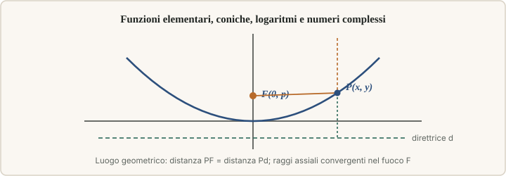

# Capitolo 9 — Funzioni elementari, coniche, logaritmi e numeri complessi

*Dalle coniche come luoghi geometrici alle scale logaritmiche, ai grafici analitici e al piano di Gauss*

## L'eredità geometrica e il limite dell'intuizione

La geometria classica, pur nella sua ineguagliabile eleganza sintetica, incontrava ostacoli strutturali di fronte allo studio di curve non elementari. Come nota Tom Apostol analizzando i fondamenti del calcolo, «non è agevole estendere la definizione di tangente data dagli antichi greci a curve più generali» [^1]. La definizione euclidea di tangente come retta che tocca la curva in un solo punto senza intersecarla funziona perfettamente per la circonferenza, ma fallisce già con curve semplici come la parabola o le cubiche. Era necessario un nuovo linguaggio che saldasse la forma geometrica al rigore dell'algebra.

Questo ponte fu costruito dalla geometria analitica, che permise di tradurre i luoghi geometrici in equazioni e viceversa. La potenza di questo metodo non si limitò all'astrazione matematica, ma offrì immediatamente strumenti per decodificare il mondo fisico. René Descartes, applicando i principi geometrici all'ottica, riuscì a spiegare la formazione dell'arcobaleno calcolando con precisione che «deve apparire un punto molto rosso e molto splendente in ciascuna di quelle gocce le cui linee tracciate verso l’occhio E formano» un angolo di circa 42 gradi rispetto alla luce incidente [^2]. La geometria diventava così la chiave di volta per leggere la natura.

## Le coniche come luoghi geometrici: la parabola

Tra le curve studiate fin dall'antichità, le sezioni coniche assumono un ruolo centrale quando vengono ridefinite come luoghi geometrici nel piano cartesiano. Consideriamo la parabola. Essa è definita rigorosamente come il luogo dei punti del piano equidistanti da un punto fisso detto fuoco, indicato con $F$, e da una retta fissa detta direttrice, indicata con $d$. Se posizioniamo il vertice della parabola nell'origine degli assi, il fuoco nel punto $F(0, c)$ e la direttrice lungo la retta di equazione $y = -c$, possiamo derivarne l'equazione analitica.

Sia $P(x, y)$ un generico punto del luogo. La distanza di $P$ dal fuoco è $\sqrt{x^2 + (y - c)^2}$, mentre la distanza di $P$ dalla direttrice è $|y + c|$. Uguagliando le due distanze e quadrando ambo i membri, otteniamo $x^2 + y^2 - 2cy + c^2 = y^2 + 2cy + c^2$. Semplificando i termini simili, si giunge all'equazione canonica $x^2 = 4cy$, che può essere riscritta come $y = \frac{1}{4c}x^2$. Questa struttura algebrica nasconde proprietà geometriche profonde, come la proprietà riflettente: ogni raggio parallelo all'asse di simmetria viene riflesso esattamente nel fuoco.

Tale proprietà non è una mera curiosità teorica, ma il principio fondante di innumerevoli tecnologie moderne, dai telescopi alle antenne paraboliche. Guglielmo Marconi sfruttò proprio questo principio geometrico nei suoi esperimenti pionieristici sulle microonde, notando che con un riflettore parabolico i segnali potevano essere ricevuti «alla distanza di 150 Km., e cioè a cinque volte la distanza ottica» [^3], superando i limiti imposti dalla curvatura terrestre grazie alla concentrazione del fascio.

*La parabola come luogo dei punti equidistanti dal fuoco F e dalla direttrice d, con proprietà riflettente assiale.*

## Scale logaritmiche e l'analisi delle funzioni

Oltre alle curve algebriche come le coniche, l'analisi matematica si arricchisce delle funzioni trascendenti, tra cui esponenziali e logaritmi. Queste funzioni sono indispensabili per modellizzare fenomeni in cui il tasso di variazione di una grandezza è proporzionale alla grandezza stessa. Nelle scienze applicate, la lettura dei grafici di tali funzioni rivela dinamiche fisiche cruciali; ad esempio, nello studio dei materiali, si osserva che «In conseguenza della formazione del solido, la curva temperatura tempo mostra una diminuzione della pendenza» [^4], un comportamento che l'analisi differenziale permette di quantificare con esattezza.

Per consolidare la comprensione del legame tra espressione analitica e forma grafica, studiamo la funzione $f(x) = |\ln(x - 2)| + 1$. Il dominio richiede che l'argomento del logaritmo sia strettamente positivo, imponendo $x - 2 > 0$, da cui $x > 2$. La retta $x = 2$ costituisce un asintoto verticale, poiché per $x \to 2^+$ la funzione diverge a $+\infty$. La presenza del valore assoluto genera un punto di non derivabilità, specificamente un punto angoloso che funge da minimo globale, nel punto in cui l'argomento del modulo si annulla: $\ln(x - 2) = 0$, che implica $x - 2 = 1$, ovvero $x = 3$. Le coordinate del minimo sono dunque $(3, 1)$.

Per valutare un punto esatto della curva, calcoliamo $f(2 + e) = |\ln(2 + e - 2)| + 1 = |\ln(e)| + 1 = 1 + 1 = 2$. Infine, lo studio del segno dell'argomento rivela la monotonia della funzione: essa risulta decrescente sull'intervallo $(2, 3)$ e strettamente crescente sull'intervallo $(3, +\infty)$. Questo studio analitico a mano, privo dell'ausilio di calcolatrici, educa la mente a dedurre la forma globale di un fenomeno a partire dalle sue proprietà locali e dai suoi invarianti strutturali.

## Il rigore del calcolo e le insidie dell'automatismo

Il passaggio dall'intuizione geometrica al calcolo analitico richiede una vigilanza logica costante. L'applicazione meccanica di formule e teoremi, slegata dalla comprensione delle ipotesi, conduce inevitabilmente all'errore. Giovanni Prodi, discutendo i teoremi di de L'Hôpital per il calcolo dei limiti, avverte severamente: «Piuttosto, vogliamo mettere in guardia il lettore dall’applicare in modo meccanico questi teoremi; infatti, in primo luogo, non è detto» che il limite del quoziente delle derivate esista, anche quando il limite originario è perfettamente determinato [^5]. L'automatismo cieco allontana dalla soluzione, trasformando la matematica in una sterile manipolazione di stringhe.

Similmente, un'impalcatura formale apparentemente ineccepibile può nascondere fallacie strutturali profonde. Tom Apostol evidenzia questo rischio invitando lo studente a «Indicare l'errore nella seguente "dimostrazione" per induzione. Enunciato. Sia data una qualsiasi» affermazione paradossale, come quella che pretende di dimostrare che tutte le ragazze bionde hanno la stessa altezza [^6]. L'errore non risiede nell'algebra, ma nel salto logico del passo induttivo per $n=2$, dove l'intersezione degli insiemi risulta vuota. Il rigore matematico non è dunque sinonimo di pedanteria burocratica, ma di onestà intellettuale: ogni passaggio deve essere giustificato dai principi primi.

## L'estensione del dominio: il piano di Gauss

La necessità di coerenza algebrica spinge la matematica oltre i confini del numero reale. L'equazione $x^2 + 1 = 0$ non ammette soluzioni nel campo dei numeri reali, poiché il quadrato di un numero reale non è mai negativo. Questa impossibilità ha forzato l'introduzione dell'unità immaginaria $i$, definita dalla proprietà fondamentale $i^2 = -1$. I numeri complessi, espressi nella forma $z = a + ib$, trovano la loro naturale rappresentazione geometrica nel piano di Gauss, dove l'asse delle ascisse ospita la parte reale $a$ e l'asse delle ordinate la parte immaginaria $b$.

Inizialmente accolti con sospetto e considerati artefatti privi di riscontro fisico, i numeri complessi si sono rivelati il linguaggio naturale per descrivere fenomeni oscillatori, circuiti in corrente alternata e la meccanica quantistica. La diffidenza verso concetti di cui non si scorge immediatamente l'origine materiale è un tratto ricorrente nella storia del pensiero scientifico. Isaac Newton stesso dovette difendere la legge di gravitazione universale da chi la riteneva un principio inaccettabile, argomentando: «Ma sarà definita la gravità una causa occulta, e per questo nome verrà respinta dalla filosofia, poiché la causa della stessa gravità» rimane ignota [^7]. L'accettazione di un ente matematico o fisico si fonda sulla sua coerenza interna e sulla sua fecondità deduttiva, non sulla sua immediata familiarità.

## Dal ragionamento al simbolo: esempi e verifiche

### Equazione della parabola dal fuoco e vertice

Scrivi l'equazione $y(x)$ della parabola con vertice nell'origine e fuoco in $F(0, 1/2)$, sapendo che il coefficiente direttivo è $a = 1/(4c)$.
1. Identifichiamo le coordinate del fuoco $F(0, c)$. Dal testo sappiamo che $F(0, 1/2)$, quindi la distanza focale è $c = 1/2$.
2. La formula generale per una parabola con vertice nell'origine e asse coincidente con l'asse $y$ è $y = ax^2$, dove $a = \frac{1}{4c}$.
3. Sostituiamo il valore di $c$ nella formula di $a$: $a = \frac{1}{4 \cdot (1/2)}$.
4. Calcoliamo il denominatore: $4 \cdot \frac{1}{2} = 2$.
5. Otteniamo quindi $a = \frac{1}{2}$.
6. Sostituendo $a$ nell'equazione generale, otteniamo l'equazione finale.

**Conclusione.** L'equazione della parabola è $y = \frac{1}{2}x^2$.

### Semplificazione esatta di logaritmi

Calcola il valore esatto dell'espressione $\log_3(243) - \log_3(3)$ senza l'uso della calcolatrice.
1. Applichiamo la proprietà del quoziente dei logaritmi: $\log_b(x) - \log_b(y) = \log_b(\frac{x}{y})$.
2. Riscriviamo l'espressione come $\log_3(\frac{243}{3})$.
3. Eseguiamo la divisione all'interno dell'argomento: $243 / 3 = 81$.
4. L'espressione diventa $\log_3(81)$.
5. Cerchiamo l'esponente da dare alla base $3$ per ottenere $81$. Sappiamo che $3^1 = 3$, $3^2 = 9$, $3^3 = 27$, $3^4 = 81$.
6. Pertanto, $\log_3(81) = 4$.

**Conclusione.** Il valore esatto dell'espressione è $4$.

### Prodotto di numeri complessi nel piano di Gauss

Calcola il prodotto dei numeri complessi $(2 + 3i)(1 + 4i)$, ricordando che $i^2 = -1$.
1. Applichiamo la proprietà distributiva della moltiplicazione rispetto all'addizione: $(2 + 3i)(1 + 4i) = 2 \cdot 1 + 2 \cdot 4i + 3i \cdot 1 + 3i \cdot 4i$.
2. Svolgiamo i singoli prodotti: $2 + 8i + 3i + 12i^2$.
3. Sommiamo i termini immaginari simili: $8i + 3i = 11i$. L'espressione diventa $2 + 11i + 12i^2$.
4. Sostituiamo $i^2$ con $-1$: $2 + 11i + 12(-1) = 2 + 11i - 12$.
5. Sommiamo le parti reali: $2 - 12 = -10$.

**Conclusione.** Il prodotto dei due numeri complessi è $-10 + 11i$.

### Esercizi di verifica attiva
1. L'ellisse di equazione $\frac{x^2}{25} + \frac{y^2}{9} = 1$ ha semiassi $a=5$ e $b=3$. Calcola il valore esatto della semidistanza focale $c$.
2. Determina il dominio e l'equazione dell'asintoto verticale della funzione $g(x) = \ln(5 - x) - 2$.
3. Calcola il quoziente $\frac{1 + i}{1 - i}$ moltiplicando numeratore e denominatore per il complesso coniugato del denominatore.
4. Fornisci un controesempio che mostri come l'applicazione della regola di de L'Hôpital al limite $\lim_{x \to +\infty} \frac{x + \sin(x)}{x}$ sia inconcludente, e risolvi il limite con metodi elementari.

## Apparato delle fonti

### [Verificato sul testo]
[^1]: [block_pk=113992 | block_uid=blk_7094aa36a26cb080f785] «non è agevole estendere la definizione di tangente data dagli antichi greci a curve più generali» — Tom Apostol, Calcolo - Analisi 1. 1-Bollati Boringhieri (1987) (p. 210)
[^2]: [block_pk=30020 | block_uid=blk_161bcfb6d74610e85ad2] «deve apparire un punto molto rosso e molto splendente in ciascuna di quelle gocce le cui linee tracciate verso l’occhio E formano» — GéométrieBompianiCartesio (p. 24)
[^3]: [block_pk=28377 | block_uid=blk_38cd031fe3a6461abb45] «alla distanza di 150 Km., e cioè a cinque volte la distanza ottica» — Giancarlo Masini, Guglielmo Marconi (1975, UTET) (p. 493)
[^4]: [block_pk=21100 | block_uid=blk_5e5245b8a33d3862efd1] «In conseguenza della formazione del solido, la curva temperatura tempo mostra una diminuzione della pendenza» — Daniele Mazza, Materiali per l'elettrotecnica (p. 53)
[^5]: [block_pk=28721 | block_uid=blk_b47af92643f159b83f07] «Piuttosto, vogliamo mettere in guardia il lettore dall’applicare in modo meccanico questi teoremi; infatti, in primo luogo, non è detto» — Giovanni Prodi, Analisi Matematica (1970,2003, Bollati Boringhieri) (p. 262)
[^6]: [block_pk=113840 | block_uid=blk_2d512a770053199dc8f2] «Indicare l'errore nella seguente "dimostrazione" per induzione. Enunciato. Sia data una qualsiasi» — Tom Apostol, Calcolo - Analisi 1. 1-Bollati Boringhieri (1987) (p. 46)
[^7]: [block_pk=114211 | block_uid=blk_cf78c45ef38f19218150] «Ma sarà definita la gravità una causa occulta, e per questo nome verrà respinta dalla filosofia, poiché la causa della stessa gravità» — Isaac Newton, a cura di Alberto Pala, Principi matematici della Filosofia naturale (1965, UTET) (p. 71)

### [Ricostruzione matematica / addestramento]
- La trattazione della parabola è stata costruita partendo rigorosamente dalla definizione di luogo geometrico, derivando l'equazione passo dopo passo per evitare l'imposizione di formule pre-confezionate, in linea con lo stile di Frajese e Prodi.
- L'inserimento della funzione con valore assoluto e logaritmo risponde alla direttiva sugli invarianti grafici, permettendo di collegare la manipolazione algebrica (dominio, annullamento dell'argomento) alla visualizzazione geometrica (asintoti, punti angolosi).
- Le citazioni storiche (Descartes, Newton) sono state integrate non come ornamento erudito, ma come prova della fatica concettuale necessaria per accettare nuovi enti matematici, parallelamente alla fatica richiesta allo studente per padroneggiare il piano di Gauss.
- Diagramma geometrico-simbolico controllato (`parabola_focal_rays`): La parabola come luogo dei punti equidistanti dal fuoco F e dalla direttrice d, con proprietà riflettente assiale.

### [Esercizi originali]
- L'ellisse di equazione $\frac{x^2}{25} + \frac{y^2}{9} = 1$ ha semiassi $a=5$ e $b=3$. Calcola il valore esatto della semidistanza focale $c$. — *Traccia di verifica:* Per l'ellisse vale la relazione $c = \sqrt{a^2 - b^2}$. Sostituendo i valori si ha $c = \sqrt{25 - 9} = \sqrt{16} = 4$.
- Determina il dominio e l'equazione dell'asintoto verticale della funzione $g(x) = \ln(5 - x) - 2$. — *Traccia di verifica:* L'argomento del logaritmo deve essere positivo: $5 - x > 0 \implies x < 5$. Il dominio è $(-\infty, 5)$. L'asintoto verticale si trova dove l'argomento si annulla, ovvero la retta $x = 5$.
- Calcola il quoziente $\frac{1 + i}{1 - i}$ moltiplicando numeratore e denominatore per il complesso coniugato del denominatore. — *Traccia di verifica:* Moltiplicando per $\frac{1 + i}{1 + i}$ si ottiene al numeratore $(1+i)^2 = 1 + 2i + i^2 = 2i$ e al denominatore $1^2 - i^2 = 1 - (-1) = 2$. Il risultato è $\frac{2i}{2} = i$.
- Fornisci un controesempio che mostri come l'applicazione della regola di de L'Hôpital al limite $\lim_{x \to +\infty} \frac{x + \sin(x)}{x}$ sia inconcludente, e risolvi il limite con metodi elementari. — *Traccia di verifica:* Derivando numeratore e denominatore si ottiene $\lim_{x \to +\infty} \frac{1 + \cos(x)}{1}$, che non esiste a causa dell'oscillazione del coseno. Tuttavia, raccogliendo $x$, il limite originale diventa $\lim_{x \to +\infty} (1 + \frac{\sin(x)}{x}) = 1 + 0 = 1$.
- **Palestra simbolica (`drill_p0_functions_parabola`):** Scrivi l'equazione y(x) della parabola con vertice nell'origine e fuoco in F(0, 1/2) sapendo che a = 1/(4c). *(Risposta verificata: `1/2*x**2`)*
- **Palestra simbolica (`drill_conics_loci`):** L'ellisse x^2/25 + y^2/9 = 1 ha semiassi a=5 e b=3: quanto vale la semidistanza focale c? *(Risposta verificata: `4`)*
- **Palestra simbolica (`drill_logarithms_exp`):** Calcola il valore esatto di log_3(243) - log_3(3) senza calcolatrice. *(Risposta verificata: `4`)*
- **Palestra simbolica (`drill_complex_numbers`):** Nel piano di Gauss calcola il prodotto (2 + 3*i)*(1 + 4*i) ricordando i^2 = -1 (usa i o I). *(Risposta verificata: `-10 + 11*I`)*
