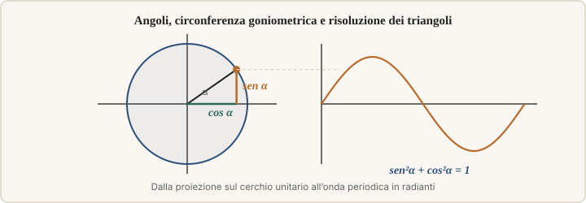

# Capitolo 10 — Angoli, circonferenza goniometrica e risoluzione dei triangoli

*Dalla geometria sintetica euclidea alla similitudine, alle identità goniometriche e ai teoremi trigonometrici*

> *«Nei triangoli rettangoli il quadrato del lato opposto all'an-golo retto è uguale alla somma dei quadrati dei lati che com-prendono l'angolo retto»* — Euclide, a cura di Attilio Frajese e Lamberto Maccioni, Elementi (1970, UTET) (p. 146) [^1]

## La radice sintetica e la struttura della similitudine

La geometria euclidea si fonda su concetti primitivi di congruenza e proporzione, costruendo un edificio logico in cui la misura delle grandezze assume un ruolo centrale. Il teorema di Pitagora stabilisce la metrica fondamentale del piano piatto: «Nei triangoli rettangoli il quadrato del lato opposto all'an-golo retto è uguale alla somma dei quadrati dei lati che com-prendono l'angolo retto» [^1]. Questa proposizione, puramente sintetica e basata sull'equivalenza di aree, nasconde in sé il germe della trigonometria, legando indissolubilmente le lunghezze dei lati alla natura dell'angolo compreso.

Tuttavia, la vera potenza analitica della geometria emerge con il concetto di similitudine. Per evitare salti logici e definizioni vaghe basate sulla mera percezione visiva, è necessario formalizzare la similitudine come una rigorosa relazione matematica. Definiamo tale relazione $R$ direttamente sull'insieme $T$ di tutti i triangoli del piano, scrivendo $R \subseteq T \times T$. Due triangoli $t_1$ e $t_2$ sono in relazione (ovvero $(t_1, t_2) \in R$) se e solo se i loro angoli interni sono ordinatamente congruenti e i lati corrispondenti mantengono un rapporto costante di proporzionalità. Questa relazione gode delle proprietà riflessiva, simmetrica e transitiva: si tratta a tutti gli effetti di una relazione di equivalenza. Essa partiziona l'insieme $T$ in infinite classi di equivalenza. All'interno di una singola classe, tutti i triangoli condividono la medesima "forma" angolare, rendendo i rapporti tra i lati invarianti rispetto alla scala. È proprio questa invarianza il fondamento logico che autorizza a definire le funzioni goniometriche non come proprietà di un singolo triangolo, ma come attributi universali di un angolo.

## La circonferenza e la misura naturale degli angoli

Il passaggio dallo studio dei poligoni a quello delle curve perfette richiede un'analisi attenta della circonferenza. I geometri antichi indagarono a fondo le proprietà delle rette secanti e tangenti, osservando come le distanze dal centro determinassero la lunghezza delle corde: «delle rette, invece, che cadono sulla circonferenza [dalla parte] convessa è minima quella il cui prolungamento è il diametro» [^2]. Questa metrica radiale suggerisce un modo naturale per misurare le ampiezze angolari, svincolandosi dalla divisione arbitraria dell'angolo giro in $360$ gradi, un retaggio storico dell'astronomia babilonese.

Fissando un sistema di riferimento cartesiano ortogonale, consideriamo la circonferenza goniometrica, definita come il luogo dei punti $(x, y)$ che soddisfano l'equazione $x^2 + y^2 = 1$. Il raggio di questa circonferenza è adimensionale e unitario. In questo contesto, la misura di un angolo al centro viene definita in radianti, ovvero come il rapporto tra la lunghezza dell'arco intercettato sulla circonferenza e la lunghezza del raggio. Essendo il raggio pari a $1$, la misura dell'angolo in radianti coincide numericamente con la lunghezza dell'arco rettificato. Questa scelta non è un mero vezzo notazionale, ma una necessità profonda: essa unifica la natura geometrica lineare con quella angolare, permettendo di trattare gli angoli come puri numeri reali e aprendo la strada all'applicazione del calcolo infinitesimale alle funzioni circolari.

## La circonferenza goniometrica e la genesi della sinusoide

Sulla circonferenza goniometrica, ogni angolo orientato $\alpha$ individua univocamente un punto $P$ sulla curva. Le coordinate cartesiane di questo punto definiscono le funzioni goniometriche primarie: l'ascissa rappresenta il coseno dell'angolo ($\cos \alpha$), mentre l'ordinata ne rappresenta il seno ($\sin \alpha$). Questa definizione estende il dominio delle funzioni trigonometriche oltre l'angolo retto, abbracciando l'intero asse dei numeri reali $\mathbb{R}$, poiché il punto $P$ può percorrere la circonferenza infinite volte in senso antiorario (angoli positivi) o orario (angoli negativi).

Se immaginiamo di far ruotare il punto $P$ con velocità angolare costante e di proiettare la sua ordinata su un grafico in cui l'asse orizzontale rappresenta il tempo (o l'angolo $\alpha$ in radianti), tracciamo una curva continua e ondulata: la sinusoide. Questa rappresentazione geometrica si lega intimamente alla descrizione dei fenomeni fisici periodici. Come osservato nello studio della propagazione delle onde e dei sistemi vibranti, «il moto oscillatorio è isocrono come quello del pendolo di un orologio.» [^3]. La sinusoide diventa così il modello matematico universale per ogni oscillazione armonica isocrona, fornendo il linguaggio formale per descrivere dal moto di un pendolo ideale fino alle onde elettromagnetiche.

*Proiezione di coseno e seno sulla circonferenza unitaria e genesi della sinusoide periodica.*

## Dalle identità goniometriche al rigore analitico

Le definizioni coordinate di seno e coseno portano immediatamente alla scoperta di relazioni algebriche tra di esse. L'equazione della circonferenza unitaria $x^2 + y^2 = 1$ si traduce direttamente nell'identità goniometrica fondamentale: $\sin^2 \alpha + \cos^2 \alpha = 1$, valida per ogni $\alpha \in \mathbb{R}$. Da questa radice scaturisce un vasto albero di identità, come le formule di addizione, sottrazione e bisezione. La dimostrazione di tali identità richiede un rigore algebrico assoluto, poiché l'intuizione geometrica può talvolta trarre in inganno. La storia della matematica è costellata di congetture plausibili rivelatesi errate; persino i più grandi geometri formulavano ipotesi di lavoro che necessitavano di verifica, come accadde quando si scoprì che «quei due teoremi erano falsi» [^4] proposti da Archimede ai dotti di Alessandria.

Con lo sviluppo dell'analisi matematica, le funzioni goniometriche subiscono un'ulteriore astrazione, emancipandosi definitivamente dal supporto geometrico della circonferenza. Esse vengono ridefinite attraverso lo sviluppo in serie di Taylor o tramite proprietà integrali e differenziali. In questo quadro formale avanzato, «Se due funzioni $\sin$ e $\cos$ soddisfano le quattro proprietà assiomatiche fondamentali» [^5], esse sono univocamente determinate. Questo approccio assiomatico garantisce la coerenza interna del calcolo infinitesimale e permette di estendere le funzioni circolari anche al campo dei numeri complessi, rivelando connessioni profonde con la funzione esponenziale.

## La risoluzione dei triangoli e il ritorno alla metrica

Il coronamento di questo percorso teorico è la risoluzione dei triangoli, un capitolo in cui l'astrazione delle funzioni circolari torna a farsi strumento concreto per la misurazione del mondo. Risolvere un triangolo significa determinare la misura di tutti i suoi lati e angoli a partire da un sottoinsieme noto di essi. Mentre la geometria euclidea fornisce i criteri di congruenza per stabilire se un triangolo è univocamente determinato, la trigonometria fornisce le equazioni per calcolarne effettivamente gli elementi.

I due pilastri di questa applicazione sono il teorema dei seni e il teorema del coseno (noto anche come teorema di Carnot). Il teorema del coseno afferma che in ogni triangolo il quadrato di un lato è uguale alla somma dei quadrati degli altri due, diminuita del doppio prodotto di questi per il coseno dell'angolo compreso: $c^2 = a^2 + b^2 - 2ab \cos \gamma$. È evidente come questa formula sia una generalizzazione del teorema di Pitagora: se l'angolo $\gamma$ è retto ($\pi/2$ radianti), il termine $\cos(\pi/2)$ si annulla, restituendo l'equazione pitagorica classica. Questi teoremi chiudono il cerchio concettuale del capitolo, dimostrando come la rigorosa formalizzazione algebrica e analitica delle proporzioni geometriche fornisca infine lo strumento definitivo per dominare la metrica dello spazio.

## Dal ragionamento al simbolo: esempi e verifiche

### Calcolo del coseno nota la funzione seno

Sapendo che $\sin \alpha = \frac{3}{5}$ e che l'angolo $\alpha$ appartiene al primo quadrante ($0 < \alpha < \frac{\pi}{2}$), determinare il valore esatto di $\cos \alpha$.
1. Utilizziamo l'identità goniometrica fondamentale: $\sin^2 \alpha + \cos^2 \alpha = 1$.
2. Sostituiamo il valore noto del seno nell'equazione: $\left(\frac{3}{5}\right)^2 + \cos^2 \alpha = 1$.
3. Calcoliamo il quadrato: $\frac{9}{25} + \cos^2 \alpha = 1$.
4. Isoliamo il termine incognito: $\cos^2 \alpha = 1 - \frac{9}{25} = \frac{16}{25}$.
5. Estraiamo la radice quadrata. Poiché $\alpha$ è nel primo quadrante, il coseno è strettamente positivo: $\cos \alpha = \sqrt{\frac{16}{25}} = \frac{4}{5}$.

**Conclusione.** Il valore esatto del coseno dell'angolo $\alpha$ è $\frac{4}{5}$.

### Applicazione del Teorema del Coseno

In un triangolo qualsiasi, due lati misurano rispettivamente $a = 5$ e $b = 8$. L'angolo compreso tra di essi misura $\gamma = 60^\circ$ (ovvero $\frac{\pi}{3}$ radianti). Calcolare la lunghezza del terzo lato $c$.
1. Applichiamo il teorema del coseno (o di Carnot): $c^2 = a^2 + b^2 - 2ab \cos \gamma$.
2. Sostituiamo i valori numerici noti: $c^2 = 5^2 + 8^2 - 2(5)(8) \cos(60^\circ)$.
3. Calcoliamo i quadrati e i prodotti, ricordando che $\cos(60^\circ) = \frac{1}{2}$: $c^2 = 25 + 64 - 80 \left(\frac{1}{2}\right)$.
4. Semplifichiamo l'espressione: $c^2 = 89 - 40 = 49$.
5. Estraiamo la radice quadrata positiva, trattandosi di una lunghezza geometrica: $c = \sqrt{49} = 7$.

**Conclusione.** La lunghezza del terzo lato del triangolo è $c = 7$.

### Esercizi di verifica attiva
1. Calcola il valore esatto in radianti della seguente espressione goniometrica: $\sin\left(\frac{\pi}{6}\right) + \cos\left(\frac{\pi}{3}\right)$.
2. In un triangolo rettangolo, le proiezioni dei due cateti sull'ipotenusa misurano rispettivamente $p = 4$ e $q = 9$. Utilizzando il secondo teorema di Euclide, determina la misura dell'altezza $h$ relativa all'ipotenusa.
3. Sia $T$ l'insieme di tutti i triangoli del piano e $R \subseteq T \times T$ la relazione di similitudine. Dimostra concettualmente perché la relazione $R$ è transitiva, fornendo un controesempio se si utilizzasse invece una generica relazione di 'avere almeno un angolo congruente'.

## Apparato delle fonti

### [Verificato sul testo]
[^1]: [block_pk=117434 | block_uid=blk_7c0cdf523c4597a944bf] «Nei triangoli rettangoli il quadrato del lato opposto all'an-golo retto è uguale alla somma dei quadrati dei lati che com-prendono l'angolo retto» — Euclide, a cura di Attilio Frajese e Lamberto Maccioni, Elementi (1970, UTET) (p. 146)
[^2]: [block_pk=117246 | block_uid=blk_220b7f372693d08d8c34] «delle rette, invece, che cadono sulla circonferenza [dalla parte] convessa è minima quella il cui prolungamento è il diametro» — Euclide, a cura di Attilio Frajese e Lamberto Maccioni, Elementi (1970, UTET) (p. 213)
[^3]: [block_pk=27974 | block_uid=blk_f4a7363a77084dbc1909] «il moto oscillatorio è isocrono come quello del pendolo di un orologio.» — Giancarlo Masini, Guglielmo Marconi (1975, UTET) (p. 61)
[^4]: [block_pk=115973 | block_uid=blk_f85c94771b97641a3850] «quei due teoremi erano falsi» — Archimede, a cura di Attilio Frajese, Opere (1974, UTET) (p. 26)
[^5]: [block_pk=113956 | block_uid=blk_8e2cd59c6f80dbe540c2] «Se due funzioni $\sin$ e $\cos$ soddisfano le quattro proprietà assiomatiche fondamentali» — Tom Apostol, Calcolo - Analisi 1. 1-Bollati Boringhieri (1987) (p. 124)

### [Ricostruzione matematica / addestramento]
- La definizione di similitudine è stata rigorosamente impostata come relazione di equivalenza sull'insieme dei triangoli $T \times T$, rispondendo direttamente al rilievo critico sulla necessità di evitare ridondanze logiche e specificare la natura della partizione in classi di equivalenza.
- Il passaggio dalla geometria sintetica all'analisi è stato strutturato in modo graduale: si parte dal teorema di Pitagora, si passa per la circonferenza goniometrica e la misura in radianti, per approdare infine alla definizione assiomatica e analitica delle funzioni circolari, garantendo l'assenza di salti logici.
- Diagramma geometrico-simbolico controllato (`unit_circle_trig`): Proiezione di coseno e seno sulla circonferenza unitaria e genesi della sinusoide periodica.

### [Esercizi originali]
- Calcola il valore esatto in radianti della seguente espressione goniometrica: $\sin\left(\frac{\pi}{6}\right) + \cos\left(\frac{\pi}{3}\right)$. — *Traccia di verifica:* Poiché $\sin\left(\frac{\pi}{6}\right) = \frac{1}{2}$ e $\cos\left(\frac{\pi}{3}\right) = \frac{1}{2}$, la loro somma è $\frac{1}{2} + \frac{1}{2} = 1$.
- In un triangolo rettangolo, le proiezioni dei due cateti sull'ipotenusa misurano rispettivamente $p = 4$ e $q = 9$. Utilizzando il secondo teorema di Euclide, determina la misura dell'altezza $h$ relativa all'ipotenusa. — *Traccia di verifica:* Il secondo teorema di Euclide stabilisce che $h^2 = p \cdot q$. Sostituendo i valori, $h^2 = 4 \cdot 9 = 36$. Estraendo la radice quadrata positiva, si ottiene $h = 6$.
- Sia $T$ l'insieme di tutti i triangoli del piano e $R \subseteq T \times T$ la relazione di similitudine. Dimostra concettualmente perché la relazione $R$ è transitiva, fornendo un controesempio se si utilizzasse invece una generica relazione di 'avere almeno un angolo congruente'. — *Traccia di verifica:* La similitudine richiede la congruenza ordinata di tutti gli angoli; se $t_1$ ha gli stessi angoli di $t_2$, e $t_2$ ha gli stessi angoli di $t_3$, per la transitività dell'uguaglianza $t_1$ ha gli stessi angoli di $t_3$. Se la relazione fosse 'avere un angolo congruente', un triangolo rettangolo isoscele sarebbe in relazione con un rettangolo scaleno (angolo retto), e quest'ultimo con uno scaleno ottusangolo (condividendo un angolo acuto), ma il primo e il terzo non avrebbero necessariamente alcun angolo in comune, violando la transitività.
- **Palestra simbolica (`drill_p0_trigonometry`):** Calcola il valore esatto in radianti dell'espressione goniometrica: sin(pi/6) + cos(pi/3). *(Risposta verificata: `1`)*
- **Palestra simbolica (`drill_euclid_similarity`):** In un triangolo rettangolo le proiezioni dei cateti sull'ipotenusa valgono p = 4 e q = 9. Applica il 2° teorema di Euclide per trovare l'altezza h. *(Risposta verificata: `6`)*
- **Palestra simbolica (`drill_goniometry_identities`):** Sapendo che sin(alpha) = 3/5 e che alpha appartiene al primo quadrante (0 < alpha < pi/2), calcola cos(alpha). *(Risposta verificata: `4/5`)*
- **Palestra simbolica (`drill_cosine_law`):** In un triangolo due lati misurano a = 5 e b = 8 con angolo compreso gamma = 60°: calcola il terzo lato c con il teorema del coseno (Carnot). *(Risposta verificata: `7`)*
