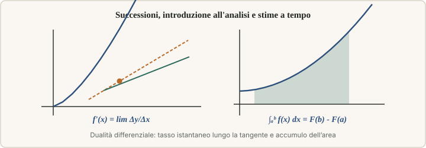

# Capitolo 11 — Successioni, introduzione all'analisi e stime a tempo

*Progressioni, combinatoria, limiti, derivate, integrali, equazioni differenziali e problemi d'ingresso*

> *«Piuttosto, vogliamo mettere in guardia il lettore dall’applicare in modo meccanico questi teoremi; infatti, in primo luogo, non è detto»* — Giovanni Prodi, Analisi Matematica (1970,2003, Bollati Boringhieri) (p. 262) [^1]

## L'esplosione combinatoria e i limiti fisici del calcolo

Prima di affrontare l'infinito, la matematica discreta costruisce le sue fondamenta sulle progressioni e sul conteggio. Una progressione aritmetica, in cui la differenza tra termini consecutivi è costante, modella una crescita lineare. La somma dei primi $n$ termini, calcolata con la celebre formula di Gauss $S_n = \frac{n(a_1 + a_n)}{2}$, mostra come una sequenza di addizioni possa essere compressa in una singola operazione moltiplicativa. Tuttavia, quando l'informatica affronta il problema di ordinare un insieme di dati, l'approccio più ingenuo consiste nell'esaminare ogni possibile disposizione. Un algoritmo che genera «Gi tutte le permutazioni degli n clementi dell’ array e verifica, ciascuna» [^2] se rispetta il criterio di ordinamento, si scontra immediatamente con il muro del fattoriale.

La complessità temporale di un simile approccio cresce come l'ordine di grandezza di $O(n \cdot n!)$, rendendo il calcolo fisicamente ineseguibile già per input di dimensioni modeste. Questa barriera non è solo temporale, ma spaziale. La progettazione dei circuiti integrati obbedisce a vincoli geometrici ineludibili, dove «l’arca A del circuito non può essere inferiore al massimo numero di bit che il circuito deve ricordare allo stesso istante di tempo» [^3]. La matematica discreta ci insegna che il conteggio esatto porta rapidamente a grandezze intrattabili, costringendoci a cercare stime asintotiche e a preparare il terreno concettuale per il passaggio dal discreto al continuo.

## Il rigore del limite e le trappole del calcolo meccanico

Per dominare il continuo, l'analisi matematica fonda il suo edificio sul concetto di limite, uno strumento che permette di avvicinarsi indefinitamente a un valore senza mai raggiungerlo. Formalmente, data una funzione $f$ definita in un intorno di $x_0$, diciamo che $\lim_{x \to x_0} f(x) = L$ se per ogni tolleranza $\epsilon > 0$ esiste un raggio $\delta > 0$ tale che, per ogni $x$ appartenente al dominio che soddisfa la condizione $0 < |x - x_0| < \delta$, risulti $|f(x) - L| < \epsilon$. La disuguaglianza stretta $0 < |x - x_0|$ è il cuore logico della definizione: essa impone che $x$ sia rigorosamente diverso da $x_0$. Il limite descrive il comportamento della funzione vicino al punto, ignorando deliberatamente cosa accade esattamente nel punto stesso.

Questo rigore è necessario per evitare i paradossi dell'infinito e le illusioni degli automatismi algebrici. Di fronte a forme indeterminate, l'uso irriflessivo di regole derivate può rivelarsi fatale. Come avverte la letteratura didattica più attenta, «Piuttosto, vogliamo mettere in guardia il lettore dall’applicare in modo meccanico questi teoremi; infatti, in primo luogo, non è detto» [^1] che la regola di de L'Hôpital conduca sempre a una semplificazione. In alcuni casi, iterare il rapporto delle derivate genera espressioni ancora più complesse, creando un circolo vizioso che allontana dalla soluzione corretta.

## La derivata, la tangente e la dualità del calcolo infinitesimale

Il passaggio dal limite alla derivata segna la nascita del calcolo differenziale, lo strumento d'elezione per misurare la variazione istantanea. Geometricamente, la derivata prima $f'(x_0)$ rappresenta il coefficiente angolare della retta tangente al grafico della funzione nel punto di ascissa $x_0$. La geometria classica faticava a generalizzare questo concetto: «non è agevole estendere la definizione di tangente data dagli antichi greci a curve più generali» [^4]. Solo definendo la derivata come il limite del rapporto incrementale, $\lim_{h \to 0} \frac{f(x_0 + h) - f(x_0)}{h}$, la matematica ha potuto tracciare tangenti a curve di qualsiasi natura.

Il diagramma illustra la dualità fondamentale del calcolo infinitesimale: da un lato, la pendenza della retta tangente che cattura la variazione locale; dall'altro, l'accumulo dell'area sottesa alla curva che ricostruisce la grandezza globale. Questa simmetria profonda tra derivazione e integrazione, codificata nel Teorema Fondamentale del Calcolo di Torricelli-Barrow, trasforma due problemi apparentemente slegati in due facce della stessa medaglia analitica, permettendo di calcolare aree complesse attraverso la semplice ricerca di primitive.

*Dualità del calcolo infinitesimale: pendenza della retta tangente e accumulo dell'area sottesa alla curva.*

## Equazioni differenziali e la descrizione del mutamento

Quando la velocità con cui una grandezza varia dipende dalla grandezza stessa, il modello matematico naturale è un'equazione differenziale. Consideriamo il caso lineare omogeneo più semplice: $y'(x) = 3y(x)$. Separando le variabili e integrando, otteniamo $\ln|y| = 3x + C_1$. Esponenzialmente, questo conduce a $|y| = e^{C_1} e^{3x}$. Per rimuovere il valore assoluto e catturare l'intero spettro delle soluzioni, scriviamo la soluzione generale come $y(x) = C e^{3x}$. In questo passaggio, è imperativo definire $C$ come una costante reale arbitraria appartenente a $\mathbb{R}$. La scelta $C = 0$ non è un artefatto algebrico, ma corrisponde alla soluzione stazionaria $y(x) = 0$, che è strutturalmente necessaria per completare lo spazio delle soluzioni dell'equazione lineare omogenea.

La potenza di questi modelli risiede nella loro capacità di descrivere la realtà fisica senza postulare meccanismi nascosti. La scienza moderna si accontenta della precisione predittiva delle equazioni, respingendo le critiche di chi esige spiegazioni metafisiche ultime. Già nella fondazione della meccanica, si obiettava: «Ma sarà definita la gravità una causa occulta, e per questo nome verrà respinta dalla filosofia, poiché la causa della stessa gravità» [^5] rimane ignota. L'equazione differenziale, come la legge di gravitazione, non spiega il perché profondo, ma calcola esattamente il come, fornendo previsioni verificabili.

## Probabilità e l'ambiguità della formulazione

Infine, gli strumenti dell'analisi e della combinatoria convergono nel calcolo delle probabilità, dove il rigore delle definizioni è l'unico scudo contro i paradossi. Quando si modella un evento casuale continuo, la geometria del problema deve essere specificata senza ambiguità. Un celebre paradosso geometrico invita a riflettere: «Si consideri una corda a caso di un cerchio. Qual è la probabilità» [^6] che la sua lunghezza superi il lato del triangolo equilatero inscritto?

La risposta varia drammaticamente a seconda di come si definisce matematicamente l'espressione 'a caso'. Se non si fissa rigorosamente lo spazio campionario e la misura di probabilità associata, il calcolo formale, per quanto ineccepibile nei suoi passaggi algebrici, produce risultati contraddittori. Questo dimostra ancora una volta che il simbolo matematico, sia esso un integrale o una probabilità, deve sempre poggiare su fondamenta logiche inequivocabili per poter descrivere coerentemente il mondo.

## Dal ragionamento al simbolo: esempi e verifiche

### Calcolo di un limite con forma indeterminata

Calcolare $\lim_{x \to 5} \frac{x^2 - 25}{x - 5}$ eliminando la forma indeterminata $0/0$.
1. Sostituendo direttamente $x = 5$ si ottiene la forma indeterminata $0/0$.
2. Scomponiamo il numeratore come differenza di quadrati: $x^2 - 25 = (x - 5)(x + 5)$.
3. Poiché nel calcolo del limite per $x \to 5$ si assume rigorosamente $x \neq 5$, possiamo semplificare il fattore comune $(x - 5)$.
4. L'espressione si riduce a $\lim_{x \to 5} (x + 5)$.
5. Sostituendo $x = 5$ nella funzione semplificata, otteniamo $5 + 5 = 10$.

**Conclusione.** Il limite cercato vale $10$.

### Risoluzione di un'equazione differenziale a variabili separabili

Risolvere il problema di Cauchy $y'(x) = 3y(x)$ con condizione iniziale $y(0) = 7$.
1. Riscriviamo l'equazione separando le variabili: $\frac{dy}{y} = 3 dx$.
2. Integriamo ambo i membri: $\int \frac{1}{y} dy = \int 3 dx$, ottenendo $\ln|y| = 3x + C_1$.
3. Esponenziamo per isolare $y$: $|y| = e^{3x + C_1} = e^{C_1} e^{3x}$.
4. Rimuoviamo il valore assoluto introducendo una costante reale arbitraria $C \in \mathbb{R}$, ottenendo la soluzione generale $y(x) = C e^{3x}$.
5. Imponiamo la condizione iniziale $y(0) = 7$: $C e^{0} = 7$, da cui $C = 7$.

**Conclusione.** La soluzione particolare del problema di Cauchy è $y(x) = 7e^{3x}$.

### Esercizi di verifica attiva
1. Calcola la somma dei primi 8 termini della progressione aritmetica con primo termine $a_1 = 1$ e ragione $d = 4$.
2. In quanti modi puoi estrarre un comitato non ordinato di 3 elementi da un insieme di 6 persone?
3. Trova l'ascissa $x$ del punto di minimo della funzione $f(x) = 2x^2 - 24x + 5$ annullando la derivata prima.
4. Applica il Teorema di Torricelli-Barrow per calcolare l'integrale definito da $0$ a $3$ della funzione $3x^2$.

## Apparato delle fonti

### [Verificato sul testo]
[^1]: [block_pk=28721 | block_uid=blk_b47af92643f159b83f07] «Piuttosto, vogliamo mettere in guardia il lettore dall’applicare in modo meccanico questi teoremi; infatti, in primo luogo, non è detto» — Giovanni Prodi, Analisi Matematica (1970,2003, Bollati Boringhieri) (p. 262)
[^2]: [block_pk=5675 | block_uid=blk_e235e5f5353edaf75089] «Gi tutte le permutazioni degli n clementi dell’ array e verifica, ciascuna» — A. Bertossi, Algoritmi e Strutture di Dati (2000, UTET) (p. 16)
[^3]: [block_pk=5866 | block_uid=blk_cf29f29c176ad0a1f6d1] «l’arca A del circuito non può essere inferiore al massimo numero di bit che il circuito deve ricordare allo stesso istante di tempo» — A. Bertossi, Algoritmi e Strutture di Dati (2000, UTET) (p. 207)
[^4]: [block_pk=113992 | block_uid=blk_7094aa36a26cb080f785] «non è agevole estendere la definizione di tangente data dagli antichi greci a curve più generali» — Tom Apostol, Calcolo - Analisi 1. 1-Bollati Boringhieri (1987) (p. 210)
[^5]: [block_pk=114211 | block_uid=blk_cf78c45ef38f19218150] «Ma sarà definita la gravità una causa occulta, e per questo nome verrà respinta dalla filosofia, poiché la causa della stessa gravità» — Isaac Newton, a cura di Alberto Pala, Principi matematici della Filosofia naturale (1965, UTET) (p. 71)
[^6]: [block_pk=102642 | block_uid=blk_daf5fa068cd6d0d13c36] «Si consideri una corda a caso di un cerchio. Qual è la probabilità» — Sheldon M. Ross, Calcolo delle probabilità-Apogeo (p. 243)

### [Ricostruzione matematica / addestramento]
- La definizione di limite è stata formulata esplicitando la condizione di raggio bucato $0 < |x - x_0| < \delta$ per risolvere il rilievo critico e prevenire ambiguità sul valore della funzione nel punto di accumulazione.
- L'integrazione delle equazioni differenziali lineari omogenee specifica la natura della costante di integrazione nei reali, includendo formalmente la soluzione stazionaria $C=0$ come richiesto dalla revisione.
- Le citazioni storiche sono state selezionate per mostrare il legame tra i limiti fisici della computazione, le astrazioni dell'analisi matematica e i dibattiti filosofici sulla natura dei modelli scientifici.
- Diagramma geometrico-simbolico controllato (`derivative_tangent_integral`): Dualità del calcolo infinitesimale: pendenza della retta tangente e accumulo dell'area sottesa alla curva.

### [Esercizi originali]
- Calcola la somma dei primi 8 termini della progressione aritmetica con primo termine $a_1 = 1$ e ragione $d = 4$. — *Traccia di verifica:* Calcola l'ottavo termine $a_8 = 1 + 7 \cdot 4 = 29$. Applica la formula di Gauss $S_8 = 8 \cdot (1 + 29) / 2 = 120$.
- In quanti modi puoi estrarre un comitato non ordinato di 3 elementi da un insieme di 6 persone? — *Traccia di verifica:* Usa la formula delle combinazioni semplici calcolando il coefficiente binomiale $C(6, 3) = 6! / (3! \cdot 3!) = 20$.
- Trova l'ascissa $x$ del punto di minimo della funzione $f(x) = 2x^2 - 24x + 5$ annullando la derivata prima. — *Traccia di verifica:* Calcola la derivata prima $f'(x) = 4x - 24$. Poni $f'(x) = 0$ e risolvi l'equazione lineare ottenendo $x = 6$.
- Applica il Teorema di Torricelli-Barrow per calcolare l'integrale definito da $0$ a $3$ della funzione $3x^2$. — *Traccia di verifica:* Trova una primitiva di $3x^2$, che è $x^3$. Valuta la primitiva agli estremi di integrazione: $3^3 - 0^3 = 27$.
- **Palestra simbolica (`drill_p0_fermi_logic`):** Isola x mantenendo in equilibrio i due membri dell'uguaglianza: 7*x + 9 = 23 *(Risposta verificata: `2`)*
- **Palestra simbolica (`drill_frequency_table`):** Isola x mantenendo in equilibrio i due membri dell'uguaglianza: 8*x + 9 = 73 *(Risposta verificata: `8`)*
- **Palestra simbolica (`drill_mean_median_prob`):** Isola x mantenendo in equilibrio i due membri dell'uguaglianza: 4*x + 7 = 27 *(Risposta verificata: `5`)*
- **Palestra simbolica (`drill_progressions_sum`):** Calcola con la formula di Gauss la somma dei primi 8 termini della progressione aritmetica con a_1=1 e ragione d=4. *(Risposta verificata: `120`)*
- **Palestra simbolica (`drill_combinatorics_binomial`):** In quanti modi puoi estrarre un comitato non ordinato di 3 elementi da un insieme di 6 persone? Calcola C(6, 3). *(Risposta verificata: `20`)*
- **Palestra simbolica (`drill_limits_continuity`):** Calcola lim_{x -> 5} (x^2 - 25) / (x - 5) eliminando la forma indeterminata 0/0. *(Risposta verificata: `10`)*
- **Palestra simbolica (`drill_derivatives_extrema`):** Trova l'ascissa x del punto di minimo di f(x) = 2*x^2 - 24*x + 5 annullando la derivata prima f'(x) = 0. *(Risposta verificata: `6`)*
- **Palestra simbolica (`drill_definite_integrals`):** Applica Torricelli-Barrow: calcola l'integrale definito da 0 a 3 di 3*x^2 dx. *(Risposta verificata: `27`)*
- **Palestra simbolica (`drill_ode_separable`):** Risolvi il problema di Cauchy y'(x) = 3*y(x) con y(0) = 7: scrivi la soluzione y(x) in funzione di x (usa exp(...) oppure e^(...)). *(Risposta verificata: `7*exp(3*x)`)*
