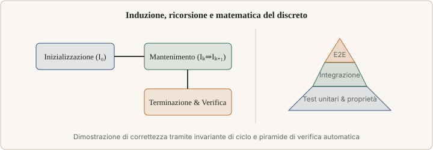

# Capitolo 1 — Induzione, ricorsione e matematica del discreto

*Dal principio del buon ordinamento alle definizioni ricorsive, alle congruenze e al conteggio combinatorio*

> *«E questa  davvero una delle cose pih curlose deI mondo: che si possa arete una scorciatoia attraverso la 10gica»* — L. Wittgenstein, Lezioni Sui Fondamenti Della Matematica (2002, Bollati Boringhieri) (p. 279) [^1]

## Il discreto, il continuo e l'ordine soggiacente

Nello studio quantitativo dei fenomeni naturali, è consuetudine operare su un dominio positivo di grandezze fisiche: parametri fondamentali come la massa, il tempo e la distanza assumono tipicamente valori reali strettamente maggiori di zero. Questo continuo spaziotemporale presuppone, dal punto di vista matematico, la completezza dei numeri reali, una proprietà assiomatica che garantisce l'assenza di interruzioni o 'buchi' sulla retta numerica. La percezione di un continuum ininterrotto ha radici antiche; analizzando i fondamenti della geometria classica, si nota come essa si basi sull'infinita divisibilità dello spazio. A tal proposito, commentando l'opera di Euclide, si osserva che «Tra due punti qualunque di una linea si può sempre inserire almeno un punto intermedio.» [^2]. Questa densità assoluta è il marchio di fabbrica del continuo.

Tuttavia, l'informatica e la logica formale operano in un universo radicalmente diverso: il dominio del discreto. Qui, gli oggetti sono separati, numerabili e costruiti attraverso passi successivi ben definiti. Il fondamento di questo edificio è l'insieme dei numeri naturali $\mathbb{N} = \{0, 1, 2, 3, \dots\}$. La transizione dal continuo al discreto non è solo un cambio di scala, ma un profondo mutamento di paradigma logico. La tensione tra questi due mondi ha animato lunghi dibattiti sui fondamenti della matematica, contrapponendo la costruzione algoritmica passo passo degli oggetti matematici all'elencazione di proprietà generali che definiscono un insieme continuo. Come è stato storicamente rilevato, «I risultati descritti in questo e nel precedente paragrafo sono stati coinvolti nella disputa filosofica» [^3] riguardante proprio la legittimità delle definizioni non costruttive rispetto a quelle strettamente operative.

Il pilastro su cui poggia l'intera aritmetica discreta è il Principio del Buon Ordinamento. Esso stabilisce che ogni sottoinsieme non vuoto dell'insieme dei numeri naturali $\mathbb{N}$ possiede un elemento minimo. Questa affermazione, apparentemente ovvia, è in realtà un assioma potente che impedisce l'esistenza di catene infinite discendenti nei numeri naturali. A differenza dei numeri reali o razionali, dove tra $0$ e $1$ esistono infiniti valori, nei naturali ogni numero ha un successore immediato e un predecessore ben definito (tranne lo zero). Da questa rigidità strutturale deriva la possibilità di dimostrare verità universali su insiemi infiniti attraverso un numero finito di passaggi logici.

## L'induzione matematica e il mantenimento dell'invariante

Dal Principio del Buon Ordinamento discende logicamente il Principio di Induzione Matematica, lo strumento principe per dominare l'infinito discreto. L'induzione permette di dimostrare che una certa proprietà $P(n)$ è vera per ogni numero naturale $n$. Il fascino di questo metodo risiede nella sua efficienza meccanica, che condensa infiniti casi in due soli passi dimostrativi: il caso base e il passo induttivo. Questa capacità di piegare l'infinito a una regola finita ha suscitato profondo stupore anche tra i logici del Novecento; riflettendo sulla natura delle dimostrazioni matematiche, è stato osservato: «E questa è davvero una delle cose più curiose del mondo: che si possa avere una scorciatoia attraverso la logica» [^1].

La struttura di una dimostrazione per induzione si articola rigorosamente. Primo, si verifica esplicitamente il caso base, solitamente $P(0)$ o $P(1)$, ancorando la catena logica a un fatto concreto. Secondo, si formula l'ipotesi induttiva: si assume che la proprietà $P(n)$ sia vera per un generico ma fissato numero naturale $n$. Terzo, si dimostra che la verità di $P(n)$ implica necessariamente la verità di $P(n+1)$. Se l'implicazione $P(n) \implies P(n+1)$ è valida, la proprietà si propaga inesorabilmente a tutti i numeri successivi, come una serie di tessere del domino che cadono una dopo l'altra. Il cuore di questo processo è il mantenimento di un invariante logico o algebrico durante la transizione dal passo $n$ al passo $n+1$.

*Schema dimostrativo per induzione matematica e mantenimento dell'invariante lungo passi discreti.*

## Definizioni ricorsive, relazioni e induzione strutturale

L'induzione matematica trova il suo specchio operativo nella ricorsione. Mentre l'induzione dimostra proprietà, la ricorsione definisce oggetti, funzioni e insiemi. Una definizione ricorsiva specifica i casi base elementari e fornisce regole per costruire oggetti complessi a partire da oggetti più semplici della stessa natura. Per formalizzare questi concetti, è necessario introdurre la nozione di relazione. Dati due insiemi $A$ e $B$, una relazione formale $R$ è definita come un sottoinsieme del prodotto cartesiano, ovvero $R \subseteq A \times B$. Una funzione ricorsiva è una particolare relazione in cui ogni elemento del dominio è associato a un unico elemento del codominio, calcolato richiamando la funzione stessa su argomenti via via più piccoli, fino a raggiungere il caso base.

Quando le strutture dati diventano più complesse dei semplici numeri naturali, come nel caso di alberi, grafi o espressioni sintattiche nei linguaggi di programmazione, l'induzione standard viene generalizzata nell'induzione strutturale. Questo principio asserisce che «per dimostrare che una proprietà vale per tutte le espressioni è sufficiente dimostrare che la proprietà vale per un'espressione qualsiasi se vale» [^4] per le sue sotto-espressioni immediate. L'induzione strutturale è il fondamento della semantica formale, poiché garantisce che le proprietà verificate sui componenti elementari di un programma si conservino durante la composizione gerarchica delle istruzioni.

## Congruenze e la natura dei numeri

Abbandonando la retta infinita per concentrarci su cicli finiti, incontriamo l'aritmetica modulare e le congruenze. Due numeri interi $a$ e $b$ si dicono congrui modulo $m$, scritto $a \equiv b \pmod{m}$, se la loro differenza $a - b$ è un multiplo intero di $m$. Questa relazione di equivalenza partiziona l'insieme degli interi in classi di resto, creando un'aritmetica circolare essenziale per la crittografia e la teoria dei codici. A differenza dell'algebra sui numeri reali, l'aritmetica modulare è intrinsecamente esatta e priva di approssimazioni.

La distinzione tra il mondo continuo e quello discreto diventa lampante se si considera la natura geometrica vs analitica di $\pi$. Geometricamente, $\pi$ emerge in modo intuitivo come il rapporto costante tra la lunghezza di una circonferenza e il suo diametro. Tuttavia, la sua natura analitica, essendo un numero irrazionale e trascendente, richiede il concetto di limite, le serie infinite e la già citata completezza dei numeri reali per essere calcolato con precisione arbitraria. Nel discreto, al contrario, non vi è spazio per i limiti: ogni operazione, come la somma in modulo o la valutazione di una funzione ricorsiva, si conclude in un numero finito e predeterminato di passi esatti.

## Il conteggio combinatorio e l'ordine delle configurazioni

L'ultimo pilastro della matematica del discreto affrontato in questa sede è il conteggio combinatorio. La combinatoria studia i modi in cui un insieme finito di elementi può essere selezionato, disposto e raggruppato secondo regole precise. L'esigenza di catalogare e contare configurazioni complesse non è una novità moderna; già nel Seicento si esortava a studiare le arti in cui regna un ordine regolare, osservando come gli artigiani «intrecciano in infiniti modi i fili in orditi diversi; così come tutte le combinazioni di numeri» [^5].

I concetti fondamentali sono le permutazioni e le combinazioni. Il numero di modi per ordinare $n$ oggetti distinti è dato dal fattoriale $n! = n \times (n-1) \times \dots \times 1$. Se invece vogliamo selezionare un sottoinsieme di $k$ elementi da un insieme di $n$ elementi, senza curarci dell'ordine, utilizziamo il coefficiente binomiale $C(n, k) = \frac{n!}{k!(n-k)!}$. Queste formule chiuse, dimostrabili rigorosamente per induzione, permettono di quantificare la complessità degli algoritmi e di calcolare le probabilità in spazi campionari discreti, chiudendo il cerchio tra la logica formale, l'algebra e l'informatica teorica.

## Dal ragionamento al simbolo: esempi e verifiche

### Dimostrazione per induzione della somma dei primi n interi

Dimostrare rigorosamente per induzione matematica che la somma dei primi $n$ numeri interi positivi è data dalla formula $S(n) = \sum_{i=1}^n i = \frac{n(n+1)}{2}$ per ogni $n \ge 1$.
1. Verifica esplicita del caso base: Poniamo $n = 1$. La somma del primo intero è semplicemente $1$. Sostituendo $n = 1$ nella formula otteniamo $\frac{1(1+1)}{2} = \frac{2}{2} = 1$. Il caso base è verificato.
2. Enunciazione dell'ipotesi induttiva: Assumiamo che la formula sia vera per un generico numero naturale fissato $n$. Pertanto, supponiamo che $1 + 2 + \dots + n = \frac{n(n+1)}{2}$ sia un'uguaglianza valida.
3. Sviluppo algebrico per $n+1$: Dobbiamo dimostrare che la formula vale per $n+1$, ovvero che $\sum_{i=1}^{n+1} i = \frac{(n+1)(n+2)}{2}$.
4. Scriviamo la somma fino a $n+1$ separando l'ultimo termine: $\sum_{i=1}^{n+1} i = \left(\sum_{i=1}^n i\right) + (n+1)$.
5. Applichiamo l'ipotesi induttiva sostituendo la sommatoria fino a $n$: $\frac{n(n+1)}{2} + (n+1)$.
6. Raccogliamo a fattor comune $(n+1)$: $(n+1) \left( \frac{n}{2} + 1 \right)$.
7. Svolgiamo la somma nella parentesi: $(n+1) \left( \frac{n+2}{2} \right) = \frac{(n+1)(n+2)}{2}$.

**Conclusione.** Poiché il caso base è verificato e il passo induttivo mantiene l'invariante algebrico, per il Principio di Induzione Matematica la formula $S(n) = \frac{n(n+1)}{2}$ è vera per ogni $n \ge 1$.

### Calcolo combinatorio degli spigoli in un grafo completo

Calcolare il numero esatto di spigoli presenti in un grafo semplice completo $K_5$, composto da $5$ vertici.
1. In un grafo semplice completo, ogni coppia di vertici distinti è collegata da esattamente uno spigolo.
2. Il problema si riduce a contare quanti sottoinsiemi non ordinati di $2$ elementi possono essere estratti da un insieme di $5$ elementi.
3. Utilizziamo la formula delle combinazioni semplici: $C(n, k) = \frac{n!}{k!(n-k)!}$ con $n = 5$ e $k = 2$.
4. Sostituiamo i valori: $C(5, 2) = \frac{5!}{2!(5-2)!} = \frac{5!}{2!3!}$.
5. Semplifichiamo i fattoriali: $\frac{5 \cdot 4 \cdot 3!}{2 \cdot 1 \cdot 3!} = \frac{20}{2} = 10$.

**Conclusione.** Un grafo semplice completo con $5$ vertici possiede esattamente $10$ spigoli.

### Esercizi di verifica attiva
1. Utilizzando la formula chiusa dimostrata per induzione $S(n) = \frac{n(n+1)}{2}$, calcola la somma dei primi $6$ numeri interi positivi ($1 + 2 + \dots + 6$).
2. Quanti spigoli possiede un grafo semplice completo $K_6$ con $6$ vertici? Applica il calcolo combinatorio appropriato.
3. Verifica concettuale sulle relazioni: È vero che ogni relazione formale $R \subseteq A \times A$ è necessariamente simmetrica? Fornisci un controesempio se l'affermazione è falsa.
4. Risolvi la seguente congruenza lineare: $3x \equiv 2 \pmod{5}$. Trova il più piccolo valore intero positivo per $x$.

## Apparato delle fonti

### [Verificato sul testo]
[^1]: [block_pk=109539 | block_uid=blk_72af66bb8703c1247682] «E questa  davvero una delle cose pih curlose deI mondo: che si possa arete una scorciatoia attraverso la 10gica» — L. Wittgenstein, Lezioni Sui Fondamenti Della Matematica (2002, Bollati Boringhieri) (p. 279)
[^2]: [block_pk=98978 | block_uid=blk_1def1f07a8131561c52f] «Tra due punti qualunque di una linea si può sempre inserire almeno un punto intermedio.» — Attilio Frajese Attraverso la storia della matematica (1969, Le Monnier) (p. 4)
[^3]: [block_pk=59028 | block_uid=blk_8adee31a90a9cd661eac] «I risultati descritti in questo e nel precedente paragrafo sono stati coinvolti nella disputa filosofica» — Fabio Bellissima, Fondamenti di matematica (2008, Carocci) (p. 57)
[^4]: [block_pk=28869 | block_uid=blk_8193142d853127d8e719] «per dimostrare che una proprietà vale per tutte le espressioni è sufficiente dimostrare che la proprietà vale per un'espressione qualsiasi se vale» — Glynn Winskel, La Semantica Formale Dei Linguaggi Di Programmazione (UTET Università) (p. 28)
[^5]: [block_pk=46349 | block_uid=blk_de20d7febd4b22407207] «intrecciano in infiniti modi i fili in orditi diversi; così come tutte le combinazioni di numeri» — René Descartes, a cura di Bruno Widmar e Ettore Lojacono, Opere filosofiche (2013, UTET) (p. 72)

### [Ricostruzione matematica / addestramento]
- La scelta di introdurre il Principio del Buon Ordinamento prima dell'Induzione Matematica risponde all'esigenza di mostrare le fondamenta assiomatiche dell'aritmetica di Peano, evidenziando come l'induzione non sia una magia logica, ma una conseguenza diretta della struttura discreta e limitata inferiormente dei numeri naturali.
- La distinzione esplicita tra la natura geometrica classica di $\pi$ e la sua formalizzazione analitica è stata inserita per tracciare un confine netto tra il dominio del continuo (che richiede il concetto di limite e la completezza di $\mathbb{R}$) e il dominio del discreto, in cui le operazioni algebriche si concludono sempre in un numero finito di passi.
- Il modulo di dimostrazione per induzione è stato strutturato separando rigidamente il caso base, l'ipotesi induttiva e lo sviluppo algebrico, per fornire un modello sintattico rigoroso che lo studente possa replicare meccanicamente senza incorrere in salti logici.
- Diagramma geometrico-simbolico controllato (`algorithm_invariant_testing`): Schema dimostrativo per induzione matematica e mantenimento dell'invariante lungo passi discreti.

### [Esercizi originali]
- Utilizzando la formula chiusa dimostrata per induzione $S(n) = \frac{n(n+1)}{2}$, calcola la somma dei primi $6$ numeri interi positivi ($1 + 2 + \dots + 6$). — *Traccia di verifica:* Sostituendo $n = 6$ nella formula si ottiene $S(6) = \frac{6(6+1)}{2} = \frac{6 \cdot 7}{2} = \frac{42}{2} = 21$.
- Quanti spigoli possiede un grafo semplice completo $K_6$ con $6$ vertici? Applica il calcolo combinatorio appropriato. — *Traccia di verifica:* Ogni coppia non ordinata di vertici definisce uno spigolo. Si calcola $C(6, 2) = \frac{6 \cdot 5}{2} = 15$ spigoli.
- Verifica concettuale sulle relazioni: È vero che ogni relazione formale $R \subseteq A \times A$ è necessariamente simmetrica? Fornisci un controesempio se l'affermazione è falsa. — *Traccia di verifica:* L'affermazione è falsa. Controesempio: sia $A = \{1, 2\}$ e $R = \{(1, 2)\}$. La relazione $R$ non contiene $(2, 1)$, pertanto non è simmetrica.
- Risolvi la seguente congruenza lineare: $3x \equiv 2 \pmod{5}$. Trova il più piccolo valore intero positivo per $x$. — *Traccia di verifica:* Moltiplicando entrambi i membri per $2$ (l'inverso moltiplicativo di $3$ modulo $5$, poiché $2 \cdot 3 = 6 \equiv 1 \pmod{5}$), si ottiene $x \equiv 4 \pmod{5}$. Il più piccolo intero positivo è $x = 4$.
- **Palestra simbolica (`drill_p2_induction`):** Usa la formula dimostrata per induzione S(n) = n(n+1)/2 per calcolare la somma 1 + 2 + ... + 6. *(Risposta verificata: `21`)*
- **Palestra simbolica (`drill_p2_discrete_combinatorics`):** Quanti spigoli possiede un grafo semplice completo K_5 con 5 vertici? *(Risposta verificata: `10`)*
