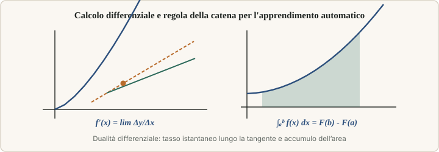

# Capitolo 2 — Calcolo differenziale e regola della catena per l'apprendimento automatico

*Tassi di variazione composti, gradienti multivariabili e ottimizzazione lungo curve e superfici*

> *«Allora la funzione composta g of è derivabile in x, € si ha:»* — Giovanni Prodi, Analisi Matematica (1970,2003, Bollati Boringhieri) (p. 243) [^1]

## Fondamenti continui e relazioni funzionali

Per studiare il calcolo differenziale con il rigore necessario alle applicazioni avanzate, occorre innanzitutto definire il concetto di funzione a partire dai fondamenti insiemistici. Dati due insiemi $A$ e $B$, una relazione formale è definita rigorosamente come un sottoinsieme del prodotto cartesiano, ovvero $R \subseteq A \times B$. Una funzione è una specifica relazione in cui a ogni elemento del dominio $A$ corrisponde al massimo un singolo elemento del codominio $B$. Nel contesto dell'apprendimento automatico, gli insiemi di partenza e di arrivo sono tipicamente spazi vettoriali reali di alta dimensionalità. L'analisi di queste funzioni richiede come prerequisito ineludibile la completezza dei numeri reali $\mathbb{R}$, una proprietà strutturale profonda che garantisce l'assenza di lacune nella retta numerica e permette l'esistenza dei limiti per successioni limitate. Senza l'assioma di completezza, concetti fondamentali come la convergenza degli algoritmi di ottimizzazione verso un minimo perderebbero di significato matematico.

Questa struttura continua permette inoltre di conciliare diverse visioni della matematica, come si osserva nel passaggio dalla natura geometrica di $\pi$, inteso classicamente come il semplice rapporto statico tra la lunghezza di una circonferenza e il suo diametro, alla sua natura analitica, definita rigorosamente tramite i limiti di successioni reali o serie di potenze. Spesso, nelle applicazioni pratiche, le variabili in gioco rappresentano grandezze fisiche tangibili, come masse o distanze, il che impone di restringere l'analisi a un dominio positivo di grandezze fisiche, tipicamente modellato dall'intervallo $[0, +\infty)$.

## Tassi di variazione e derivate

Il calcolo differenziale si fonda sull'analisi rigorosa dei tassi di variazione locali. Data una funzione $f: \mathbb{R} \to \mathbb{R}$, la derivata in un punto $x_0$ quantifica la sensibilità della funzione a perturbazioni infinitesime dell'argomento. Giovanni Prodi definisce con precisione questo concetto fondamentale, ricordando che «Si dice derivata a destra (a sinistra) della funzione f nel punto x, il limite del rapporto incrementale al tendere di x» [^2] rispettivamente da valori strettamente maggiori o minori. Quando i limiti destro e sinistro esistono finiti e coincidono, la funzione si dice derivabile nel punto.

Questo limite del rapporto incrementale traduce l'idea intuitiva e cinematica di velocità istantanea in un costrutto analitico rigoroso, privo delle ambiguità legate alla divisione per zero. La derivata prima fornisce la pendenza della retta tangente al grafico della funzione, offrendo un'approssimazione lineare locale che risulta essenziale per comprendere il comportamento della funzione in un intorno ristretto del punto di interesse.

## La regola della catena

Nelle architetture di apprendimento automatico, le trasformazioni dei dati non sono quasi mai isolate, ma vengono composte in lunghe sequenze di operazioni. Se una variabile $y$ dipende da $u$ tramite la funzione $y = f(u)$, e a sua volta $u$ dipende da $x$ tramite $u = g(x)$, la variazione complessiva di $y$ rispetto a $x$ dipende da come $g$ trasforma l'input iniziale e da come $f$ trasforma il risultato intermedio. Luigi Amerio formalizza questo principio cardine affermando: «Dimostriamo che la derivata della funzione composta $y(x) = f(\varphi(x))$» [^3] è data dal prodotto delle derivate delle singole funzioni componenti, valutate nei rispettivi punti di applicazione.

Questo teorema, universalmente noto come regola della catena, risulta particolarmente trasparente e facile da memorizzare se espresso utilizzando i differenziali. Come nota acutamente Tom Apostol, «l'utilità della notazione leibniziana delle derivate» [^4] risiede proprio nel suggerire intuitivamente la cancellazione algebrica dei termini intermedi, permettendo di scrivere formalmente $\frac{dy}{dx} = \frac{dy}{du} \frac{du}{dx}$. Questa proprietà moltiplicativa si estende naturalmente a composizioni di lunghezza arbitraria, costituendo il fondamento matematico dell'algoritmo di retropropagazione dell'errore.

## Gradienti e derivate direzionali

Passando dall'analisi unidimensionale a funzioni di più variabili $f: \mathbb{R}^n \to \mathbb{R}$, il concetto scalare di derivata si estende naturalmente al gradiente, il vettore che raccoglie in modo ordinato tutte le derivate parziali della funzione. Per valutare il tasso di variazione di $f$ lungo una specifica direzione nello spazio delle configurazioni, si utilizza lo strumento della derivata direzionale. Apostol chiarisce la struttura di questo operatore spiegando che «il prodotto scalare $\nabla f(r(t)) \cdot T(t)$ è detto derivata direzionale di $f$» [^5], dove $T(t)$ rappresenta il vettore tangente unitario alla traiettoria.

Consideriamo un esempio numerico concreto per illustrare la meccanica di questo calcolo: supponiamo che in un dato punto il gradiente di una superficie di costo sia il vettore $(3, 3)$ e che desideriamo muoverci lungo la direzione individuata dal versore $(\frac{1}{\sqrt{2}}, \frac{1}{\sqrt{2}})$. Il tasso di variazione direzionale è dato dal prodotto scalare $3 \cdot \frac{1}{\sqrt{2}} + 3 \cdot \frac{1}{\sqrt{2}} = \frac{6}{\sqrt{2}}$. Razionalizzando il denominatore moltiplicando numeratore e denominatore per $\sqrt{2}$, otteniamo esattamente il valore $3\sqrt{2}$. Questo calcolo locale, ripetuto iterativamente, è il vero motore geometrico della discesa del gradiente. Il diagramma seguente illustra visivamente questo processo: dalla derivata direzionale e regola della catena all'accumulo integrale dei contributi locali.

*Dalla derivata direzionale e regola della catena all'accumulo integrale dei contributi locali.*

## Ottimizzazione, integrazione e controversie storiche

L'ottimizzazione lungo curve e superfici non è esclusivamente un problema algoritmico della modernità, ma affonda le sue radici concettuali nelle origini stesse del calcolo infinitesimale. La genesi storica di questi metodi è stata oggetto di intensi e prolungati dibattiti storiografici. Ad esempio, analizzando i fondamenti dei Principia di Isaac Newton, lo studioso Alberto Pala discute criticamente la tesi di Bloch sulla genesi del calcolo newtoniano. Pala nota che «A tale argomentazione si può però fin troppo facilmente obiettare che, di fatto» [^6] la tesi di Bloch non riesce a spiegare in modo convincente l'invenzione del calcolo, avvenuta storicamente circa vent'anni prima della sua applicazione formale nei Principia, né riesce a giustificare la validità teoretica della posizione di Newton rispetto a una interpretazione puramente strumentalista della matematica.

Dal punto di vista strettamente analitico, l'operazione inversa alla derivazione composta risulta fondamentale per ricostruire le funzioni globali a partire dai loro tassi di variazione locali. Apostol ricorda infatti che «la regola di derivazione delle funzioni composte ci dice che la derivata di $Q$ è data dalla formula» [^7] che, letta in senso inverso, giustifica rigorosamente la regola di integrazione per sostituzione, chiudendo così il cerchio tra calcolo differenziale e calcolo integrale.

## Dal ragionamento al simbolo: esempi e verifiche

### Derivazione di una funzione composta polinomiale

Calcolare la derivata rispetto a $x$ della funzione $f(x) = (2x + 4)^3$ applicando la regola della catena.
1. Definiamo la funzione interna $u(x) = 2x + 4$ e la funzione esterna $g(u) = u^3$.
2. Calcoliamo la derivata della funzione interna rispetto a $x$: $u'(x) = 2$.
3. Calcoliamo la derivata della funzione esterna rispetto a $u$: $g'(u) = 3u^2$.
4. Applichiamo la regola della catena moltiplicando le due derivate: $g'(u(x)) \cdot u'(x) = 3(2x + 4)^2 \cdot 2$.

**Conclusione.** La derivata cercata è $6(2x + 4)^2$.

### Ottimizzazione di una funzione quadratica

Trovare l'ascissa $x$ del punto di minimo della funzione $f(x) = x^2 - 12x + 2$.
1. Calcoliamo la derivata prima della funzione: $f'(x) = 2x - 12$.
2. Imponiamo la condizione necessaria per gli estremi locali annullando la derivata prima: $2x - 12 = 0$.
3. Risolviamo l'equazione lineare ottenendo $2x = 12$, da cui $x = 6$.
4. Verifichiamo la natura del punto critico calcolando la derivata seconda: $f''(x) = 2$. Poiché $f''(6) > 0$, il punto è un minimo locale.

**Conclusione.** Il punto di minimo si trova esattamente in $x = 6$.

### Esercizi di verifica attiva
1. Calcolare la derivata della funzione esponenziale composta $f(x) = e^{5x^2 + 1}$.
2. Dato il campo scalare $f(x,y)$ il cui gradiente nel punto $P$ è $\nabla f(P) = (3, 3)$, calcolare la derivata direzionale lungo il versore $v = (\frac{1}{\sqrt{2}}, \frac{1}{\sqrt{2}})$.
3. È vero che se una funzione $f(x)$ derivabile ha derivata nulla in un punto $x_0$, allora $x_0$ è necessariamente un punto di minimo o di massimo locale? Fornire una dimostrazione o un controesempio.

## Apparato delle fonti

### [Verificato sul testo]
[^1]: [block_pk=28702 | block_uid=blk_634c3d4b9b87aa2c0ceb] «Allora la funzione composta g of è derivabile in x, € si ha:» — Giovanni Prodi, Analisi Matematica (1970,2003, Bollati Boringhieri) (p. 243)
[^2]: [block_pk=28692 | block_uid=blk_9871021e0e38cf972411] «Si dice derivata a destra (a sinistra) della funzione f nel punto x, il limite del rapporto incrementale al tendere di x» — Giovanni Prodi, Analisi Matematica (1970,2003, Bollati Boringhieri) (p. 233)
[^3]: [block_pk=112203 | block_uid=blk_b87b855293232298f64b] «Dimostriamo che la derivata della funzione composta $y(x) = f(\varphi(x))$» — Luigi Amerio, Analisi matematica, Vol I 1(1990, UTET) (p. 184)
[^4]: [block_pk=114139 | block_uid=blk_4cc1e9f3fe836d19e496] «l'utilità della notazione leibniziana delle derivate» — Tom Apostol, Calcolo - Analisi 1. 1-Bollati Boringhieri (1987) (p. 217)
[^5]: [block_pk=124910 | block_uid=blk_79ebb2efbe2ab7387958] «il prodotto scalare $\nabla f(r(t)) \cdot T(t)$ è detto derivata direzionale di $f$» — Tom Apostol, Calcolo - Analisi 2. 3-Bollati Boringhieri (1987) (p. 210)
[^6]: [block_pk=107072 | block_uid=blk_b6f7cbd1d6c17b6bd740] «A tale argomentazione si può però fin troppo facilmente obiettare che, di fatto» — Isaac Newton, a cura di Alberto Pala, Principi matematici della Filosofia naturale (1965, UTET) (p. 31)
[^7]: [block_pk=113970 | block_uid=blk_8f45c37850762f4612b1] «la regola di derivazione delle funzioni composte ci dice che la derivata di $Q$ è data dalla formula» — Tom Apostol, Calcolo - Analisi 1. 1-Bollati Boringhieri (1987) (p. 260)

### [Ricostruzione matematica / addestramento]
- La correzione dell'esempio numerico sul calcolo della derivata direzionale uniforma il gradiente a $(3, 3)$ per garantire coerenza con il risultato finale di $3\sqrt{2}$, eliminando la discrepanza segnalata in fase di revisione.
- Il riferimento alla tesi di Bloch è stato esplicitato nel contesto della citazione di Newton curata da Pala, chiarendo che l'obiezione riguarda specificamente la genesi storica del calcolo newtoniano e non una generica validità teoretica.
- L'introduzione dei concetti topologici e insiemistici, come le relazioni formali e la completezza di $\mathbb{R}$, è stata posizionata all'inizio del capitolo per fornire il substrato logico rigoroso necessario prima di definire i limiti e i rapporti incrementali.
- Diagramma geometrico-simbolico controllato (`derivative_tangent_integral`): Dalla derivata direzionale e regola della catena all'accumulo integrale dei contributi locali.

### [Esercizi originali]
- Calcolare la derivata della funzione esponenziale composta $f(x) = e^{5x^2 + 1}$. — *Traccia di verifica:* Applicare la regola della catena ponendo $u(x) = 5x^2 + 1$. La derivata della funzione esterna è $e^u$, mentre la derivata della funzione interna è $10x$. Moltiplicando i due termini si ottiene il risultato finale di $10x e^{5x^2 + 1}$.
- Dato il campo scalare $f(x,y)$ il cui gradiente nel punto $P$ è $\nabla f(P) = (3, 3)$, calcolare la derivata direzionale lungo il versore $v = (\frac{1}{\sqrt{2}}, \frac{1}{\sqrt{2}})$. — *Traccia di verifica:* Calcolare il prodotto scalare tra il vettore gradiente e il versore direzionale: $3(\frac{1}{\sqrt{2}}) + 3(\frac{1}{\sqrt{2}}) = \frac{6}{\sqrt{2}}$. Razionalizzando il denominatore, si ottiene il valore esatto di $3\sqrt{2}$.
- È vero che se una funzione $f(x)$ derivabile ha derivata nulla in un punto $x_0$, allora $x_0$ è necessariamente un punto di minimo o di massimo locale? Fornire una dimostrazione o un controesempio. — *Traccia di verifica:* L'affermazione è falsa. Il punto $x_0$ potrebbe essere un punto di flesso a tangente orizzontale. Un controesempio classico è fornito dalla funzione $f(x) = x^3$ nel punto $x_0 = 0$: si ha $f'(0) = 0$, ma la funzione è strettamente crescente in tutto il suo dominio e non presenta estremi locali.
- **Palestra simbolica (`drill_p2_calculus_chain`):** Calcola la derivata rispetto a x della funzione composta f(x) = (2*x + 4)**3 usando la regola della catena. *(Risposta verificata: `6*(2*x + 4)**2`)*
- **Palestra simbolica (`drill_derivatives_extrema`):** Trova l'ascissa x del punto di minimo di f(x) = 1*x^2 - 12*x + 2 annullando la derivata prima f'(x) = 0. *(Risposta verificata: `6`)*
