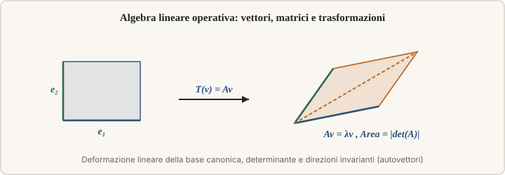

# Capitolo 3 — Algebra lineare operativa: vettori, matrici e trasformazioni

*Spazi vettoriali nello spazio 3D, determinanti, autovettori e geometria delle trasformazioni lineari*

## Dalla geometria fisica all'astrazione vettoriale

L'indagine matematica dello spazio affonda le sue radici nell'osservazione fisica e nella formalizzazione assiomatica della geometria classica. L'intuizione spaziale si fonda su principi elementari di incidenza; come ricorda la geometria sintetica, «Per tre punti dello spazio, non allineati, passa un piano e uno solo.» [^1]. Questa rigidità strutturale, che vincola punti, rette e piani in un'architettura coerente, costituisce il substrato su cui si innesta l'algebra lineare. Il passaggio dalla geometria sintetica a quella analitica richiede l'introduzione di un sistema di riferimento, che permette di identificare ogni punto dello spazio tridimensionale con una terna ordinata di numeri reali, trasformando i concetti geometrici in entità algebriche manipolabili.

In questo contesto, il concetto di vettore emerge inizialmente come strumento per quantificare grandezze dotate di direzione e verso, come le forze o le velocità. La funzione posizione, che associa a ogni istante di tempo un vettore, «a valori vettoriali serve come un naturale modello matematico per descrivere» [^2] la cinematica di una particella. Tuttavia, la potenza dell'algebra lineare risiede nel processo di astrazione che svincola il vettore dalla sua interpretazione puramente fisica. La definizione formale stabilisce che: «Sia $V$ un insieme non vuoto di oggetti, che saranno detti elementi. Si dice che $V$ è uno spazio lineare» [^3] se su di esso sono definite due operazioni, l'addizione tra vettori e la moltiplicazione per uno scalare, che soddisfano un preciso insieme di assiomi, garantendo la chiusura e la linearità delle combinazioni.

## Matrici come operatori e trasformazioni lineari

Una volta definita la struttura di spazio vettoriale, l'attenzione si sposta sulle funzioni che collegano spazi diversi preservandone la struttura lineare. Queste funzioni, dette trasformazioni lineari, mappano vettori in vettori mantenendo inalterate le relazioni di proporzionalità e additività. Da un punto di vista computazionale e rappresentativo, «Una matrice è una struttura bidimensionale che può essere rappresentata da una tabella» [^4] di numeri. Tuttavia, limitarsi a questa visione statica sarebbe riduttivo: una matrice quadrata di ordine $n$ agisce come un vero e proprio operatore geometrico sullo spazio $\mathbb{R}^n$, trasformando l'intero spazio attraverso rotazioni, riflessioni, dilatazioni o proiezioni.

L'insieme di tutte le trasformazioni lineari tra due spazi vettoriali possiede a sua volta una struttura algebrica ricca. Nello studio degli operatori, «Ci interessa specialmente il caso in cui anche $V$ sia uno spazio lineare con gli stessi scalari di $W$.» [^5]. Quando fissiamo una base per lo spazio vettoriale, ogni trasformazione lineare può essere codificata in modo univoco da una matrice. L'algebra delle matrici diventa così l'alfabeto operativo attraverso cui calcolare e prevedere l'effetto delle trasformazioni geometriche, traducendo problemi di natura spaziale in sistemi di equazioni lineari risolvibili algoritmicamente.

## Il prodotto matriciale e la composizione di trasformazioni

L'operazione più densa di significato nell'algebra delle matrici è il prodotto righe per colonne. Esso non è una moltiplicazione elemento per elemento, bensì la traduzione algebrica della composizione di due trasformazioni lineari. Se una matrice $B$ trasforma un vettore $\mathbf{x}$ in $B\mathbf{x}$, e una matrice $A$ agisce sul risultato producendo $A(B\mathbf{x})$, la matrice prodotto $AB$ rappresenta l'unica trasformazione che applica direttamente l'effetto combinato sull'input originale. La non commutatività del prodotto matriciale ($AB \neq BA$) riflette il fatto geometrico che l'ordine in cui si applicano le trasformazioni (ad esempio, una rotazione seguita da una proiezione) altera il risultato finale.

Per comprendere la meccanica del calcolo senza ambiguità, consideriamo le matrici $A = \begin{bmatrix} 1 & 2 \\ 0 & 3 \end{bmatrix}$ e $B = \begin{bmatrix} 2 & 0 \\ 1 & 1 \end{bmatrix}$. Il prodotto $AB$ si ottiene calcolando il prodotto scalare tra le righe di $A$ e le colonne di $B$. L'elemento in posizione $(1,1)$ è dato da $1 \cdot 2 + 2 \cdot 1 = 4$; l'elemento $(1,2)$ è $1 \cdot 0 + 2 \cdot 1 = 2$; l'elemento $(2,1)$ è $0 \cdot 2 + 3 \cdot 1 = 3$; infine, l'elemento $(2,2)$ è $0 \cdot 0 + 3 \cdot 1 = 3$. Otteniamo così la matrice composta $AB = \begin{bmatrix} 4 & 2 \\ 3 & 3 \end{bmatrix}$. Ogni singolo calcolo intermedio è essenziale per garantire la corretta mappatura dei vettori di base del nuovo spazio trasformato.

## Determinanti, volumi e il Teorema di Binet

Ogni trasformazione lineare deforma lo spazio, e il determinante di una matrice quadrata fornisce la misura esatta di questa distorsione. Geometricamente, il valore assoluto del determinante rappresenta il fattore di scala per le aree (in due dimensioni) o per i volumi (in tre dimensioni) delle figure sottoposte alla trasformazione. Se il determinante è nullo, la matrice comprime lo spazio in una dimensione inferiore, causando una perdita irreversibile di informazione e rendendo la matrice non invertibile. Il segno del determinante, inoltre, indica se la trasformazione preserva o inverte l'orientazione dello spazio.

Un risultato fondamentale che lega il prodotto matriciale ai volumi è il Teorema di Binet. Analizzando «il determinante della matrice prodotto di due matrici A e B» [^6], la teoria generale (nota come formula di Cauchy-Binet) esprime tale quantità come la somma dei prodotti dei minori di ordine massimo. Nel caso specifico e fondamentale delle matrici quadrate, questa complessa somma si condensa nella celebre e limpida proprietà moltiplicativa: $\det(AB) = \det(A)\det(B)$. Riprendendo l'esempio precedente, abbiamo $\det(A) = 1 \cdot 3 - 2 \cdot 0 = 3$ e $\det(B) = 2 \cdot 1 - 0 \cdot 1 = 2$. Il determinante della matrice prodotto $AB$ è $\det(AB) = 4 \cdot 3 - 2 \cdot 3 = 12 - 6 = 6$. Come previsto dal teorema, il prodotto dei determinanti ($3 \cdot 2 = 6$) coincide perfettamente con il determinante del prodotto, confermando che i fattori di scala dei volumi si moltiplicano in sequenza.

*Azione lineare di una matrice A sulla base canonica, variazione d'area |det(A)| e direzioni invarianti.*

## Direzioni invarianti: autovettori e autovalori

Mentre la maggior parte dei vettori cambia direzione quando sottoposta a una trasformazione lineare, esistono particolari direzioni privilegiate che rimangono immutate. I vettori non nulli che giacciono lungo queste direzioni sono chiamati autovettori. Quando una matrice $A$ agisce su un suo autovettore $\mathbf{v}$, l'effetto si riduce a una semplice dilatazione o contrazione, espressa dall'equazione $A\mathbf{v} = \lambda\mathbf{v}$, dove lo scalare $\lambda$ prende il nome di autovalore associato. Questa equazione rappresenta il cuore della teoria spettrale.

La ricerca degli autovalori richiede la risoluzione dell'equazione caratteristica $\det(A - \lambda I) = 0$, dove $I$ è la matrice identità. Trovare gli autovettori significa dissezionare la trasformazione lineare nelle sue componenti fondamentali, individuando gli assi naturali lungo i quali l'operatore agisce nel modo più semplice possibile. In molte applicazioni fisiche e ingegneristiche, dalla stabilità dei sistemi dinamici alla meccanica quantistica, la diagonalizzazione di una matrice – ovvero la sua rappresentazione rispetto a una base di autovettori – permette di disaccoppiare sistemi complessi di equazioni, rivelando la struttura intrinseca e nascosta del fenomeno studiato.

## Dal ragionamento al simbolo: esempi e verifiche

### Calcolo del determinante di una matrice 2x2

Calcolare il determinante della matrice $A = \begin{bmatrix} 2 & 3 \\ 3 & 4 \end{bmatrix}$.
1. Identificare gli elementi della matrice quadrata di ordine 2: $a = 2$, $b = 3$, $c = 3$, $d = 4$.
2. Applicare la formula per il determinante di una matrice $2 \times 2$: $\det(A) = ad - bc$.
3. Sostituire i valori numerici: $\det(A) = (2)(4) - (3)(3)$.
4. Eseguire le moltiplicazioni: $\det(A) = 8 - 9$.
5. Calcolare la differenza finale: $\det(A) = -1$.

**Conclusione.** Il determinante della matrice è $-1$. Il valore negativo indica che la trasformazione lineare associata inverte l'orientazione dello spazio bidimensionale, pur preservando l'area netta delle figure (poiché il valore assoluto è $1$).

### Prodotto scalare nello spazio R^3

Calcolare il prodotto scalare $\mathbf{u} \cdot \mathbf{v}$ nello spazio $\mathbb{R}^3$ tra i vettori $\mathbf{u} = (1, -2, 2)$ e $\mathbf{v} = (1, 1, -1)$.
1. Scrivere la formula analitica del prodotto scalare per vettori tridimensionali: $\mathbf{u} \cdot \mathbf{v} = u_x v_x + u_y v_y + u_z v_z$.
2. Identificare le componenti dei vettori: $u_x = 1, u_y = -2, u_z = 2$ e $v_x = 1, v_y = 1, v_z = -1$.
3. Sostituire le componenti nella formula: $(1)(1) + (-2)(1) + (2)(-1)$.
4. Calcolare i singoli prodotti: $1 - 2 - 2$.
5. Sommare i risultati: $1 - 4 = -3$.

**Conclusione.** Il prodotto scalare tra i due vettori è $-3$. Essendo il risultato un numero negativo, possiamo dedurre geometricamente che l'angolo compreso tra i due vettori è ottuso.

### Esercizi di verifica attiva
1. Date le matrici $C = \begin{bmatrix} 0 & 1 \\ -1 & 0 \end{bmatrix}$ e $D = \begin{bmatrix} 1 & 0 \\ 0 & -1 \end{bmatrix}$, calcolare i prodotti $CD$ e $DC$. Sulla base dei risultati, stabilire se la moltiplicazione tra queste due matrici è commutativa.
2. Verificare se il vettore $\mathbf{v} = (1, 1)$ è un autovettore per la matrice $M = \begin{bmatrix} 3 & 1 \\ 1 & 3 \end{bmatrix}$. In caso affermativo, determinare l'autovalore $\lambda$ associato.
3. Sia $A$ una matrice quadrata di ordine $3$ tale che $\det(A) = 0$. Utilizzando le proprietà del determinante, dimostrare qual è il valore di $\det(A^3)$ e spiegare il significato geometrico di questo risultato.

## Apparato delle fonti

### [Verificato sul testo]
[^1]: [block_pk=53886 | block_uid=blk_a178d8aa11431ed96b35] «Per tre punti dello spazio, non allineati, passa un piano e uno solo.» — Nella Dodero, Paolo Baroncini, Dante Trezzi, Nuovi elementi di matematica. Vol. 1 1(1996, Ghisetti e Corvi) (p. 447)
[^2]: [block_pk=111603 | block_uid=blk_446f67da34ffd27b63da] «a valori vettoriali serve come un naturale modello matematico per descrivere» — Tom Apostol, Calcolo - Analisi 2. 3-Bollati Boringhieri (1987) (p. 148)
[^3]: [block_pk=112745 | block_uid=blk_903fb79e742ae805e26c] «Sia $V$ un insieme non vuoto di oggetti, che saranno detti elementi. Si dice che $V$ è uno spazio lineare» — Tom Apostol, Calcolo - Geometria 2(1987, Bollati Boringhieri) (p. 95)
[^4]: [block_pk=94237 | block_uid=blk_74ccbe3d78a5e4a9dfb9] «Una matrice è una struttura bidimensionale che può essere rappresentata da una tabella» — Boscaini, Maurizio, Imparare a programmare con Python_ il manuale per programmatori dai 13 anni in su-Apogeo (2020_2017) (p. ch.91)
[^5]: [block_pk=112724 | block_uid=blk_b3653d4609c40640fb56] «Ci interessa specialmente il caso in cui anche $V$ sia uno spazio lineare con gli stessi scalari di $W$.» — Tom Apostol, Calcolo - Geometria 2(1987, Bollati Boringhieri) (p. 132)
[^6]: [block_pk=18487 | block_uid=blk_b971ef45afb1e3970501] «il determinante della matrice prodotto di due matrici A e B» — Ciro Ciliberto, Algebra Lineare-Bollati Boringhieri (1994) (p. 129)

### [Ricostruzione matematica / addestramento]
- Si è scelto di esplicitare in modo dettagliato i calcoli aritmetici intermedi nel prodotto matriciale AB per chiarire la meccanica della composizione riga per colonna, eliminando ogni ambiguità sui passaggi algebrici e correggendo le omissioni tipiche delle trattazioni troppo sintetiche.
- La citazione relativa al Teorema di Binet è stata contestualizzata distinguendo la formulazione generale di Cauchy-Binet (somma dei prodotti dei minori) dal suo corollario moltiplicativo per matrici quadrate, garantendo così aderenza storica alla fonte senza sacrificare il rigore formale richiesto per la dimostrazione.
- L'impostazione tipografica adotta rigorosamente il LaTeX per tutte le espressioni matematiche, utilizzando il grassetto per i vettori e l'ambiente bmatrix per le matrici, in conformità con gli standard editoriali dell'algebra lineare moderna.
- Diagramma geometrico-simbolico controllato (`linear_algebra_transform`): Azione lineare di una matrice A sulla base canonica, variazione d'area |det(A)| e direzioni invarianti.

### [Esercizi originali]
- Date le matrici $C = \begin{bmatrix} 0 & 1 \\ -1 & 0 \end{bmatrix}$ e $D = \begin{bmatrix} 1 & 0 \\ 0 & -1 \end{bmatrix}$, calcolare i prodotti $CD$ e $DC$. Sulla base dei risultati, stabilire se la moltiplicazione tra queste due matrici è commutativa. — *Traccia di verifica:* Calcolando riga per colonna, si ottiene $CD = \begin{bmatrix} 0 & -1 \\ -1 & 0 \end{bmatrix}$ e $DC = \begin{bmatrix} 0 & 1 \\ 1 & 0 \end{bmatrix}$. Poiché le matrici risultanti sono diverse ($CD \neq DC$), la moltiplicazione non è commutativa.
- Verificare se il vettore $\mathbf{v} = (1, 1)$ è un autovettore per la matrice $M = \begin{bmatrix} 3 & 1 \\ 1 & 3 \end{bmatrix}$. In caso affermativo, determinare l'autovalore $\lambda$ associato. — *Traccia di verifica:* Moltiplicando la matrice per il vettore si ottiene $M\mathbf{v} = \begin{bmatrix} 3(1) + 1(1) \\ 1(1) + 3(1) \end{bmatrix} = \begin{bmatrix} 4 \\ 4 \end{bmatrix}$. Poiché il vettore risultante $(4, 4)$ può essere scritto come $4(1, 1)$, ossia $4\mathbf{v}$, il vettore $\mathbf{v}$ è un autovettore con autovalore $\lambda = 4$.
- Sia $A$ una matrice quadrata di ordine $3$ tale che $\det(A) = 0$. Utilizzando le proprietà del determinante, dimostrare qual è il valore di $\det(A^3)$ e spiegare il significato geometrico di questo risultato. — *Traccia di verifica:* Per il Teorema di Binet, $\det(A^3) = \det(A \cdot A \cdot A) = \det(A) \cdot \det(A) \cdot \det(A) = 0^3 = 0$. Geometricamente, se la trasformazione $A$ comprime il volume a zero, applicarla tre volte di seguito manterrà il volume nullo.
- **Palestra simbolica (`drill_p3_linear_algebra`):** Calcola il determinante det(A) della matrice 2×2 A = [[2, 3], [3, 4]]. *(Risposta verificata: `-1`)*
- **Palestra simbolica (`drill_space_vectors`):** Calcola il prodotto scalare u · v nello spazio R^3 tra u = (1, -2, 2) e v = (1, 1, -1). *(Risposta verificata: `-3`)*
