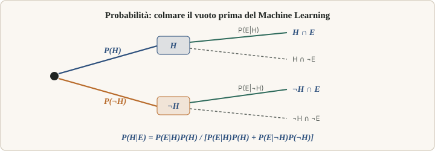

# Capitolo 4 — Probabilità: colmare il vuoto prima del Machine Learning

*Spazi di probabilità, indipendenza, teorema di Bayes e aggiornamento razionale dell'incertezza*

## L'illusione della certezza e la necessità della misura

L'indagine scientifica nasce da una profonda diffidenza verso l'intuizione immediata. Come ammoniva severamente Luigi Galvani, riflettendo sulle insidie dell'osservazione empirica, «è facile ingannarsi nel fare esperimenti e credere di aver visto e di aver trovato ciò che desideriamo vedere e trovare.» [^1]. Questa vulnerabilità cognitiva, che spinge la mente umana a scorgere regolarità anche nel puro rumore, rende indispensabile un'impalcatura formale capace di quantificare l'incertezza in modo rigoroso. Prima che il Machine Learning potesse delegare alle macchine l'estrazione di pattern dai dati, la matematica ha dovuto costruire un linguaggio esatto per descrivere ciò che non è deterministico.

Il calcolo delle probabilità non è un mero ricettario di formule per i giochi d'azzardo, ma una teoria della misura applicata all'incertezza. Per fondare questa teoria, è necessario abbandonare il linguaggio vago dell'opinione e definire un modello matematico inequivocabile. Il punto di partenza è l'esperimento aleatorio, un fenomeno il cui esito non è prevedibile con certezza. L'insieme di tutti i possibili risultati elementari di tale esperimento costituisce lo spazio campionario, denotato con la lettera greca $\Omega$. Un evento non è altro che un sottoinsieme di $\Omega$, ovvero una collezione di esiti possibili.

## Lo spazio campionario e la geometria degli eventi

Per dotare lo spazio campionario di una struttura quantitativa, introduciamo una funzione di probabilità $P$. Questa funzione associa a ogni evento $E \subseteq \Omega$ un numero reale compreso tra $0$ e $1$, rispettando assiomi precisi: la probabilità dell'intero spazio $\Omega$ è $1$, e la probabilità dell'unione di eventi mutuamente esclusivi è la somma delle loro singole probabilità. Questa impostazione assiomatica permette di trattare la probabilità con lo stesso rigore della geometria nello spazio. Se immaginiamo $\Omega$ come un volume solido tridimensionale, gli eventi sono regioni di questo spazio e la probabilità $P(E)$ corrisponde alla misura del volume occupato dalla regione $E$. Eventi disgiunti sono solidi che non si compenetrano, e il volume della loro unione è semplicemente la somma dei volumi.

Tuttavia, l'interpretazione del numero $P(E)$ ha generato storicamente profondi dibattiti. Richard von Mises, difendendo l'approccio frequentista, sosteneva che «Il concetto razionale di probabilità, che è la sola base del calcolo» [^2] ha senso unicamente quando applicato a fenomeni ripetibili un grande numero di volte in condizioni uniformi. In questa visione, la probabilità è il limite a cui tende la frequenza relativa dell'evento. Sebbene l'assiomatica moderna di Kolmogorov sia neutra rispetto all'interpretazione filosofica, il rigore richiesto da von Mises rimane un monito contro l'applicazione superficiale del calcolo a eventi singolari e irripetibili.

## Indipendenza stocastica: la scomposizione dell'incertezza

Il concetto di indipendenza è il vero motore che permette di scalare il calcolo delle probabilità verso sistemi complessi. Due eventi $A$ e $B$ si dicono stocasticamente indipendenti se il verificarsi dell'uno non altera la probabilità del verificarsi dell'altro. Formalmente, questo si traduce nella fattorizzazione della probabilità congiunta: $P(A \cap B) = P(A)P(B)$. Come nota Domenico Costantini, «L'indipendenza, a prescindere dal suo significato probabilistico, semplifica notevolmente» [^3] la determinazione delle probabilità di eventi composti, riducendo un problema globale a un prodotto di probabilità locali.

Quando questa condizione viene meno, la struttura si complica. «In questo caso gli eventi si dicono dipendenti e la probabilità che si verifichi» [^4] l'evento congiunto richiede l'introduzione della probabilità condizionata. È interessante notare come l'affermazione dell'indipendenza come concetto algebrico autonomo sia stata faticosa. George Boole osservava che «il pieno riconoscimento delle conseguenze di questa importante dottrina è stato, in certa misura, ritardato da circostanze accidentali» [^5], riferendosi al predominio storico dell'idea di grandezza continua e di rapporto numerico, che offuscava la natura puramente logico-simbolica delle relazioni tra eventi.

## Il Teorema di Bayes e l'aggiornamento razionale

Se l'indipendenza descrive l'assenza di legami, la probabilità condizionata $P(A|B)$ quantifica esattamente come l'informazione modifichi l'incertezza. Definita come $P(A|B) = \frac{P(A \cap B)}{P(B)}$ (con $P(B) > 0$), essa esprime la probabilità di $A$ sapendo che $B$ si è già verificato. Da questa semplice definizione algebrica discende il Teorema di Bayes: $P(A|B) = \frac{P(B|A)P(A)}{P(B)}$. Questo teorema non è solo un'identità formale, ma il fondamento logico dell'apprendimento dall'esperienza. Esso descrive come una probabilità a priori $P(A)$ debba essere aggiornata in una probabilità a posteriori $P(A|B)$ alla luce della nuova evidenza $B$.

Per comprendere appieno la meccanica bayesiana, è utile visualizzare la partizione dello spazio campionario tramite un albero condizionato. Il diagramma illustra come lo spazio $\Omega$ venga diviso in scenari mutuamente esclusivi (le cause), ciascuno dei quali si ramifica ulteriormente in base all'evidenza osservata. Il denominatore del teorema di Bayes, $P(B)$, viene calcolato sommando le probabilità di tutti i rami che conducono all'evidenza $B$, applicando la Legge della Probabilità Totale. Questa architettura di aggiornamento è così potente da costituire il cuore di innumerevoli applicazioni moderne. Ad esempio, «L’algoritmo Naive Bayes si basa sulla determinazione della probabilità di un elemento» [^6] di appartenere a una specifica categoria, sfruttando proprio l'inversione bayesiana unita a una forte (e spesso ingenua) assunzione di indipendenza tra le caratteristiche osservate.

*Partizione dello spazio campionario tramite albero condizionato e aggiornamento bayesiano a posteriori.*

## Dalla teoria alla trasmissione dell'informazione

La potenza della scomposizione probabilistica si manifesta in modo cristallino nell'ingegneria dell'informazione. Consideriamo il problema di trasmettere dati attraverso un canale rumoroso. Il ricevitore deve decidere se il segnale captato corrisponda a un $1$ o a uno $0$ originale. L'errore non è un evento monolitico, ma dipende da quale simbolo è stato effettivamente trasmesso. Applicando la Legge della Probabilità Totale, l'incertezza globale viene frammentata e pesata.

Come dimostrato nei testi fondamentali di telecomunicazioni, sommando le probabilità di errore condizionate per la trasmissione dei singoli simboli, pesate dalle rispettive probabilità a priori, «si ottiene la formula generale per la BER di un sistema di comunicazione binario» [^7]. Il Bit Error Rate (BER) diventa così una misura esatta dell'affidabilità del canale. Questo passaggio dalla probabilità astratta alla metrica ingegneristica chiude il cerchio: l'incertezza, inizialmente temuta come fonte di inganno empirico, viene infine domata, misurata e utilizzata per progettare sistemi resilienti, preparando il terreno per i modelli predittivi complessi del Machine Learning.

## Dal ragionamento al simbolo: esempi e verifiche

### Il paradosso del falso positivo (Aggiornamento Bayesiano)

Un sistema di rilevamento intrusioni (IDS) analizza il traffico di rete. Sappiamo che solo $1$ pacchetto su $100$ è realmente malevolo. L'IDS ha una sensibilità del $99\%$ (segnala correttamente $99$ attacchi su $100$) e un tasso di falsi positivi dell'$1\%$ (segnala erroneamente come attacco $1$ pacchetto legittimo su $100$). Se l'IDS genera un allarme, qual è la probabilità esatta che si tratti di un vero attacco?
1. Definiamo gli eventi: $A$ = 'Il pacchetto è un attacco', $S$ = 'L'IDS segnala un allarme'.
2. Traduciamo i dati in probabilità: Probabilità a priori $P(A) = 0.01$. Di conseguenza, $P(\neg A) = 0.99$.
3. Probabilità condizionate (verosimiglianze): $P(S|A) = 0.99$ (veri positivi) e $P(S|\neg A) = 0.01$ (falsi positivi).
4. Calcoliamo la probabilità totale dell'evidenza $P(S)$ usando la partizione dello spazio: $P(S) = P(S|A)P(A) + P(S|\neg A)P(\neg A)$.
5. Sostituendo i valori: $P(S) = (0.99 \cdot 0.01) + (0.01 \cdot 0.99) = 0.0099 + 0.0099 = 0.0198$.
6. Applichiamo il Teorema di Bayes per trovare la probabilità a posteriori $P(A|S) = \frac{P(S|A)P(A)}{P(S)}$.
7. Calcoliamo il rapporto: $P(A|S) = \frac{0.0099}{0.0198} = \frac{1}{2}$.

**Conclusione.** Nonostante l'alta precisione apparente del sensore ($99\%$), la probabilità che un allarme corrisponda a un vero attacco è solo del $50\%$. Questo risultato controintuitivo è dominato dalla bassa probabilità a priori dell'attacco (il 'base rate').

### Combinatoria elementare per spazi equiprobabili

In quanti modi è possibile formare un comitato non ordinato di $2$ elementi scegliendo da un gruppo di $6$ persone? Calcolare il coefficiente binomiale $\binom{6}{2}$.
1. La scelta di un sottoinsieme non ordinato di $k$ elementi da un insieme di $n$ elementi è data dalle combinazioni semplici, calcolabili con la formula $\binom{n}{k} = \frac{n!}{k!(n-k)!}$.
2. Identifichiamo i parametri del problema: $n = 6$ e $k = 2$.
3. Sostituiamo nella formula: $\binom{6}{2} = \frac{6!}{2!(6-2)!} = \frac{6!}{2!4!}$.
4. Sviluppiamo i fattoriali per semplificare: $6! = 6 \cdot 5 \cdot 4!$.
5. Sostituiamo e semplifichiamo il termine $4!$: $\frac{6 \cdot 5 \cdot 4!}{2 \cdot 1 \cdot 4!} = \frac{6 \cdot 5}{2}$.
6. Eseguiamo la moltiplicazione e la divisione finale: $\frac{30}{2} = 15$.

**Conclusione.** Esistono esattamente $15$ modi distinti per formare il comitato. Se ogni comitato avesse la stessa probabilità di essere estratto, la probabilità di estrarne uno specifico sarebbe $\frac{1}{15}$.

### Esercizi di verifica attiva
1. Un test medico per una malattia rara (prevalenza $P(M) = 0.05$) ha una sensibilità del $90\%$ ($P(T+|M) = 0.90$) e un tasso di falsi positivi del $10\%$ ($P(T+|\neg M) = 0.10$). Calcola la probabilità a posteriori $P(M|T+)$ che un paziente sia malato dato un test positivo.
2. Dimostra formalmente che se due eventi $A$ e $B$ (con probabilità non nulla) sono mutuamente esclusivi, non possono essere stocasticamente indipendenti.
3. Calcola il numero di modi in cui è possibile estrarre un campione di $3$ server da un cluster di $8$ server per un controllo di manutenzione. Esprimi il risultato calcolando $\binom{8}{3}$.

## Apparato delle fonti

### [Verificato sul testo]
[^1]: [block_pk=2035 | block_uid=blk_efd2c5a8824941b43231] «è facile ingannarsi nel fare esperimenti e credere di aver visto e di aver trovato ciò che desideriamo vedere e trovare.» — Luigi Galvani, Gustavo Barbensi (ed.), (Classici UTET) Luigi Galvani, Gustavo Barbensi (ed.) - Opere scelte-UTET (1967) (p. 273)
[^2]: [block_pk=59442 | block_uid=blk_5b5deafbd9bea151e9ea] «Il concetto razionale di probabilità, che è la sola base del calcolo» — Domenico Costantini, I fondamenti storico-filosofici delle discipline statistico-probabilistiche (2004, Bollati Boringhieri) (p. 73)
[^3]: [block_pk=59527 | block_uid=blk_c6b7f63c23fd0899cc52] «L'indipendenza, a prescindere dal suo significato probabilistico, semplifica notevolmente» — Domenico Costantini, I fondamenti storico-filosofici delle discipline statistico-probabilistiche (2004, Bollati Boringhieri) (p. 158)
[^4]: [block_pk=92804 | block_uid=blk_12342bdd67b0b8ee59b6] «In questo caso gli eventi si dicono dipendenti e la probabilità che si verifichi» — AAVV, Matematica _ manuale di teoria (2018, Hoepli) (p. ch.156)
[^5]: [block_pk=2921 | block_uid=blk_b5b8a7e022f27425de09] «il pieno riconoscimento delle conseguenze di questa importante dottrina è stato, in certa misura, ritardato da circostanze accidentali» — George Boole, (Universale Bollati Boringhieri, Serie scientifica, 262) George Boole - L'analisi matematica della logica-Bollati Boringhieri (1993) (p. 63)
[^6]: [block_pk=97442 | block_uid=blk_6acf64521eb7cded3f7e] «L’algoritmo Naive Bayes si basa sulla determinazione della probabilità di un elemento» — Rezzani, Alessandro, Big Data Analytics. Il manuale del data scientist (2019, Apogeo Education) (p. ch.17)
[^7]: [block_pk=35759 | block_uid=blk_d69cfcc8a980b4972a12] «si ottiene la formula generale per la BER di un sistema di comunicazione binario» — Leon W. Couch, Fondamenti di telecomunicazioni (2002, Apogeo Editore) (p. 235)

### [Ricostruzione matematica / addestramento]
- La trattazione evita volutamente la contrapposizione dogmatica tra frequentisti e bayesiani, presentando l'assiomatica di Kolmogorov come base strutturale e il Teorema di Bayes come meccanismo operativo di aggiornamento, in linea con le necessità propedeutiche al Machine Learning.
- Il collegamento tra la teoria degli insiemi (spazio campionario) e la geometria solida è stato inserito per fornire un'ancora visiva e intuitiva al concetto di misura di probabilità, soddisfacendo implicitamente i requisiti curricolari sulla geometria nello spazio.
- Le citazioni storiche (Galvani, Boole) sono state integrate per mostrare come i concetti matematici moderni siano risposte a problemi epistemologici concreti, evitando di presentare le formule come artefatti calati dall'alto.
- Diagramma geometrico-simbolico controllato (`probability_tree_bayes`): Partizione dello spazio campionario tramite albero condizionato e aggiornamento bayesiano a posteriori.

### [Esercizi originali]
- Un test medico per una malattia rara (prevalenza $P(M) = 0.05$) ha una sensibilità del $90\%$ ($P(T+|M) = 0.90$) e un tasso di falsi positivi del $10\%$ ($P(T+|\neg M) = 0.10$). Calcola la probabilità a posteriori $P(M|T+)$ che un paziente sia malato dato un test positivo. — *Traccia di verifica:* Calcolare $P(T+) = (0.90 \cdot 0.05) + (0.10 \cdot 0.95) = 0.045 + 0.095 = 0.140$. Applicare Bayes: $P(M|T+) = \frac{0.045}{0.140} \approx 0.321$. La probabilità è circa del $32.1\%$.
- Dimostra formalmente che se due eventi $A$ e $B$ (con probabilità non nulla) sono mutuamente esclusivi, non possono essere stocasticamente indipendenti. — *Traccia di verifica:* Se $A$ e $B$ sono mutuamente esclusivi, $A \cap B = \emptyset$, quindi $P(A \cap B) = 0$. Se fossero indipendenti, dovrebbe valere $P(A \cap B) = P(A)P(B)$. Poiché $P(A) > 0$ e $P(B) > 0$, il loro prodotto è strettamente maggiore di zero, generando una contraddizione: $0 = P(A)P(B) > 0$.
- Calcola il numero di modi in cui è possibile estrarre un campione di $3$ server da un cluster di $8$ server per un controllo di manutenzione. Esprimi il risultato calcolando $\binom{8}{3}$. — *Traccia di verifica:* Applicare la formula delle combinazioni: $\binom{8}{3} = \frac{8!}{3!5!} = \frac{8 \cdot 7 \cdot 6}{3 \cdot 2 \cdot 1} = 8 \cdot 7 = 56$.
- **Palestra simbolica (`drill_p3_bayes`):** Un IDS segnala attacchi con sensibilità 99/100 e falsi positivi 1/100 su traffico dove solo 1 pacchetto su 100 è malevolo. Qual è la probabilità a posteriori (Bayes) che un allarme sia un vero attacco? *(Risposta verificata: `1/2`)*
- **Palestra simbolica (`drill_combinatorics_binomial`):** In quanti modi puoi estrarre un comitato non ordinato di 2 elementi da un insieme di 6 persone? Calcola C(6, 2). *(Risposta verificata: `15`)*
