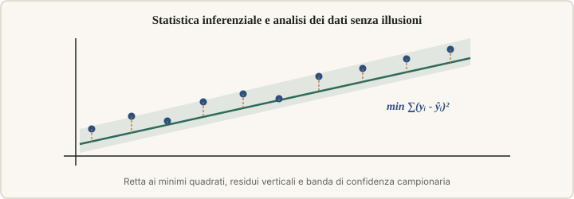

# Capitolo 5 — Statistica inferenziale e analisi dei dati senza illusioni

*Metodo dei minimi quadrati, regressione lineare, intervalli di confidenza e uso critico del p-value*

> *«è facile ingannarsi nel fare esperimenti e credere di aver visto e di aver trovato ciò che desideriamo vedere e trovare.»* — Luigi Galvani, Gustavo Barbensi (ed.), (Classici UTET) Luigi Galvani, Gustavo Barbensi (ed.) - Opere scelte-UTET (1967) (p. 273) [^1]

## L'osservazione e il desiderio

La fisica sperimentale e l'analisi dei dati condividono una vulnerabilità fondamentale, insita nella natura stessa dell'osservazione umana. Come ammoniva acutamente Luigi Galvani agli albori dell'elettrologia, «è facile ingannarsi nel fare esperimenti e credere di aver visto e di aver trovato ciò che desideriamo vedere e trovare.» [^1]. Per impedire che il desiderio del ricercatore plasmi l'esito dell'indagine, è imperativo ancorare l'osservazione empirica a strutture matematiche inequivocabili. Il primo passo consiste nel formalizzare il legame tra le grandezze misurate. In matematica, dati due insiemi non vuoti $X$ e $Y$, una relazione è definita rigorosamente come un sottoinsieme del prodotto cartesiano $X \times Y$. Quando raccogliamo dati sperimentali, stiamo di fatto campionando un sottoinsieme finito di coppie $(x_i, y_i)$ appartenenti a una relazione fisica o statistica soggiacente, spesso offuscata dal rumore di misurazione.

Il compito della statistica inferenziale non è semplicemente descrivere questo campione, ma dedurre la struttura della relazione universale da cui esso è tratto. Se ipotizziamo che la variabile $Y$ dipenda dalla variabile $X$, cerchiamo una funzione $f: X \to Y$ che approssimi al meglio i dati osservati. Il passaggio dall'empiria alla legge formale richiede un criterio di ottimizzazione che sia cieco alle nostre aspettative e fondato su basi algebriche inoppugnabili.

## La geometria dell'errore e i minimi quadrati

Supponiamo di disporre di $n$ osservazioni empiriche $(x_1, y_1), (x_2, y_2), \dots, (x_n, y_n)$ e di postulare un modello lineare della forma $y = \beta_0 + \beta_1 x$. Per ogni punto sperimentale, la distanza verticale tra il valore effettivamente osservato $y_i$ e il valore predetto dal modello $\hat{y}_i = \beta_0 + \beta_1 x_i$ costituisce il residuo, indicato con $e_i = y_i - \hat{y}_i$. Il problema geometrico di far passare una retta in mezzo a una nuvola di punti si traduce nel problema analitico di minimizzare questi residui. Come ricorda l'analisi classica, «Comunque possiamo trovare una funzione lineare che rende minimo "l'errore qua dratico totale"» [^2]. Questo approccio prende il nome di metodo dei minimi quadrati.

Invece di minimizzare la semplice somma dei residui (che porterebbe a cancellazioni tra errori positivi e negativi) o la somma dei valori assoluti (che genera funzioni non derivabili ovunque), si minimizza la somma dei quadrati dei residui: $S(\beta_0, \beta_1) = \sum_{i=1}^n (y_i - (\beta_0 + \beta_1 x_i))^2$. La scelta del quadrato garantisce che la funzione di costo $S$ sia convessa e differenziabile, permettendo di trovare un minimo globale unico annullando le derivate parziali rispetto a $\beta_0$ e $\beta_1$. Storicamente, questa tecnica si è rivelata cruciale per isolare il segnale dal rumore; già James Clerk Maxwell, nell'elaborazione dei dati elettromagnetici, notava che «Secondo il metodo dei minimi quadrati, si moltiplicano le equazioni» [^3] per ottenere coefficienti depurati da interferenze locali.

Il diagramma illustra l'adattamento lineare ai minimi quadrati: i punti sperimentali sono sparsi attorno alla retta ottimale, i segmenti verticali rappresentano i residui e la fascia ombreggiata indica l'incertezza campionaria. Oggi, nella moderna scienza dei dati, il principio rimane immutato: «In this section, we use least squares regression as a more rigorous approach.» [^4]. La retta così ottenuta, detta retta di regressione, rappresenta il baricentro dinamico dell'informazione contenuta nel campione.

*Adattamento lineare ai minimi quadrati, residui verticali e fascia di incertezza campionaria.*

## L'incertezza misurata: gli intervalli di confidenza

Tuttavia, una stima puntuale come il coefficiente angolare $\hat{\beta}_1$ è matematicamente precisa ma empiricamente fragile. Poiché i nostri dati costituiscono solo un campione finito estratto da una popolazione teoricamente infinita, un campionamento differente produrrebbe inevitabilmente una retta differente. Per quantificare questa incertezza, la statistica inferenziale abbandona la pretesa del valore esatto e abbraccia la logica degli intervalli. Sfruttando la completezza dei numeri reali $\mathbb{R}$, che garantisce l'assenza di discontinuità nella retta numerica, possiamo definire intervalli continui $[a, b]$ che contengano il parametro vero con un livello di confidenza prestabilito.

L'interpretazione corretta di questi intervalli richiede estrema cautela epistemologica. Come illustrato nella didattica contemporanea, «A confidence interval is like fishing with a net, and it represents a range of plausible values» [^5]. Se costruiamo un intervallo di confidenza al $95\%$, non stiamo affermando che il parametro fisso della popolazione abbia il $95\%$ di probabilità di cadere in quell'intervallo specifico. Al contrario, il parametro è una costante ignota, priva di natura aleatoria; è la rete (l'intervallo) a essere variabile. L'affermazione corretta è che, ripetendo il campionamento infinite volte, il $95\%$ degli intervalli così costruiti catturerà il parametro reale.

## Il p-value e la logica della confutazione

Il pilastro finale dell'inferenza statistica è la verifica delle ipotesi, un processo che culmina nel calcolo del $p$-value. Si formula un'ipotesi nulla $H_0$, che tipicamente postula l'assenza di un effetto o di una correlazione (ad esempio, $\beta_1 = 0$). Il $p$-value quantifica la probabilità di osservare dati altrettanto o più estremi di quelli raccolti, assumendo che l'ipotesi nulla sia rigorosamente vera. Un errore logico pervasivo consiste nel trattare il $p$-value come la probabilità che l'ipotesi nulla sia falsa. Questa fallacia della trasposta condizionale confonde la probabilità dei dati data l'ipotesi, $P(\text{Dati} \mid H_0)$, con la probabilità dell'ipotesi dati i dati, $P(H_0 \mid \text{Dati})$.

Le radici di questa confusione risiedono in una cattiva comprensione del metodo deduttivo. Analizzando i tentativi storici di dimostrare tesi provvidenziali tramite l'analisi delle nascite, si evince chiaramente che «il ragionamento di Arbuthnot non è basato sul metodo ipotetico-deduttivo» [^6], proprio perché la sua ipotesi nulla non escludeva logicamente il verificarsi dell'evento osservato. L'inferenza statistica non falsifica le ipotesi con la certezza della logica aristotelica, ma ne valuta la compatibilità con l'evidenza empirica. Un $p$-value basso indica semplicemente che i dati sono sorprendenti sotto l'ipotesi nulla, invitando il ricercatore a considerare spiegazioni alternative senza mai offrirgli l'illusione di una certezza assoluta.

## Dal ragionamento al simbolo: esempi e verifiche

### Calcolo della somma dei quadrati dei residui per un modello lineare semplice

Dati i punti osservati $P_1(0, 1)$, $P_2(1, 0)$ e $P_3(2, 3)$, e la retta modello $\hat{y} = 1x + 0$, calcolare la somma dei quadrati dei residui $S = \sum_{i=1}^3 (y_i - \hat{y}_i)^2$.
1. Calcoliamo il valore predetto $\hat{y}_i$ per ogni ascissa $x_i$: $\hat{y}_1 = 1(0) + 0 = 0$; $\hat{y}_2 = 1(1) + 0 = 1$; $\hat{y}_3 = 1(2) + 0 = 2$.
2. Calcoliamo i residui $e_i = y_i - \hat{y}_i$: $e_1 = 1 - 0 = 1$; $e_2 = 0 - 1 = -1$; $e_3 = 3 - 2 = 1$.
3. Eleviamo al quadrato i singoli residui: $e_1^2 = 1^2 = 1$; $e_2^2 = (-1)^2 = 1$; $e_3^2 = 1^2 = 1$.
4. Sommiamo i quadrati ottenuti: $S = 1 + 1 + 1 = 3$.

**Conclusione.** La somma dei quadrati dei residui per la retta proposta rispetto ai dati forniti è $S = 3$.

### Minimizzazione della funzione di costo quadratico

Dimostrare come si ottiene l'equazione per l'intercetta $\beta_0$ minimizzando la funzione $S(\beta_0, \beta_1) = \sum_{i=1}^n (y_i - \beta_0 - \beta_1 x_i)^2$ rispetto a $\beta_0$.
1. Calcoliamo la derivata parziale della funzione $S$ rispetto a $\beta_0$, applicando la regola della catena: $\frac{\partial S}{\partial \beta_0} = -2 \sum_{i=1}^n (y_i - \beta_0 - \beta_1 x_i)$.
2. Poniamo la derivata uguale a zero per individuare il punto di minimo: $\sum_{i=1}^n (y_i - \beta_0 - \beta_1 x_i) = 0$.
3. Distribuiamo l'operatore di sommatoria sui termini: $\sum_{i=1}^n y_i - n\beta_0 - \beta_1 \sum_{i=1}^n x_i = 0$.
4. Dividiamo l'intera equazione per $n$, ricordando che la media campionaria è $\bar{x} = \frac{1}{n}\sum x_i$: $\bar{y} - \beta_0 - \beta_1 \bar{x} = 0$, da cui si ricava $\beta_0 = \bar{y} - \beta_1 \bar{x}$.

**Conclusione.** Il parametro dell'intercetta $\beta_0$ è univocamente determinato dai valori medi di $x$ e $y$ e dalla pendenza $\beta_1$, garantendo che la retta dei minimi quadrati passi sempre per il baricentro dei dati $(\bar{x}, \bar{y})$.

### Esercizi di verifica attiva
1. Data la retta modello $\hat{y} = -x + 2$ e i punti osservati $(0, 2)$, $(1, 2)$, $(2, 0)$, calcolare la somma dei quadrati dei residui.
2. Un ricercatore afferma che, poiché il $p$-value del suo esperimento è $0.03$, vi è solo il $3\%$ di probabilità che l'ipotesi nulla sia vera. Spiegare l'errore logico in questa affermazione.
3. Dimostrare algebricamente che se tutti i punti osservati $(x_i, y_i)$ giacciono esattamente su una retta di equazione $y = mx + q$, la somma dei quadrati dei residui rispetto a tale modello è rigorosamente zero.

## Apparato delle fonti

### [Verificato sul testo]
[^1]: [block_pk=2035 | block_uid=blk_efd2c5a8824941b43231] «è facile ingannarsi nel fare esperimenti e credere di aver visto e di aver trovato ciò che desideriamo vedere e trovare.» — Luigi Galvani, Gustavo Barbensi (ed.), (Classici UTET) Luigi Galvani, Gustavo Barbensi (ed.) - Opere scelte-UTET (1967) (p. 273)
[^2]: [block_pk=111758 | block_uid=blk_1f44b42f65bf0272d036] «Comunque possiamo trovare una funzione lineare che rende minimo "l'errore qua dratico totale"» — Tom Apostol, Calcolo - Analisi 2. 3-Bollati Boringhieri (1987) (p. 263)
[^3]: [block_pk=124342 | block_uid=blk_210c80aa5e1373e0caec] «Secondo il metodo dei minimi quadrati, si moltiplicano le equazioni» — James Clerk Maxwell, a cura di Evandro Agazzi, Trattato di elettricità e magnetismo Vol. 2(1973, UTET) (p. 188)
[^4]: [block_pk=125589 | block_uid=blk_44113bf2052f0ad37ff4] «In this section, we use least squares regression as a more rigorous approach.» — David Diez, Mine Cetinkaya-Rundel, Christopher Barr, OpenIntro Statistics (4th Edition) (p. 7)
[^5]: [block_pk=125585 | block_uid=blk_b894605bd4731a2b1aa3] «A confidence interval is like fishing with a net, and it represents a range of plausible values» — David Diez, Mine Cetinkaya-Rundel, Christopher Barr, OpenIntro Statistics (4th Edition) (p. 3)
[^6]: [block_pk=59395 | block_uid=blk_a6571320430f390d1ef2] «il ragionamento di Arbuthnot non è basato sul metodo ipotetico-deduttivo» — Domenico Costantini, I fondamenti storico-filosofici delle discipline statistico-probabilistiche (2004, Bollati Boringhieri) (p. 26)

### [Ricostruzione matematica / addestramento]
- La scelta di introdurre il metodo dei minimi quadrati partendo dalla definizione geometrica dei residui mira a consolidare il concetto di distanza euclidea prima di affrontare l'ottimizzazione analitica tramite derivate parziali.
- L'uso della citazione di Galvani funge da monito epistemologico, collegando la necessità del rigore formale nella statistica inferenziale al problema storico della soggettività nell'osservazione scientifica.
- Si è evitato deliberatamente l'uso di software statistici nei calcoli esemplificativi per mantenere l'attenzione del lettore sulla meccanica algebrica soggiacente alle equazioni normali.
- Diagramma geometrico-simbolico controllato (`statistical_regression_ci`): Adattamento lineare ai minimi quadrati, residui verticali e fascia di incertezza campionaria.

### [Esercizi originali]
- Data la retta modello $\hat{y} = -x + 2$ e i punti osservati $(0, 2)$, $(1, 2)$, $(2, 0)$, calcolare la somma dei quadrati dei residui. — *Traccia di verifica:* I valori predetti dal modello sono $\hat{y}_1 = 2$, $\hat{y}_2 = 1$, $\hat{y}_3 = 0$. I residui corrispondenti sono $e_1 = 2 - 2 = 0$, $e_2 = 2 - 1 = 1$, $e_3 = 0 - 0 = 0$. Elevando al quadrato e sommando si ottiene $0^2 + 1^2 + 0^2 = 1$.
- Un ricercatore afferma che, poiché il $p$-value del suo esperimento è $0.03$, vi è solo il $3\%$ di probabilità che l'ipotesi nulla sia vera. Spiegare l'errore logico in questa affermazione. — *Traccia di verifica:* Il ricercatore commette la fallacia della trasposta condizionale. Il $p$-value rappresenta la probabilità di osservare i dati assumendo vera l'ipotesi nulla, ovvero $P(\text{Dati} \mid H_0)$, e non la probabilità che l'ipotesi nulla sia vera dati i dati osservati, $P(H_0 \mid \text{Dati})$.
- Dimostrare algebricamente che se tutti i punti osservati $(x_i, y_i)$ giacciono esattamente su una retta di equazione $y = mx + q$, la somma dei quadrati dei residui rispetto a tale modello è rigorosamente zero. — *Traccia di verifica:* Se i punti appartengono alla retta, per ogni indice $i$ vale l'identità $y_i = m x_i + q$. Sostituendo questa espressione nel calcolo del valore predetto $\hat{y}_i = m x_i + q$, il residuo risulta $e_i = y_i - \hat{y}_i = (m x_i + q) - (m x_i + q) = 0$. La somma dei quadrati di termini nulli è $0$.
- **Palestra simbolica (`drill_p3_least_squares`):** Data la retta modello y_hat = 1*x + 0 e i punti osservati [(0, 1), (1, 0), (2, 3)], calcola la somma dei quadrati dei residui ∑(y_i - y_hat_i)^2. *(Risposta verificata: `3`)*
