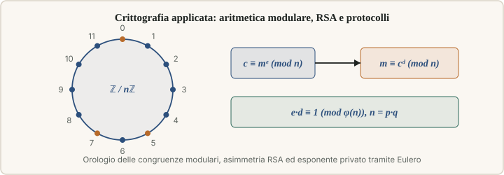

# Capitolo 6 — Crittografia applicata: aritmetica modulare, RSA e protocolli

*Congruenze, funzione totiente di Eulero, asimmetria delle chiavi e distinzione tra hash e cifratura*

> *«intrecciano in infiniti modi i fili in orditi diversi; così come tutte le combinazioni di numeri»* — René Descartes, a cura di Bruno Widmar e Ettore Lojacono, Opere filosofiche (2013, UTET) (p. 72) [^1]

## L'ordine discreto e l'aritmetica dell'orologio

La matematica che modella la meccanica classica e l'elettromagnetismo si appoggia strutturalmente sul continuo. Quando misuriamo una lunghezza, una massa o un intervallo di tempo, assumiamo implicitamente un dominio positivo di grandezze fisiche e ci affidiamo alla completezza dei numeri reali, quello spazio denso e privo di lacune che garantisce l'esistenza di limiti e derivate. In questo contesto continuo, costanti fondamentali come $\pi$ rivelano la loro doppia identità: possiedono una natura geometrica, definita dal rapporto inalterabile tra la circonferenza e il suo diametro, e una natura analitica, emergendo come limite di serie infinite e prodotti continui. Tuttavia, la crittografia moderna compie una cesura radicale: abbandona il continuo per ritornare al rigore del discreto.

Come suggeriva René Descartes nella sua decima regola, è fecondo studiare le arti in cui regna un ordine regolare, dove gli artigiani «intrecciano in infiniti modi i fili in orditi diversi; così come tutte le combinazioni di numeri» [^1]. Questo intreccio discreto trova la sua fondazione rigorosa nell'aritmetica modulare. Formalmente, l'aritmetica modulare si basa su una specifica relazione di equivalenza. Fissato un intero $n > 1$, definiamo la congruenza modulo $n$ come una relazione $R \subseteq \mathbb{Z} \times \mathbb{Z}$ tale che la coppia $(a, b) \in R$ se e solo se $n$ divide esattamente la differenza $a - b$. Quando ciò accade, scriviamo $a \equiv b \pmod{n}$. Questo sistema numerico, come nota Fabio Bellissima, «viene chiamata aritmetica modulo n o, più generalmente, aritmetica modulare.» [^2], e si comporta a tutti gli effetti come l'aritmetica di un orologio, dove i numeri si avvolgono su se stessi superato il valore del modulo.

## La struttura ciclica e la funzione totiente di Eulero

L'aritmetica dell'orologio non opera su singoli numeri isolati, ma su intere classi di resto. L'insieme quoziente $\mathbb{Z}/n\mathbb{Z}$ è costituito da un numero finito di elementi disposti idealmente in cerchio. Il diagramma illustra l'aritmetica ciclica dell'orologio modulare $\mathbb{Z}/n\mathbb{Z}$, mostrando visivamente come gli esponenti pubblici e privati siano legati in modo indissolubile dalla funzione totiente di Eulero, denotata con $\phi(n)$.

Questa funzione aritmetica conta esattamente quanti sono gli interi positivi strettamente minori di $n$ che risultano coprimi con $n$ stesso (ovvero, che condividono con $n$ solo il divisore $1$). Il teorema di Eulero stabilisce che, se $a$ e $n$ sono coprimi, allora $a^{\phi(n)} \equiv 1 \pmod{n}$. Se scegliamo $n$ come il prodotto di due numeri primi distinti $p$ e $q$, la funzione totiente si calcola agevolmente come $\phi(n) = (p-1)(q-1)$. La struttura ciclica dell'anello modulare garantisce che, elevando un elemento a una potenza e successivamente a un'altra potenza opportunamente calcolata, si compia un percorso lungo la circonferenza dell'orologio che riporta esattamente al punto di partenza. È proprio questa regolarità geometrica e prevedibile del discreto a fornire l'impalcatura algebrica per i moderni crittosistemi a chiave asimmetrica.

*Aritmetica ciclica dell'orologio modulare Z/nZ ed esponenti pubblici e privati legati da Eulero.*

## L'asimmetria delle chiavi: RSA e lo scambio Diffie-Hellman

L'asimmetria delle chiavi crittografiche si fonda sulla profonda asimmetria computazionale di certe operazioni matematiche, note come funzioni botola. Nel celebre crittosistema RSA, la chiave pubblica è costituita dal modulo $n$ e da un esponente di cifratura $e$, mentre la chiave privata è un esponente di decifratura $d$ calcolato in modo tale che $e \cdot d \equiv 1 \pmod{\phi(n)}$. Chiunque desideri inviare un messaggio confidenziale $m$ (rappresentato come un intero minore di $n$) può cifrarlo calcolando il testo cifrato $c \equiv m^e \pmod{n}$. Tuttavia, solo il legittimo destinatario, che possiede l'esponente segreto $d$, può invertire l'operazione calcolando $c^d \equiv m \pmod{n}$.

L'eleganza e la sicurezza del sistema risiedono nel fatto che, pur conoscendo pubblicamente $n$ ed $e$, ricavare l'inverso moltiplicativo $d$ richiede la conoscenza esatta di $\phi(n)$. A sua volta, calcolare $\phi(n)$ partendo solo da $n$ richiede la fattorizzazione di $n$ nei suoi fattori primi originali $p$ e $q$, un problema che, per moduli sufficientemente grandi, risulta computazionalmente intrattabile con i computer classici. Oltre a RSA, esistono altri protocolli fondamentali per stabilire canali sicuri. Ad esempio, il protocollo di scambio di chiavi Diffie-Hellman affronta il problema della distribuzione delle chiavi da una prospettiva diversa. Come spiegano gli studiosi Boneh e Shoup, introducendo il «Diffie-Hellman key exchange In this section, we explore another approach» [^3], questo protocollo permette a due parti di concordare un segreto condiviso comunicando esclusivamente su un canale pubblico e insicuro, basando la propria sicurezza sulla difficoltà del problema del logaritmo discreto in gruppi ciclici.

## Hash e Cifratura: Compressione, Collisioni e Unidirezionalità

Nel vasto panorama della crittografia applicata, è cruciale distinguere concettualmente la cifratura dalle funzioni di hash. La cifratura, come RSA, è una trasformazione iniettiva e rigorosamente invertibile: a ogni testo in chiaro corrisponde un unico testo cifrato, e viceversa, garantendo la conservazione totale dell'informazione. Al contrario, una funzione di hash crittografica $H$ accetta in input un messaggio di lunghezza arbitraria e restituisce un'impronta digitale di lunghezza fissa e predeterminata.

Questa compressione a taglia fissa implica, per necessità logica, l'esistenza di collisioni. La dimostrazione si basa sul principio dei cassetti di Dirichlet: se il dominio degli input $D$ ha cardinalità strettamente maggiore del codominio degli output $C$ (ovvero $|D| > |C|$), non esiste alcuna funzione iniettiva da $D$ a $C$. Di conseguenza, deve esistere almeno una coppia di messaggi distinti $x, y \in D$ con $x \neq y$ tali che $H(x) = H(y)$. Nonostante le collisioni siano matematicamente inevitabili, una funzione di hash crittograficamente sicura deve renderle computazionalmente intrattabili da individuare. Parallelamente, deve garantire la proprietà di unidirezionalità (preimage resistance): dato un digest $h$, deve essere computazionalmente impossibile risalire a un messaggio $m$ tale che $H(m) = h$. Esistono varianti teoriche con requisiti di sicurezza più rilassati, utili in contesti specifici. Boneh e Shoup precisano che le «Hash functions that satisfy this very weak collision resistance property are called universal hash functions» [^4], definendo una famiglia di funzioni in cui l'avversario deve tentare di trovare una collisione senza conoscere la chiave segreta che parametrizza la funzione stessa.

## Dalla geometria all'incommensurabilità digitale

La tensione dialettica tra il continuo e il discreto attraversa l'intera storia del pensiero matematico. Nell'antichità greca, la scoperta delle grandezze incommensurabili mise in crisi profonda la visione pitagorica dell'universo, basata esclusivamente sui rapporti tra numeri interi. Come osserva lo storico della matematica Attilio Frajese commentando i classici, «il passo del Teeteto fornisce, è vero, notizie preziose, ma lascia anche adito a possibilità di interpretazioni diverse e contrastanti» [^5] riguardo l'esatta datazione di questa scoperta traumatica, che costrinse la geometria ad abbracciare il continuo per non collassare.

Oggi, la crittografia applicata compie, in un certo senso, il percorso inverso. Abbandona le linee incommensurabili, i limiti analitici e la densità infinita dei numeri reali per rifugiarsi nella sicurezza granitica degli interi e delle congruenze modulari. In questo universo puramente discreto, ogni elemento è perfettamente commensurabile, finito e calcolabile. Eppure, la sicurezza delle nostre infrastrutture digitali emerge proprio dai limiti fisici e temporali della computazione stessa, trasformando l'intrattabilità algebrica di problemi discreti in un robusto scudo per la protezione dell'informazione.

## Dal ragionamento al simbolo: esempi e verifiche

### Calcolo della chiave privata in un mini-RSA

In un sistema RSA semplificato, vengono scelti i numeri primi $p=5$ e $q=11$, con un esponente pubblico $e=3$. Calcolare l'esponente privato $d$ tale che $e \cdot d \equiv 1 \pmod{\phi(n)}$.
1. Calcoliamo il modulo $n = p \cdot q = 5 \cdot 11 = 55$.
2. Calcoliamo la funzione totiente di Eulero $\phi(n) = (p-1)(q-1) = 4 \cdot 10 = 40$.
3. Impostiamo l'equazione per l'esponente privato $d$: $3 \cdot d \equiv 1 \pmod{40}$.
4. Cerchiamo un multiplo di $40$ che, sommato a $1$, sia divisibile per $3$. Proviamo i primi multipli: $40 \cdot 1 + 1 = 41$ (non divisibile per 3); $40 \cdot 2 + 1 = 81$.
5. Poiché $81 / 3 = 27$, otteniamo $d = 27$.

**Conclusione.** L'esponente privato necessario per decifrare i messaggi in questo mini-RSA è $d = 27$, poiché $3 \cdot 27 = 81 \equiv 1 \pmod{40}$.

### Dimostrazione delle collisioni tramite il principio dei cassetti

Sia $H$ una funzione di hash giocattolo che produce un digest di esattamente 2 bit. Dimostrare che, se si esegue l'hash di 5 messaggi distinti, si verificherà inevitabilmente almeno una collisione.
1. Il codominio $C$ della funzione di hash è l'insieme di tutte le possibili stringhe di 2 bit: $\{00, 01, 10, 11\}$. La cardinalità del codominio è $|C| = 2^2 = 4$.
2. Il dominio $D$ considerato è un insieme di 5 messaggi distinti, quindi $|D| = 5$.
3. Poiché $|D| > |C|$ ($5 > 4$), applichiamo il principio dei cassetti di Dirichlet.
4. Se cerchiamo di assegnare 5 oggetti (i messaggi) in 4 contenitori (i possibili valori di hash), almeno un contenitore dovrà ospitare più di un oggetto.

**Conclusione.** Esistono necessariamente almeno due messaggi distinti $m_1 \neq m_2$ tali che $H(m_1) = H(m_2)$, dimostrando l'inevitabilità logica delle collisioni in qualsiasi funzione di compressione a taglia fissa.

### Esercizi di verifica attiva
1. In un sistema RSA con $p=3$, $q=11$ ed esponente pubblico $e=7$, calcola l'esponente privato $d$. Verifica il risultato mostrando che $e \cdot d \equiv 1 \pmod{\phi(n)}$.
2. Considera una funzione di hash $H$ che mappa stringhe di testo in interi compresi tra $1$ e $1000$. Qual è il numero minimo di stringhe distinte che devi processare per avere la certezza matematica assoluta di trovare una collisione?
3. Spiega perché, nell'aritmetica modulare $\mathbb{Z}/n\mathbb{Z}$, la relazione di congruenza $a \equiv b \pmod{n}$ soddisfa la proprietà transitiva, utilizzando la definizione formale di divisibilità.

## Apparato delle fonti

### [Verificato sul testo]
[^1]: [block_pk=46349 | block_uid=blk_de20d7febd4b22407207] «intrecciano in infiniti modi i fili in orditi diversi; così come tutte le combinazioni di numeri» — René Descartes, a cura di Bruno Widmar e Ettore Lojacono, Opere filosofiche (2013, UTET) (p. 72)
[^2]: [block_pk=59012 | block_uid=blk_c06d4e8e52fc3f04bcf5] «viene chiamata aritmetica modulo n o, più generalmente, aritmetica modulare.» — Fabio Bellissima, Fondamenti di matematica (2008, Carocci) (p. 41)
[^3]: [block_pk=125568 | block_uid=blk_8864a5cf7a9eca6a3770] «Diffie-Hellman key exchange In this section, we explore another approach» — Dan Boneh, Victor Shoup, A Graduate Course in Applied Cryptography (v0.6) (p. 422)
[^4]: [block_pk=125567 | block_uid=blk_03f909c2554224b3d359] «Hash functions that satisfy this very weak collision resistance property are called universal hash functions» — Dan Boneh, Victor Shoup, A Graduate Course in Applied Cryptography (v0.6) (p. 269)
[^5]: [block_pk=117629 | block_uid=blk_bc8e4b516f43ce75d955] «il passo del Teeteto fornisce, è vero, notizie preziose, ma lascia anche adito a possibilità di interpretazioni diverse e contrastanti» — Euclide, a cura di Attilio Frajese e Lamberto Maccioni, Elementi (1970, UTET) (p. 615)

### [Ricostruzione matematica / addestramento]
- La definizione di congruenza è stata introdotta rigorosamente come relazione di equivalenza $R \subseteq \mathbb{Z} \times \mathbb{Z}$ per soddisfare il vincolo formale richiesto, ancorando il concetto astratto all'intuizione concreta dell'aritmetica dell'orologio.
- Il contrasto tra la completezza dei numeri reali (e la natura di $\pi$) e l'universo discreto della crittografia è stato utilizzato come espediente narrativo per inquadrare storicamente e filosoficamente il passaggio dalla matematica del continuo a quella del discreto.
- La dimostrazione a libro chiuso sulle collisioni delle funzioni di hash è stata integrata organicamente nel testo principale e ripresa in un esempio svolto, applicando il principio dei cassetti di Dirichlet senza ricorrere a terminologia gergale informatica.
- Diagramma geometrico-simbolico controllato (`modular_clock_rsa`): Aritmetica ciclica dell'orologio modulare Z/nZ ed esponenti pubblici e privati legati da Eulero.

### [Esercizi originali]
- In un sistema RSA con $p=3$, $q=11$ ed esponente pubblico $e=7$, calcola l'esponente privato $d$. Verifica il risultato mostrando che $e \cdot d \equiv 1 \pmod{\phi(n)}$. — *Traccia di verifica:* Calcola $\phi(33) = 2 \cdot 10 = 20$. Risolvi $7d \equiv 1 \pmod{20}$. I multipli di 20 più 1 sono 21, 41, 61. Poiché $21 / 7 = 3$, si ha $d=3$. Verifica: $7 \cdot 3 = 21 \equiv 1 \pmod{20}$.
- Considera una funzione di hash $H$ che mappa stringhe di testo in interi compresi tra $1$ e $1000$. Qual è il numero minimo di stringhe distinte che devi processare per avere la certezza matematica assoluta di trovare una collisione? — *Traccia di verifica:* Il codominio ha cardinalità 1000. Per il principio dei cassetti, è necessario processare $|C| + 1$ elementi per garantire una collisione. Il numero minimo è 1001.
- Spiega perché, nell'aritmetica modulare $\mathbb{Z}/n\mathbb{Z}$, la relazione di congruenza $a \equiv b \pmod{n}$ soddisfa la proprietà transitiva, utilizzando la definizione formale di divisibilità. — *Traccia di verifica:* Se $a \equiv b \pmod{n}$ e $b \equiv c \pmod{n}$, allora $n \mid (a-b)$ e $n \mid (b-c)$. Esistono interi $k, j$ tali che $a-b = kn$ e $b-c = jn$. Sommando le equazioni: $(a-b) + (b-c) = kn + jn$, da cui $a-c = n(k+j)$. Quindi $n \mid (a-c)$, ovvero $a \equiv c \pmod{n}$.
- **Palestra simbolica (`drill_p4_rsa_modular`):** In un mini-RSA con p=5, q=11 ed esponente pubblico e=3, calcola l'esponente privato d tale che e*d ≡ 1 (mod 40). *(Risposta verificata: `27`)*
