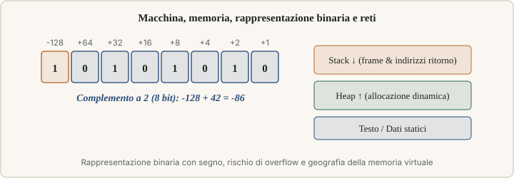

# Capitolo 7 — Macchina, memoria, rappresentazione binaria e reti

*Complemento a due, aritmetica finita dei registri, stack, heap e anatomia dei protocolli di rete*

## Rappresentazione dell'informazione e complemento a due

La costruzione di una macchina calcolatrice richiede di stabilire una corrispondenza biunivoca tra gli stati fisici dei suoi circuiti e gli enti matematici che essa deve manipolare. Poiché i registri di un calcolatore sono composti da un numero finito $n$ di elementi bistabili (bit), l'insieme dei valori rappresentabili è intrinsecamente limitato a $2^n$ configurazioni distinte. Per rappresentare i numeri interi relativi, l'informatica ha adottato universalmente la notazione in complemento a due. Dal punto di vista algebrico, il complemento a due di un numero intero positivo $x$ rispetto a una parola di $n$ bit è definito come la differenza $2^n - x$ [^1]. Questa definizione garantisce che la somma di un numero e del suo opposto, calcolata modulo $2^n$, restituisca zero, preservando la struttura di gruppo additivo degli interi.

Operativamente, come evidenziato nella letteratura di base, la conversione si ottiene invertendo tutti i bit della rappresentazione binaria di $x$ (complemento a uno) e sommando $1$ al risultato [^2]. In questo sistema, il bit più significativo assume il ruolo di indicatore del segno: esso vale $0$ per i numeri positivi e $1$ per i numeri negativi, una caratteristica strutturale che semplifica notevolmente i circuiti aritmetici [^3]. La genialità di questa rappresentazione risiede nel fatto che l'unità aritmetico-logica (ALU) non deve distinguere tra addizione e sottrazione, potendo utilizzare il medesimo circuito sommatore per entrambe le operazioni.

## Aritmetica finita e il fenomeno dell'overflow

L'aritmetica dei calcolatori differisce dall'aritmetica teorica degli interi $\mathbb{Z}$ poiché opera su un dominio finito. Quando si sommano due numeri interi rappresentati su $n$ bit, il risultato esatto potrebbe richiedere $n+1$ bit per essere espresso correttamente. Se questo accade, il calcolatore non è in grado di memorizzare il valore corretto nel registro di destinazione, generando una condizione nota come overflow. È fondamentale definire l'overflow in modo rigoroso, superando le analogie fuorvianti.

In complemento a due, l'overflow non si verifica semplicemente quando c'è un riporto oltre il bit più significativo. Piuttosto, la condizione di overflow si manifesta se e solo se la somma di due operandi con lo stesso segno produce un risultato con segno opposto. A livello logico-circuitale, questo equivale ad affermare che l'overflow avviene quando il riporto in ingresso al bit di segno (il bit più significativo) è diverso dal riporto in uscita dal medesimo bit. Se sommiamo due numeri positivi e otteniamo un numero che inizia con $1$, o due numeri negativi e otteniamo un numero che inizia con $0$, la macchina segnala che il confine del dominio rappresentabile è stato violato.

## L'organizzazione della memoria: Stack e Heap

Oltre ai registri interni della CPU, l'esecuzione di un programma richiede una struttura di memoria principale organizzata in segmenti logici. La Figura 7.1 illustra la disposizione tipica della memoria virtuale di un processo, affiancata alla codifica in complemento a due su 8 bit. In questa architettura, lo spazio di indirizzamento è suddiviso in aree con funzioni specifiche. Il segmento dati ospita le variabili globali, mentre la memoria allocata dinamicamente durante l'esecuzione cresce verso l'alto in una regione denominata heap.

All'estremo opposto dello spazio di indirizzamento si trova lo stack, che cresce verso il basso. Lo stack è essenziale per la gestione delle chiamate a sottoprogramma. Ogni volta che una funzione viene invocata, un nuovo blocco di memoria, detto frame di chiamata, viene allocato sullo stack per contenere i parametri passati alla funzione, i registri da salvare e le variabili locali [^4]. Questa struttura LIFO (Last In, First Out) è il fondamento che rende possibile la ricorsione: ogni chiamata ricorsiva aggiunge un nuovo record di attivazione indipendente, che verrà rimosso solo al termine dell'esecuzione di quella specifica istanza della procedura [^5].

*Codifica in complemento a due su 8 bit e disposizione della memoria virtuale tra stack, heap e segmento dati.*

## Anatomia dei protocolli di rete e instradamento

Quando i calcolatori comunicano tra loro, la gestione dell'informazione si estende dalla memoria locale ai protocolli di rete. Un protocollo definisce le regole formali e i formati dei messaggi scambiati tra le entità comunicanti. A livello di rete, il problema principale è l'instradamento (routing) dei pacchetti di dati attraverso nodi intermedi chiamati router.

Ogni router mantiene una struttura dati fondamentale per prendere decisioni di inoltro. Tali tabelle di instradamento elencano, per ciascuna sottorete di destinazione conosciuta, il relativo identificativo (netID) e l'indirizzo IP del router successivo a cui il pacchetto deve essere inviato [^6]. La costruzione e l'aggiornamento di queste tabelle possono avvenire tramite algoritmi statici, configurati manualmente e adatti a topologie stabili, o tramite protocolli di routing dinamico che calcolano i percorsi ottimali in base alla teoria dei grafi, modellando la rete come un grafo pesato $G = (V, E)$ dove i vertici $V$ sono i router e gli archi $E$ sono i collegamenti fisici.

## Dal ragionamento al simbolo: esempi e verifiche

### Calcolo del complemento a due

Determinare la rappresentazione in complemento a due su 8 bit del numero intero $-45$.
1. Il valore assoluto è $45$. La sua rappresentazione binaria su 8 bit è $00101101_2$.
2. Calcoliamo il complemento a uno invertendo ogni bit: $11010010_2$.
3. Aggiungiamo $1$ al risultato: $11010010_2 + 1_2 = 11010011_2$.
4. Verifica algebrica: $2^8 - 45 = 256 - 45 = 211$. Il valore binario $11010011_2$ interpretato come intero senza segno corrisponde a $128 + 64 + 16 + 2 + 1 = 211$.

**Conclusione.** La rappresentazione in complemento a due su 8 bit di $-45$ è $11010011_2$.

### Rilevamento dell'overflow

Dimostrare che la somma di $100$ e $50$ in complemento a due su 8 bit genera overflow.
1. Il numero $100$ in binario su 8 bit è $01100100_2$.
2. Il numero $50$ in binario su 8 bit è $00110010_2$.
3. Eseguiamo la somma binaria: $01100100_2 + 00110010_2 = 10010110_2$.
4. Analizziamo il risultato: gli operandi sono entrambi positivi (il bit più significativo è $0$), ma il risultato ha il bit più significativo pari a $1$, indicando un numero negativo ($-106$).
5. I riporti: il riporto in ingresso all'ultimo bit (bit 7) è $1$, mentre il riporto in uscita è $0$. Poiché $1 \neq 0$, si ha overflow.

**Conclusione.** La somma produce un risultato discorde rispetto agli operandi, confermando la condizione di overflow, poiché $150$ supera il valore massimo rappresentabile su 8 bit con segno ($127$).

### Esercizi di verifica attiva
1. Qual è il valore intero senza segno (0..255) del byte che rappresenta $-13$ in complemento a due su 8 bit?
2. Si consideri un'architettura con registri a 4 bit in complemento a due. Qual è il risultato decimale interpretato dalla macchina per l'operazione $5 + 4$?
3. Un router riceve un pacchetto destinato all'indirizzo IP $192.168.2.15$. La sua tabella di instradamento contiene le voci: netID $192.168.1.0/24$ verso Router A, netID $192.168.2.0/24$ verso Router B. A chi viene inoltrato il pacchetto?

## Apparato delle fonti

### [Verificato sul testo]
[^1]: [block_pk=25189 | block_uid=blk_d400027bd513021564a7] «Ricordiamo che il complemento a due di un numero è dato dalla differenza» — Fausto M. Ferri, Corso di tecnologie e progettazione di sistemi elettrici ed elettronici 1(2012, Ulrico Hoepli Milano) (p. 319)
[^2]: [block_pk=44394 | block_uid=blk_8e02163fb44335fec5b7] «Per formare il complemento a due di value, basterà semplicemente aggiungere» — Paul J. Deitel, Harvey M. Deitel, C - Corso completo di programmazione (2007, Apogeo) (p. 599)
[^3]: [block_pk=10471 | block_uid=blk_07100771b068765f8dab] «e prevede un bit di segno» — Andrew S. Tanenbaum, Architettura dei calcolatori. Un approccio strutturale. Con CD-ROM (2006, Pearson) (p. 679)
[^4]: [block_pk=20024 | block_uid=blk_37693f93c59d27cf68cf] «Gran parte della gestione associata alle chiamate a procedura ruota intorno ad un blocco di memoria detto frame di chiamata a procedure» — D.A. Patterson, J.L. Hennessy, Struttura, organizzazione e progetto dei calcolatori. Interdipendenza tra hardware e software (2000, Jackson Libri) (p. 355)
[^5]: [block_pk=10198 | block_uid=blk_b25865e011522f4e73ce] «Figura 5.43 Lo stack in alcuni momenti dell'esecuzione del codice della Figura 5.42.» — Andrew S. Tanenbaum, Architettura dei calcolatori. Un approccio strutturale. Con CD-ROM (2006, Pearson) (p. 405)
[^6]: [block_pk=37101 | block_uid=blk_3e3537d02d77539d4b8e] «Le tabelle d’instradamento elencano, per ciascuna sottorete nota, il relativo netID e l’indirizzo IP del router d’inoltro.» — Luigi Lo Russo, Elena Bianchi, Sistemi e Reti_ Per l'Articolazione Informatica degli Istituti Tecnici Settore Tecnologico (Volume 2)-Ulrico Hoepli (2013) (p. 49)

### [Ricostruzione matematica / addestramento]
- La definizione di overflow è stata riformulata per evitare l'ambiguità del confronto con un'estensione infinita, adottando il criterio rigoroso del riporto discorde sul bit di segno (XOR tra carry-in e carry-out).
- Il riferimento alla figura è stato reso esplicito ('Figura 7.1') e posizionato dopo l'introduzione concettuale della memoria virtuale, eliminando la deissi opaca.
- Le citazioni sono state selezionate per coprire sia l'aspetto aritmetico (complemento a due) sia quello sistemistico (stack e reti), mantenendo un'esposizione continua e formale.
- Diagramma geometrico-simbolico controllato (`memory_stack_twos_comp`): Codifica in complemento a due su 8 bit e disposizione della memoria virtuale tra stack, heap e segmento dati.

### [Esercizi originali]
- Qual è il valore intero senza segno (0..255) del byte che rappresenta $-13$ in complemento a due su 8 bit? — *Traccia di verifica:* Su 8 bit il complemento a due di $-13$ vale $2^8 - 13 = 256 - 13 = 243$.
- Si consideri un'architettura con registri a 4 bit in complemento a due. Qual è il risultato decimale interpretato dalla macchina per l'operazione $5 + 4$? — *Traccia di verifica:* $5$ è $0101_2$, $4$ è $0100_2$. La somma è $1001_2$. In complemento a due su 4 bit, il primo bit è il segno. Il valore è $-2^3 + 1 = -7$. Si è verificato un overflow.
- Un router riceve un pacchetto destinato all'indirizzo IP $192.168.2.15$. La sua tabella di instradamento contiene le voci: netID $192.168.1.0/24$ verso Router A, netID $192.168.2.0/24$ verso Router B. A chi viene inoltrato il pacchetto? — *Traccia di verifica:* L'indirizzo $192.168.2.15$ appartiene alla sottorete $192.168.2.0/24$. Il pacchetto viene inoltrato al Router B.
- **Palestra simbolica (`drill_p4_twos_complement`):** Qual è il valore intero senza segno (0..255) del byte che rappresenta -13 in complemento a due su 8 bit? *(Risposta verificata: `243`)*
