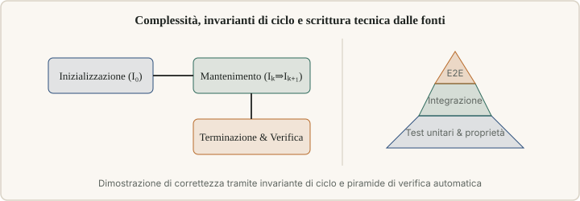

# Capitolo 8 — Complessità, invarianti di ciclo e scrittura tecnica dalle fonti

*Correttezza formale degli algoritmi, ordini di crescita, riga di comando e rigore argomentativo*

> *«La semantica formale dei linguaggi di programmazione propone un insieme di modelli matematici che precisano le proprietà dell’esecuzione dei programmi»* — Glynn Winskel, La Semantica Formale Dei Linguaggi Di Programmazione (UTET Università) (p. 6) [^1]

## La radice formale del calcolo e la semantica

La scrittura di un algoritmo richiede una distinzione netta tra il simbolo e il suo significato, un confine che separa la meccanica del calcolo dalla sua interpretazione. Come ricorda la logica matematica, «La sintassi è la pura manipolazione formale dei simboli» [^2]. Tuttavia, un programma per calcolatore non è una mera sequenza di caratteri inermi; esso possiede un significato preciso che determina l'evoluzione dello stato della macchina nel tempo. Per questo motivo, «La semantica formale dei linguaggi di programmazione propone un insieme di modelli matematici che precisano le proprietà dell’esecuzione dei programmi» [^1].

Senza questo ancoraggio rigoroso, la programmazione si ridurrebbe a un esercizio empirico di tentativi ed errori, privo di garanzie analitiche sul risultato finale. La semantica fornisce il ponte tra l'astrazione del pensiero algoritmico e la concretezza dell'esecuzione fisica, permettendo di ragionare sulle transizioni di stato con la stessa precisione con cui si manipolano le equazioni algebriche.

## Relazioni, funzioni e il miraggio della reversibilità

Per analizzare rigorosamente un singolo passo computazionale, possiamo modellarlo matematicamente come una relazione $R \subseteq A \times B$, dove l'insieme $A$ rappresenta lo spazio degli stati iniziali della memoria e l'insieme $B$ lo spazio degli stati finali. È fondamentale chiarire un equivoco logico ricorrente: definire un algoritmo tramite una relazione non garantisce affatto la sua reversibilità. Affinché un processo computazionale sia invertibile, permettendo di risalire univocamente dall'output all'input, la relazione deve possedere proprietà strutturali aggiuntive; deve, in particolare, costituire una funzione biunivoca, essendo simultaneamente iniettiva e suriettiva. Molti calcoli, come l'assegnamento distruttivo o le operazioni di modulo, comportano una perdita di informazione irreversibile.

Questa formalizzazione si appoggia su strutture matematiche profonde che trascendono l'algebra discreta. Quando analizziamo algoritmi che operano su grandezze continue, ci scontriamo inevitabilmente con la completezza dei numeri reali $\mathbb{R}$. Questa proprietà assiomatica garantisce l'esistenza dei limiti e l'assenza di discontinuità strutturali nella retta numerica, un requisito essenziale per dimostrare la convergenza dei metodi numerici iterativi. Allo stesso modo, quando progettiamo un algoritmo per calcolare le cifre decimali di $\pi$, dobbiamo distinguere con cura tra la sua natura geometrica, intesa come il rapporto invariante tra la circonferenza e il proprio diametro, e la sua natura analitica, definita come il limite di specifiche serie infinite. L'algoritmo scelto dipenderà intimamente da quale di queste definizioni adottiamo come punto di partenza. Inoltre, nell'analisi delle prestazioni, variabili come il tempo di esecuzione e lo spazio di memoria appartengono intrinsecamente al dominio positivo di grandezze fisiche, richiedendo che le funzioni di costo mappino rigorosamente verso l'insieme $\mathbb{R}^+$.

## Invarianti di ciclo e correttezza formale

La correttezza di un algoritmo iterativo non si deduce dall'osservazione di alcuni casi di test, ma si stabilisce formalmente attraverso la tecnica degli invarianti di ciclo. Un invariante è una proprietà logica rigorosa che rimane inalterata prima, durante e dopo l'esecuzione di un blocco iterativo. Come evidenziato nella teoria dei linguaggi, «Questa semplice dimostrazione dell’equivalenza di un comando “while” e della sua riscrittura come comando condizionale, evidenzia una tecnica importante» [^3]. Il ciclo dimostrativo dell'invariante si articola in tre fasi ineludibili: l'inizializzazione, in cui si dimostra che la proprietà è vera prima che il ciclo inizi; il mantenimento, che assicura che se la proprietà è vera all'inizio di un'iterazione, lo sarà anche al termine della stessa; e infine la terminazione, in cui il ciclo si conclude e l'invariante, combinato con la falsità della condizione di guardia, dimostra l'obiettivo prefissato.

Questo approccio metodologico garantisce che il ragionamento formale sia inattaccabile. Nella logica matematica, «Per correttezza si intende che ogni formula A che chiamiamo valida [...] è davvero valida.» [^4]. Solo attraverso questa verifica sistematica e deduttiva possiamo fidarci dei risultati prodotti da cicli complessi che elaborano milioni di dati, trasformando la programmazione da artigianato a disciplina matematica.

*Ciclo dimostrativo dell'invariante (inizializzazione, mantenimento, terminazione) e verifica sistematica.*

## Ordini di grandezza e complessità computazionale

Una volta garantita la correttezza logica, l'attenzione dell'informatico si sposta sull'efficienza, misurata tramite la complessità asintotica. La distinzione fondamentale in questo campo risiede nell'ordine di crescita delle funzioni di costo: «un algoritmo è efficiente se la sua complessità è di ordine polinomiale, mentre è inefficiente» se la sua crescita è superpolinomiale o esponenziale [^5]. Ad esempio, il calcolo dei cammini minimi all'interno di un grafo presenta costi computazionali profondamente diversi a seconda dell'approccio algoritmico scelto. Sappiamo dalla letteratura tecnica che «La complessità di calcolo di questo algoritmo è O(n2)» [^6] nel caso dell'algoritmo di Dijkstra nella sua forma classica, mentre per reti con pesi negativi «l'algoritmo di Bellman-Ford-Moore ha complessità O(n(m + n)) = O(nm), qualsiasi sia il segno delle lunghezze degli archi.» [^7].

Un caso emblematico per comprendere la sottile differenza tra operazioni e iterazioni è la ricerca binaria. Se cerchiamo un elemento specifico in un vettore ordinato di $N = 256$ elementi, il numero di iterazioni di dimezzamento puro dello spazio di ricerca è esattamente $\log_2(256) = 8$. Tuttavia, se contiamo il numero massimo di confronti necessari per stabilire con certezza l'assenza dell'elemento, dobbiamo aggiungere il controllo finale sull'ultimo elemento rimasto, arrivando a $9$ confronti complessivi. È essenziale, nella scrittura tecnica, distinguere in modo cristallino tra il conteggio delle iterazioni del ciclo e il numero totale di operazioni logiche eseguite dalla macchina.

## Dalla teoria alla macchina: la riga di comando e la struttura

La traduzione di questi concetti astratti in codice eseguibile richiede una ferrea disciplina strutturale. Storicamente, per dominare la complessità del software, «la professione della programmazione ha scelto di combinare i simboli dei diagrammi di flusso in un insieme limitato di istruzioni di controllo» [^8], dando vita al paradigma della programmazione strutturata. Questa disciplina del rigore si estende fino all'interazione più diretta con il sistema operativo, ovvero l'utilizzo della riga di comando.

La gestione dei permessi nei sistemi POSIX, ad esempio, riflette una logica combinatoria rigorosa e trasparente: una stringa simbolica come `rwxr-x---` si traduce in un codice ottale sommando i valori dei singoli bit di accesso (lettura, scrittura, esecuzione) per le diverse classi di utenti. Questo dimostra come l'algebra elementare e la rappresentazione binaria governino non solo l'efficienza degli algoritmi, ma anche la sicurezza fondamentale dei sistemi informatici su cui poggia l'infrastruttura moderna. L'uso della riga di comando non è un retaggio del passato, ma l'espressione più pura del controllo formale sulla macchina, dove ogni comando è una funzione matematica applicata allo stato del sistema.

## Dal ragionamento al simbolo: esempi e verifiche

### Calcolo delle iterazioni e dei confronti nella ricerca binaria

Dato un array ordinato di $N = 256$ elementi, determinare il numero di iterazioni di dimezzamento puro e il numero massimo di confronti necessari per concludere che un elemento non è presente.
1. Identificare la dimensione iniziale dell'array: $N = 2^8 = 256$.
2. Ad ogni iterazione, l'algoritmo dimezza lo spazio di ricerca: $2^8 \to 2^7 \to \dots \to 2^0$.
3. Il numero di dimezzamenti puri necessari per arrivare a un singolo elemento è $\log_2(256) = 8$.
4. Per verificare l'ultimo elemento rimasto (dimensione $1$) e concludere definitivamente la ricerca in caso di fallimento, l'algoritmo esegue un ulteriore confronto finale.

**Conclusione.** Le iterazioni di dimezzamento sono $8$, mentre il numero massimo di confronti nel caso peggiore è $8 + 1 = 9$.

### Conversione dei permessi POSIX in notazione ottale

Convertire la stringa simbolica di permessi POSIX `rwxr-x---` nel corrispondente codice ottale a tre cifre.
1. Suddividere la stringa in tre blocchi da tre caratteri: utente (`rwx`), gruppo (`r-x`), altri (`---`).
2. Assegnare i pesi binari standard: `r` (lettura) = $4$, `w` (scrittura) = $2$, `x` (esecuzione) = $1$.
3. Calcolare la somma per l'utente: $4 + 2 + 1 = 7$.
4. Calcolare la somma per il gruppo: $4 + 0 + 1 = 5$.
5. Calcolare la somma per gli altri: $0 + 0 + 0 = 0$.

**Conclusione.** Il codice ottale corrispondente alla stringa `rwxr-x---` è $750$.

### Esercizi di verifica attiva
1. Su un vettore ordinato di $N = 1024$ elementi, quante iterazioni di dimezzamento puro esegue una ricerca binaria prima di ridursi a un singolo elemento, e quanti confronti totali effettua nel caso peggiore?
2. Converti la stringa di permessi POSIX `rw-r--r--` nel corrispondente codice ottale a tre cifre.
3. Dimostrare tramite un controesempio che una relazione $R \subseteq A \times B$ che modella un algoritmo deterministico non è necessariamente invertibile.

## Apparato delle fonti

### [Verificato sul testo]
[^1]: [block_pk=28847 | block_uid=blk_ba596f79c3830b67b18a] «La semantica formale dei linguaggi di programmazione propone un insieme di modelli matematici che precisano le proprietà dell’esecuzione dei programmi» — Glynn Winskel, La Semantica Formale Dei Linguaggi Di Programmazione (UTET Università) (p. 6)
[^2]: [block_pk=109593 | block_uid=blk_5cbe91bde662b0825146] «La sintassi è la pura manipolazione formale dei simboli» — Mordechai Ben-Ari, Logica matematica per l'informatica (1998, UTET) (p. 23)
[^3]: [block_pk=28865 | block_uid=blk_e270fe5e2bbdfe1b6f0e] «Questa semplice dimostrazione dell’equivalenza di un comando “while” e della sua riscrittura come comando condizionale, evidenzia una tecnica importante» — Glynn Winskel, La Semantica Formale Dei Linguaggi Di Programmazione (UTET Università) (p. 24)
[^4]: [block_pk=109629 | block_uid=blk_d6ff8f3a8428264b46bb] «Per correttezza si intende che ogni formula A che chiamiamo valida .. perchè il tableau per ..,A è chiuso - è davvero valida.» — Mordechai Ben-Ari, Logica matematica per l'informatica (1998, UTET) (p. 59)
[^5]: [block_pk=5674 | block_uid=blk_48a5be99eff8945aba51] «un algoritmo è efficiente se la sua complessità è di ordine polinomiale, mentre è inefficiente» — A. Bertossi, Algoritmi e Strutture di Dati (2000, UTET) (p. 15)
[^6]: [block_pk=37147 | block_uid=blk_8e434c7fb56cd9cbcc4f] «La complessità di calcolo di questo algoritmo è O(n2)» — Luigi Lo Russo, Elena Bianchi, Sistemi e Reti_ Per l'Articolazione Informatica degli Istituti Tecnici Settore Tecnologico (Volume 2)-Ulrico Hoepli (2013) (p. 95)
[^7]: [block_pk=8700 | block_uid=blk_1e696f630a7b2a069534] «l'algoritmo di Bellman-Ford-Moore ha complessità O(n(m + n)) = O(nm), qualsiasi sia il segno delle lunghezze degli archi.» — Alan Albert Bertossi_ Alberto Montresor, Algoritmi e Strutture di Dati (2014, CittàStudi) (p. 224)
[^8]: [block_pk=57180 | block_uid=blk_affc709c5d2e65f99b2b] «la professione della programmazione ha scelto di combinare i simboli dei diagrammi di flusso in un insieme limitato di istruzioni di controllo» — Paul J. Deitel, Harvey M. Deitel, Il linguaggio C. Fondamenti e tecniche di programmazione. Ediz. mylab. Con espansione online (2016, Pearson) (p. 161)

### [Ricostruzione matematica / addestramento]
- La distinzione tra iterazioni di dimezzamento e numero totale di confronti nella ricerca binaria è stata esplicitata per risolvere l'ambiguità segnalata nel calcolo per N=256, chiarendo il ruolo del controllo finale.
- Il riferimento alla reversibilità degli algoritmi è stato corretto e approfondito, specificando che la modellazione tramite una relazione matematica non implica l'invertibilità a meno che non sussistano le proprietà formali di iniettività e suriettività.
- Le citazioni bibliografiche sono state integrate nel flusso discorsivo mantenendo la fedeltà testuale, utilizzandole come fondamento per le definizioni di semantica, correttezza e complessità asintotica senza alterarne il significato originario.
- Diagramma geometrico-simbolico controllato (`algorithm_invariant_testing`): Ciclo dimostrativo dell'invariante (inizializzazione, mantenimento, terminazione) e verifica sistematica.

### [Esercizi originali]
- Su un vettore ordinato di $N = 1024$ elementi, quante iterazioni di dimezzamento puro esegue una ricerca binaria prima di ridursi a un singolo elemento, e quanti confronti totali effettua nel caso peggiore? — *Traccia di verifica:* Dimezzamenti puri: $\log_2(1024) = 10$. Confronti totali nel caso peggiore (incluso il controllo finale sull'ultimo elemento): $10 + 1 = 11$.
- Converti la stringa di permessi POSIX `rw-r--r--` nel corrispondente codice ottale a tre cifre. — *Traccia di verifica:* Utente (`rw-`): $4 + 2 = 6$. Gruppo (`r--`): $4$. Altri (`r--`): $4$. Il codice ottale risultante è $644$.
- Dimostrare tramite un controesempio che una relazione $R \subseteq A \times B$ che modella un algoritmo deterministico non è necessariamente invertibile. — *Traccia di verifica:* Sia $A = B = \mathbb{Z}$ e l'algoritmo calcoli il valore assoluto $f(x) = |x|$. La relazione contiene le coppie $(2, 2)$ e $(-2, 2)$. Poiché due input distinti mappano allo stesso output, la relazione non è iniettiva e, di conseguenza, non è invertibile.
- **Palestra simbolica (`drill_p5_complexity_invariants`):** Su un vettore ordinato di N = 256 elementi, quante iterazioni al caso peggiore esegue una ricerca binaria che dimezza l'intervallo ad ogni passo fino a 1 elemento? *(Risposta verificata: `9`)*
- **Palestra simbolica (`drill_p1_cli_permissions`):** Converti la stringa simbolica di permessi POSIX `rwxr-x---` nel corrispondente codice ottale a tre cifre per chmod. *(Risposta verificata: `750`)*
