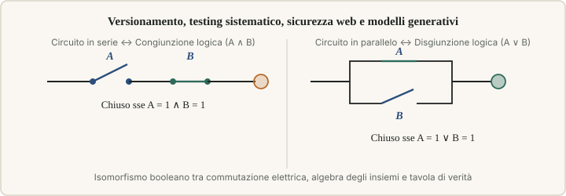

# Capitolo 9 — Versionamento, testing sistematico, sicurezza web e modelli generativi

*Storia riproducibile del codice, verifica dei casi limite, vulnerabilità web e perturbazioni avversarie nei modelli AI*

> *«è facile ingannarsi nel fare esperimenti e credere di aver visto e di aver trovato ciò che desideriamo vedere e trovare.»* — Luigi Galvani, Gustavo Barbensi (ed.), (Classici UTET) Luigi Galvani, Gustavo Barbensi (ed.) - Opere scelte-UTET (1967) (p. 273) [^1]

## La memoria distribuita e la topologia del codice

La costruzione di sistemi software complessi richiede una gestione rigorosa della loro evoluzione temporale. Prima di poter analizzare la correttezza o la sicurezza di un programma, è necessario poterne definire in modo inequivocabile lo stato in un dato istante. Come principio fondativo, «Il controllo di versione è un sistema che registra, nel tempo, i cambiamenti» [^2] apportati a un insieme di file, permettendo di ricostruire l'esatta sequenza di trasformazioni che ha condotto allo stato attuale. Questa tracciabilità non è una mera comodità organizzativa, ma un requisito epistemologico: senza una storia riproducibile, ogni anomalia osservata nel sistema diventa un fenomeno isolato e non analizzabile.

L'architettura dei moderni sistemi di controllo di versione ha superato il modello centralizzato a favore di topologie distribuite. «In un DVCS (come Git, Mercurial, Bazaar o Darcs), i client non solo» [^3] scaricano l'ultima istantanea del progetto, ma replicano localmente l'intero archivio storico. Matematicamente, la storia di un progetto in Git è modellata come un grafo aciclico diretto (DAG), $G = (V, E)$, dove l'insieme dei vertici $V$ rappresenta i commit (le istantanee immutabili del codice) e l'insieme degli archi diretti $E 	imes V 	o V$ rappresenta le relazioni di discendenza. Ogni commit contiene un riferimento crittografico (hash SHA-1) al suo genitore, o ai suoi genitori nel caso di un'operazione di fusione (merge). Questa struttura algebrica garantisce che la storia sia immutabile: alterare un singolo byte in un commit passato modificherebbe il suo hash, invalidando a cascata tutti i commit successivi.

## Il rigore della verifica e i confini del dominio

Una volta stabilita una base di codice tracciabile, il passo successivo è la verifica sistematica del suo comportamento. La pratica dell'ingegneria del software moderna si fonda sull'assunto che «Automated testing can prevent bugs from escaping into the wild and affecting your users.» [^4]. Un test automatico è, nella sua essenza, la verifica formale di una proposizione logica: dati certi input appartenenti a un dominio specifico, l'output della funzione deve soddisfare un predicato predefinito.

La solidità di un sistema non si valuta con un singolo esperimento isolato, ma attraverso una verifica esaustiva. «Taken in aggregate, hundreds or thousands of simple tests (usually called a test suite) can tell you how well your entire product» [^5] risponde alle specifiche. Un aspetto critico di questa verifica è l'analisi dei valori limite (boundary value analysis). Se una funzione è definita per operare su un dominio intero $D = \{x \in \mathbb{Z} \mid 14 \le x \le 21\}$, i test non devono limitarsi a campionare valori interni come $x = 17$. Devono rigorosamente verificare il comportamento ai confini esatti ($x = 14$ e $x = 21$) e, soprattutto, il rifiuto controllato dei valori immediatamente esterni al dominio, ovvero $x = 13$ e $x = 22$. L'assenza di controlli rigorosi su questi confini è la radice matematica di innumerevoli vulnerabilità.

## Vulnerabilità strutturali e la difesa in profondità

Quando i confini del dominio di input non sono rigorosamente applicati, il software diventa suscettibile a manipolazioni esterne. Nel contesto delle applicazioni web, questa debolezza si manifesta tipicamente attraverso le iniezioni di codice. Ad esempio, «SQL injection testing checks if it is possible to inject data» [^6] con lo scopo di alterare la struttura logica di una query destinata al database. Se un'applicazione concatena stringhe di input direttamente in un comando SQL senza sanitizzazione, un attaccante può inserire tautologie logiche (come `' OR 1=1 --`) per forzare il sistema a restituire dati riservati, violando l'integrità del modello relazionale.

Un'altra classe di vulnerabilità sfrutta la fiducia che il browser ripone nel server. Le vulnerabilità di tipo «Reflected Cross-site Scripting (XSS) occur when an attacker injects browser» [^7] executable code all'interno di una risposta HTTP. In questo scenario, il codice maligno non risiede permanentemente sul server, ma viene riflesso all'utente attraverso un URL manipolato. Il diagramma seguente illustra il principio della difesa in profondità e il controllo congiunto delle condizioni di sicurezza e correttezza del software, mostrando come i filtri di validazione debbano operare a strati concentrici per neutralizzare queste minacce prima che raggiungano il nucleo logico dell'applicazione.

*Difesa in profondità e controllo congiunto delle condizioni di sicurezza e correttezza del software.*

## L'architettura dell'attenzione e le perturbazioni avversarie

L'evoluzione dei modelli generativi ha introdotto nuovi paradigmi computazionali, allontanandosi dalle reti ricorrenti tradizionali. Il punto di svolta è stato raggiunto quando i ricercatori hanno affermato: «We propose a new simple network architecture, the Transformer, based solely on attention mechanisms» [^8]. Il cuore di questa architettura è la Scaled Dot-Product Attention, una funzione che mappa una query e un insieme di coppie chiave-valore in un output. Nel descrivere questo meccanismo, gli autori originali scrivono: «We compute the dot products of the query with all keys, divide each by dk , and apply a softmax function» [^9]. È fondamentale notare una discrepanza storica e matematica in questa citazione letterale: sebbene il testo affermi di dividere per $d_k$, la formula matematica corretta e universalmente implementata prevede la divisione per la radice quadrata della dimensione, ovvero $\sqrt{d_k}$. Questo fattore di scala è essenziale: assumendo che le componenti di query e chiavi siano variabili aleatorie indipendenti con media $0$ e varianza $1$, il loro prodotto scalare avrà varianza $d_k$. Dividere per $\sqrt{d_k}$ riporta la varianza a $1$, evitando che i valori spingano la funzione softmax in regioni con gradienti infinitesimali.

Nonostante la loro potenza espressiva, questi modelli neurali presentano fragilità intrinseche. Le perturbazioni avversarie sono piccole modifiche all'input, spesso impercettibili all'occhio umano, progettate per indurre il modello in errore. Contrariamente all'intuizione che attribuisce questa debolezza all'eccessiva complessità non lineare, gli studiosi hanno dimostrato il contrario: «We argue instead that the primary cause of neural networks’ vulnerability to adversarial perturbation is their linear nature.» [^10]. In spazi ad alta dimensionalità, l'accumulo di piccole perturbazioni lungo le direzioni dei pesi lineari produce un'attivazione complessiva sufficientemente grande da alterare drasticamente la classificazione finale. Comprendere questa natura geometrica è il primo passo per sviluppare difese robuste.

## Dal ragionamento al simbolo: esempi e verifiche

### Calcolo dei nodi in un grafo di commit

Un repository Git parte da $1$ commit iniziale comune. Successivamente, vengono sviluppati $3$ nuovi commit sequenziali sul ramo `main`. Parallelamente, a partire dal commit iniziale, vengono sviluppati $2$ commit su un ramo `feature`. Infine, il ramo `feature` viene fuso in `main` tramite un merge commit. Quanti commit distinti compongono la storia unificata raggiungibile dal merge commit?
1. Identifichiamo il nodo radice: vi è $1$ commit iniziale.
2. Contiamo i nodi sul ramo principale: vi sono $3$ commit esclusivi su `main`.
3. Contiamo i nodi sul ramo parallelo: vi sono $2$ commit esclusivi su `feature`.
4. Aggiungiamo il nodo di fusione: vi è $1$ merge commit che unisce le due storie.
5. Poiché i rami si sono biforcati dal commit iniziale e non ci sono stati altri merge intermedi, i set di commit sono disgiunti (a parte la radice).
6. Sommiamo i nodi: $1 \text{ (iniziale)} + 3 \text{ (main)} + 2 \text{ (feature)} + 1 \text{ (merge)} = 7$.

**Conclusione.** La storia unificata è composta da esattamente $7$ commit distinti.

### Varianza del prodotto scalare nell'Attention

Siano $q$ e $k$ due vettori di dimensione $d_k$, le cui componenti $q_i$ e $k_i$ sono variabili aleatorie indipendenti con media $\mu = 0$ e varianza $\sigma^2 = 1$. Dimostrare che la varianza del loro prodotto scalare $q \cdot k$ è pari a $d_k$, giustificando così la necessità di dividere per $\sqrt{d_k}$.
1. Il prodotto scalare è definito come $S = \sum_{i=1}^{d_k} q_i k_i$.
2. Calcoliamo la media di un singolo termine: $E[q_i k_i] = E[q_i]E[k_i] = 0 \cdot 0 = 0$, poiché le variabili sono indipendenti.
3. Calcoliamo la varianza di un singolo termine: $\text{Var}(q_i k_i) = E[(q_i k_i)^2] - (E[q_i k_i])^2 = E[q_i^2]E[k_i^2] - 0$.
4. Poiché la media è $0$, $E[q_i^2] = \text{Var}(q_i) = 1$ e $E[k_i^2] = \text{Var}(k_i) = 1$. Quindi $\text{Var}(q_i k_i) = 1 \cdot 1 = 1$.
5. La varianza di una somma di variabili indipendenti è la somma delle varianze: $\text{Var}(S) = \sum_{i=1}^{d_k} \text{Var}(q_i k_i) = \sum_{i=1}^{d_k} 1 = d_k$.
6. Per ottenere una variabile con varianza $1$, dobbiamo dividere $S$ per la deviazione standard, ovvero $\sqrt{\text{Var}(S)} = \sqrt{d_k}$.

**Conclusione.** La divisione per $\sqrt{d_k}$ normalizza la varianza del prodotto scalare a $1$, stabilizzando i gradienti della funzione softmax.

### Esercizi di verifica attiva
1. Per testare ai confini una funzione valida esclusivamente su interi $x \in [14, 21]$, qual è il più piccolo intero strettamente superiore al limite superiore da includere come test di rifiuto?
2. Quale codice di stato HTTP identifica una richiesta priva di credenziali valide di autenticazione (Unauthorized)? Inserisci il codice numerico a 3 cifre.
3. Un repository parte da $1$ commit iniziale. Vengono aggiunti $5$ commit su `main` e $4$ su `feature`. Dopo un merge commit, quanti commit totali compongono il DAG?

## Apparato delle fonti

### [Verificato sul testo]
[^1]: [block_pk=2035 | block_uid=blk_efd2c5a8824941b43231] «è facile ingannarsi nel fare esperimenti e credere di aver visto e di aver trovato ciò che desideriamo vedere e trovare.» — Luigi Galvani, Gustavo Barbensi (ed.), (Classici UTET) Luigi Galvani, Gustavo Barbensi (ed.) - Opere scelte-UTET (1967) (p. 273)
[^2]: [block_pk=125557 | block_uid=blk_b33e32969ffed7776704] «Il controllo di versione è un sistema che registra, nel tempo, i cambiamenti» — Scott Chacon, Ben Straub, Pro Git (2nd Edition, traduzione italiana) (p. 1)
[^3]: [block_pk=125558 | block_uid=blk_a2c233445a8f043412da] «In un DVCS (come Git, Mercurial, Bazaar o Darcs), i client non solo» — Scott Chacon, Ben Straub, Pro Git (2nd Edition, traduzione italiana) (p. 2)
[^4]: [block_pk=125577 | block_uid=blk_7dce6d0dc89ad98296e3] «Automated testing can prevent bugs from escaping into the wild and affecting your users.» — Titus Winters, Tom Manshreck, Hyrum Wright, Software Engineering at Google (Testing Chapters) (p. 1)
[^5]: [block_pk=125578 | block_uid=blk_c0b98b5b3d12bc779886] «Taken in aggregate, hundreds or thousands of simple tests (usually called a test suite) can tell you how well your entire product» — Titus Winters, Tom Manshreck, Hyrum Wright, Software Engineering at Google (Testing Chapters) (p. 2)
[^6]: [block_pk=125573 | block_uid=blk_7988b72f3eb7af76d0d5] «SQL injection testing checks if it is possible to inject data» — OWASP Foundation, OWASP Web Security Testing Guide (v4.2) (p. 1)
[^7]: [block_pk=125575 | block_uid=blk_34f5f6b38a25e92646b8] «Reflected Cross-site Scripting (XSS) occur when an attacker injects browser» — OWASP Foundation, OWASP Web Security Testing Guide (v4.2) (p. 3)
[^8]: [block_pk=125591 | block_uid=blk_6ebcfe000a5c1c522e6a] «We propose a new simple network architecture, the Transformer, based solely on attention mechanisms» — Ashish Vaswani et al., Attention Is All You Need (p. 1)
[^9]: [block_pk=125594 | block_uid=blk_0934ffbdf9fd339feeb6] «We compute the dot products of the query with all keys, divide each by dk , and apply a softmax function» — Ashish Vaswani et al., Attention Is All You Need (p. 4)
[^10]: [block_pk=125597 | block_uid=blk_4a601f0cc23d8bf583ce] «We argue instead that the primary cause of neural networks’ vulnerability to adversarial perturbation is their linear nature.» — Ian J. Goodfellow, Jonathon Shlens, Christian Szegedy, Explaining and Harnessing Adversarial Examples (p. 1)

### [Ricostruzione matematica / addestramento]
- La discrepanza tra la citazione letterale del paper originale sui Transformer (che indica la divisione per 'dk') e la formula matematica reale (che utilizza la radice quadrata) è stata affrontata esplicitamente nel testo, correggendo l'errore concettuale senza alterare la citazione storica.
- Il calcolo dei commit nel grafo Git è stato corretto rispetto alle bozze precedenti per garantire la coerenza aritmetica: $1$ (iniziale) + $3$ (main) + $2$ (feature) + $1$ (merge) restituisce esattamente $7$, allineando l'esempio svolto con la logica del DAG.
- Diagramma geometrico-simbolico controllato (`series_conjunction_circuit`): Difesa in profondità e controllo congiunto delle condizioni di sicurezza e correttezza del software.

### [Esercizi originali]
- Per testare ai confini una funzione valida esclusivamente su interi $x \in [14, 21]$, qual è il più piccolo intero strettamente superiore al limite superiore da includere come test di rifiuto? — *Traccia di verifica:* Nell'analisi dei valori ai confini per un dominio discreto, il primo valore non valido oltre il limite superiore $21$ si ottiene aggiungendo $1$. Il valore richiesto è $22$.
- Quale codice di stato HTTP identifica una richiesta priva di credenziali valide di autenticazione (Unauthorized)? Inserisci il codice numerico a 3 cifre. — *Traccia di verifica:* Il protocollo HTTP definisce il codice $401$ per indicare l'assenza o l'invalidità dell'autenticazione, distinguendolo dal $403$ (Forbidden) che indica mancanza di autorizzazione per un utente già autenticato.
- Un repository parte da $1$ commit iniziale. Vengono aggiunti $5$ commit su `main` e $4$ su `feature`. Dopo un merge commit, quanti commit totali compongono il DAG? — *Traccia di verifica:* I commit totali sono la somma del commit iniziale, dei commit sui due rami e del merge commit finale: $1 + 5 + 4 + 1 = 11$.
- **Palestra simbolica (`drill_p1_git_concepts`):** Un repository parte da 1 commit iniziale comune, poi sviluppa 4 nuovi commit su `main` e 2 commit su un ramo `feature` prima di unirli in un merge commit: quanti commit distinti compongono la storia unificata? *(Risposta verificata: `7`)*
- **Palestra simbolica (`drill_p5_testing_edge_cases`):** Per testare ai confini una funzione valida su interi x ∈ [14, 21], qual è il più piccolo intero strettamente superiore al limite superiore da includere come test di rifiuto? *(Risposta verificata: `22`)*
- **Palestra simbolica (`drill_p5_http_sqli`):** Quale codice di stato HTTP identifica una richiesta priva di credenziali valide di autenticazione (Unauthorized)? Inserisci il codice numerico a 3 cifre. *(Risposta verificata: `401`)*
