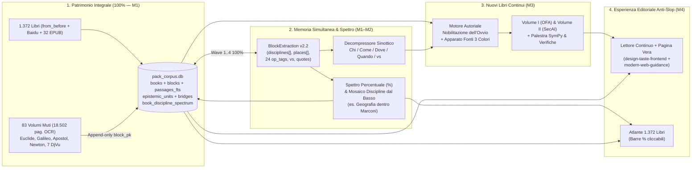

# Architecture Decision Records (ADR) & Master Task Backlog — `resuscipack`

Questa cartella raccoglie gli **Architecture Decision Records (ADR)** e il **Master Task Backlog** del progetto **`resuscipack`** (*Pedagogical Agentic Curriculum Knowledge — Corpus Integrale, Spettro Disciplinare, "Libro Sbagliato" & Nuovi Libri verso SecAI L-31*), consolidando le decisioni architetturali, epistemiche e editoriali fino al completamento finale.

---

## Indice degli ADR

| ID | Titolo | Stato | Priorità | Autori / Fonti |
| :--- | :--- | :--- | :--- | :--- |
| **[ADR-0001](./0001-immutable-corpus-and-wave0.md)** | Schema Corpus Immutabile (`block_pk`/`block_uid`), Bonifica Wave 0 e Manifesto OCR Wave 1–4 | Accettato (`Accepted`) | **P0 — Critica** | `@scale`, `@critic` |
| **[ADR-0002](./0002-block-extraction-and-wrong-book-bridge.md)** | Schema `BlockExtraction v2.1`, 24 `op_tags`, Ponte *"Libro Sbagliato"* e Validatore a 6 Gate | Accettato (`Accepted`) | **P0 — Critica** | `@wrongbook`, `@critic` |
| **[ADR-0003](./0003-secai-spine-and-study-workbench.md)** | Spina Dorsale Curricolare a 4 Strati, Fast-Forward `SymPy` e Tavolo di Studio SecAI v1 | Accettato (`Accepted`) | **P1 — Alta** | `@secai`, `@critic` |
| **[ADR-0004](./0004-new-books-disciplinary-spectrum-and-editorial-ui.md)** | *"Nuovi Libri"* Continui, Spettro Disciplinare Percentuale, Doppio *"Libro Sbagliato"* & UI Anti-Slop | Accettato (`Accepted`) | **P0 — Critica** | Daniele Bertuccio, `Orchestrator` |

---

## Diagramma Architetturale End-to-End

---

## Master Task Backlog — Fondamenta Completate (`M0`, Su `main`)

| Stato | Task ID | ADR | Titolo Task | File Principali | Priorità |
| :---: | :--- | :--- | :--- | :--- | :--- |
| ✅ | **TASK-CORPUS-01** | [ADR-0001](./0001-immutable-corpus-and-wave0.md) | Schema SQLite immutabile (`books`, `blocks`, `passages_fts`, trigger FTS5) e normalizzatore testo | `resuscipack/corpus/schema.py`, `normalizer.py` | **P0** |
| ✅ | **TASK-CORPUS-02** | [ADR-0001](./0001-immutable-corpus-and-wave0.md) | Esecuzione Wave 0 (splicing 4.162 pag. Baidu, 32 `.epub`, filtro rumore/cloni, migrazione `rowid`) | `resuscipack/corpus/wave0_ingest.py`, `data/legacy_card_migration.json` | **P0** |
| ✅ | **TASK-CORPUS-03** | [ADR-0001](./0001-immutable-corpus-and-wave0.md) | Manifesto OCR `wave_1..wave_4` per le pagine mancanti e test Wave 0 | `resuscipack/corpus/ocr_manifest.py`, `data/ocr_wave_manifest.json` | **P1** |
| ✅ | **TASK-EPIST-01** | [ADR-0002](./0002-block-extraction-and-wrong-book-bridge.md) | Vocabolario chiuso 24 `op_tags` e validatore `BlockExtraction v2.1` | `resuscipack/epistemic/op_tags.py`, `schema_v21.py` | **P0** |
| ✅ | **TASK-EPIST-02** | [ADR-0002](./0002-block-extraction-and-wrong-book-bridge.md) | Validatore deterministico a 6 Gate (`verifica_citazioni.py`) | `resuscipack/epistemic/verifica_citazioni.py` | **P0** |
| ✅ | **TASK-EPIST-03** | [ADR-0002](./0002-block-extraction-and-wrong-book-bridge.md) | Motore *"Libro Sbagliato"*, seed ponti reali (Marconi, Galvani, Cartesio) e Batch CLI | `resuscipack/epistemic/bridge.py`, `batch_cli.py` | **P1** |
| ✅ | **TASK-EPIST-04** | [ADR-0002](./0002-block-extraction-and-wrong-book-bridge.md) | Runner Vertex AI su crediti GCP, `block_extraction_log`, Wave 1 Nucleo Aureo (`3.608` blocchi, `135` ponti) | `resuscipack/epistemic/batch_cli.py`, `bridge.py`, `schema.py` | **P1** |
| ✅ | **TASK-SECAI-01** | [ADR-0003](./0003-secai-spine-and-study-workbench.md) | DAG Unificato a 4 Strati, registro Open-Access (€0) e prime 7 schede v3 | `data/curriculum/`, `resuscipack/curriculum/dag.py`, `data/cards/` | **P1** |
| ✅ | **TASK-SECAI-02** | [ADR-0003](./0003-secai-spine-and-study-workbench.md) | Motore Fast-Forward Diagnostico `SymPy`, verificatori grafici/dimostrazioni e `student_state.db` | `resuscipack/curriculum/drills_sympy.py`, `student_state.py` | **P1** |
| ✅ | **TASK-SECAI-03** | [ADR-0003](./0003-secai-spine-and-study-workbench.md) | Prototipo v1 Tavolo di Studio Flask a 2 Colonne (superseded da `M4` UI Anti-Slop) | `resuscipack/workbench/` | **P1** |

---

## Master Task Backlog — Roadmap Attiva fino al Prodotto Finale (`M1 → M4` su GitHub)

| Stato | Task ID | Milestone | ADR | Titolo Task | File Coinvolti | Priorità |
| :---: | :--- | :--- | :--- | :--- | :--- | :--- |
| ✅ | **TASK-CORPUS-04** | `M1` Contezza Simultanea | [ADR-0004](./0004-new-books-disciplinary-spectrum-and-editorial-ui.md) | OCR degli 83 volumi muti (`79` canonici + `4` duplicati verificati = `83/83`; `+18.506` blocchi attivi post-Wave-0, `1.193` figure, `124.744 == passages_fts_docsize`) | `resuscipack/corpus/ocr_manifest.py`, `ocr_ingest.py` | **P1 — Alta** |
| ✅ | **TASK-EPIST-05** | `M1` Contezza Simultanea | [ADR-0004](./0004-new-books-disciplinary-spectrum-and-editorial-ui.md) | Upgrade `BlockExtraction v2.2` (`macro_disciplines[]`, `places[]`, `topics[]`) + fix OCR/LaTeX/`kind` + `responseSchema` packer | `resuscipack/epistemic/schema_v21.py`, `batch_cli.py`, `corpus/schema.py` | **P0 — Critica** |
| ✅ | **TASK-EPIST-06** | `M1` Contezza Simultanea | [ADR-0004](./0004-new-books-disciplinary-spectrum-and-editorial-ui.md) | Estrazione integrale su `1.416` libri attivi (`98,51%` sostantivo = `120.684/122.515`; `106.265` `v2.2`, `139.382` unità, `175` ponti `score 0.89–0.98`) | `resuscipack/epistemic/batch_cli.py`, `data/pack_corpus.db` | **P1 — Alta** |
| ✅ | **TASK-SPEC-01** | `M2` Spettro & Libro Sbagliato | [ADR-0004](./0004-new-books-disciplinary-spectrum-and-editorial-ui.md) | Spettro Disciplinare Percentuale per Libro ($\text{Cov}$ e $\text{Share}$) calcolato sui blocchi reali (`1.164` libri, `5.083` righe, scarto somma `0.0%`) | `resuscipack/epistemic/spectrum.py`, `resuscipack/corpus/schema.py`, `tests/test_spectrum.py` | **P1 — Alta** |
| ✅ | **TASK-SPEC-02** | `M2` Spettro & Libro Sbagliato | [ADR-0004](./0004-new-books-disciplinary-spectrum-and-editorial-ui.md) | Ricostruzione delle Discipline dal Basso (Geografia `69` libri/`653` passaggi, Logica `78`/`2.048`, Musica `25`/`689`) | `resuscipack/epistemic/discipline_reconstructor.py`, `tests/test_spectrum.py` | **P1 — Alta** |
| ⬜ | **TASK-SPEC-03** | `M2` Spettro & Libro Sbagliato | [ADR-0004](./0004-new-books-disciplinary-spectrum-and-editorial-ui.md) | Decompressore Sinottico Cronologico e Modale (`Chi / Come / Dove / Quando / vs`) | `resuscipack/epistemic/decompressor.py` | **P1 — Alta** |
| ⬜ | **TASK-SPEC-04** | `M2` Spettro & Libro Sbagliato | [ADR-0004](./0004-new-books-disciplinary-spectrum-and-editorial-ui.md) | Ontologia Ministeriale v6 (`2.813+` obiettivi) & Mappatura Bidirezionale della Contezza Simultanea (`1ª Elementare → 5ª Superiore`) *(import `v6` + DAG 108 nodi acquisiti)* | `resuscipack/curriculum/ministerial_ontology.py`, `data/curriculum/ministerial_ontology/`, `resuscipack/epistemic/curriculum_mapper.py` | **P1 — Alta** |
| ⬜ | **TASK-BOOK-01** | `M3` Nuovi Libri SecAI | [ADR-0004](./0004-new-books-disciplinary-spectrum-and-editorial-ui.md) | Motore Autoriale di Capitoli Continui (figure, apparato fonti 3 colori, rilettura critica) | `resuscipack/books/author_engine.py`, `critique.py` | **P0 — Critica** |
| ⬜ | **TASK-BOOK-02** | `M3` Nuovi Libri SecAI | [ADR-0004](./0004-new-books-disciplinary-spectrum-and-editorial-ui.md) | *Volume I — Dall'Ovvio al Simbolo*: capitoli continui e palestra `SymPy` fino al Gate OFA | `data/books/vol1_ofa/`, `resuscipack/books/` | **P1 — Alta** |
| ⬜ | **TASK-BOOK-03** | `M3` Nuovi Libri SecAI | [ADR-0004](./0004-new-books-disciplinary-spectrum-and-editorial-ui.md) | *Volume II — I Ponti Nascosti di SecAI*: Probabilità 0 CFU, Discreto, Crypto, Sistemi, Testing | `data/books/vol2_secai/`, `resuscipack/books/` | **P1 — Alta** |
| ⬜ | **TASK-UI-01** | `M4` UI Anti-Slop | [ADR-0004](./0004-new-books-disciplinary-spectrum-and-editorial-ui.md) | Rifondazione Design System Editoriale con `design-taste-frontend` + `modern-web-guidance` (zero codici interni) | `resuscipack/workbench/`, `.taste-skill/` | **P0 — Critica** |
| ⬜ | **TASK-UI-02** | `M4` UI Anti-Slop | [ADR-0004](./0004-new-books-disciplinary-spectrum-and-editorial-ui.md) | Lettore continuo dei *Nuovi Libri* con pagina originale e figure a fianco + palestra operativa | `resuscipack/workbench/templates/`, `static/` | **P1 — Alta** |
| ⬜ | **TASK-UI-03** | `M4` UI Anti-Slop | [ADR-0004](./0004-new-books-disciplinary-spectrum-and-editorial-ui.md) | *Atlante dei 1.372 Libri* con barre interattive dello Spettro Percentuale e mosaico per disciplina | `resuscipack/workbench/`, `app.py` | **P2 — Media** |
