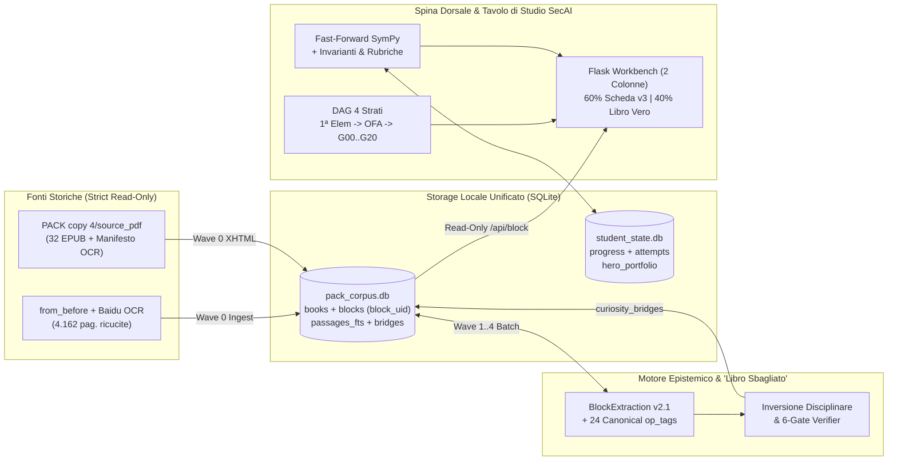

# Architecture Decision Records (ADR) & Master Task Backlog — `resuscipack`

Questa cartella raccoglie gli **Architecture Decision Records (ADR)** e il **Master Task Backlog** del progetto **`resuscipack`** (*Pedagogical Agentic Curriculum Knowledge — Corpus Integrale, "Libro Sbagliato" & Tavolo di Studio SecAI L-31*), consolidando le decisioni architetturali, epistemiche e pedagogiche validate.

---

## Indice degli ADR

| ID | Titolo | Stato | Priorità | Autori / Fonti |
| :--- | :--- | :--- | :--- | :--- |
| **[ADR-0001](./0001-immutable-corpus-and-wave0.md)** | Schema Corpus Immutabile (`block_pk`/`block_uid`), Bonifica Wave 0 e Manifesto OCR Wave 1–4 | Accettato (`Accepted`) | **P0 — Critica** | `@scale`, `@critic` |
| **[ADR-0002](./0002-block-extraction-and-wrong-book-bridge.md)** | Schema `BlockExtraction v2.1`, 24 `op_tags`, Ponte *"Libro Sbagliato"* e Validatore a 6 Gate | Accettato (`Accepted`) | **P0 — Critica** | `@wrongbook`, `@critic` |
| **[ADR-0003](./0003-secai-spine-and-study-workbench.md)** | Spina Dorsale Curricolare a 4 Strati, Fast-Forward `SymPy` e Tavolo di Studio SecAI a 2 Colonne | Accettato (`Accepted`) | **P1 — Alta** | `@secai`, `@critic` |

---

## Diagramma Architetturale del Sistema

---

## Master Task Backlog (Tutti i Task Censiti)

> **Nota:** Ogni task è legato al proprio ADR di origine e dispone di test automatici end-to-end eseguibili con `.venv/bin/pytest -v`.

| Task ID | ADR | Titolo Task | File Coinvolti | Priorità | Assegnatari |
| :--- | :--- | :--- | :--- | :--- | :--- |
| **TASK-CORPUS-01** | [ADR-0001](./0001-immutable-corpus-and-wave0.md) | Schema SQLite immutabile (`books`, `blocks`, `passages_fts`, trigger FTS5) e normalizzatore testo | `resuscipack/corpus/schema.py`, `resuscipack/corpus/normalizer.py` | **P0 — Critica** | `@scale` |
| **TASK-CORPUS-02** | [ADR-0001](./0001-immutable-corpus-and-wave0.md) | Esecuzione Wave 0 (splicing 4.162 pag. Baidu, 32 `.epub`, filtro rumore/cloni, migrazione legacy `rowid`) | `resuscipack/corpus/wave0_ingest.py`, `data/legacy_card_migration.json` | **P0 — Critica** | `@scale` |
| **TASK-CORPUS-03** | [ADR-0001](./0001-immutable-corpus-and-wave0.md) | Generazione manifesto OCR `wave_1..wave_4` per le 19.226 pagine mancanti e test Wave 0 | `resuscipack/corpus/ocr_manifest.py`, `data/ocr_wave_manifest.json`, `tests/test_corpus_wave0.py` | **P1 — Alta** | `@scale` |
| **TASK-EPIST-01** | [ADR-0002](./0002-block-extraction-and-wrong-book-bridge.md) | Vocabolario chiuso a 24 `op_tags` e validatore `BlockExtraction v2.1` (anti-deissi, `domain_stripping`, anti-template) | `resuscipack/epistemic/op_tags.py`, `resuscipack/epistemic/schema_v21.py` | **P0 — Critica** | `@wrongbook` |
| **TASK-EPIST-02** | [ADR-0002](./0002-block-extraction-and-wrong-book-bridge.md) | Validatore deterministico a 6 Gate (`verifica_citazioni.py`) per le schede `.md` contro `pack_corpus.db` | `resuscipack/epistemic/verifica_citazioni.py` | **P0 — Critica** | `@wrongbook` |
| **TASK-EPIST-03** | [ADR-0002](./0002-block-extraction-and-wrong-book-bridge.md) | Motore di inversione disciplinare *"Libro Sbagliato"*, seed ponti reali (Marconi, Galvani, Cartesio), CLI batch e test | `resuscipack/epistemic/bridge.py`, `resuscipack/epistemic/batch_cli.py`, `tests/test_epistemic_v21.py` | **P1 — Alta** | `@wrongbook` |
| **TASK-SECAI-01** | [ADR-0003](./0003-secai-spine-and-study-workbench.md) | Costruzione DAG Unificato a 4 Strati, registro 5 testi Open-Access (€0) e migrazione schede `data/cards/` | `data/curriculum/`, `resuscipack/curriculum/dag.py`, `resuscipack/curriculum/cards.py`, `data/cards/` | **P1 — Alta** | `@secai` |
| **TASK-SECAI-02** | [ADR-0003](./0003-secai-spine-and-study-workbench.md) | Motore Fast-Forward Diagnostico `SymPy`, verificatori grafici/dimostrazioni e DB separato `student_state.db` | `resuscipack/curriculum/drills_sympy.py`, `resuscipack/curriculum/student_state.py` | **P1 — Alta** | `@secai` |
| **TASK-SECAI-03** | [ADR-0003](./0003-secai-spine-and-study-workbench.md) | Tavolo di Studio Flask a 2 Colonne (Bussola Hero, Scheda v3 + KaTeX, Lettore Libro Vero `/api/block/<block_pk>`) e test E2E | `resuscipack/workbench/`, `tests/test_workbench_secai.py` | **P1 — Alta** | `@secai` |
